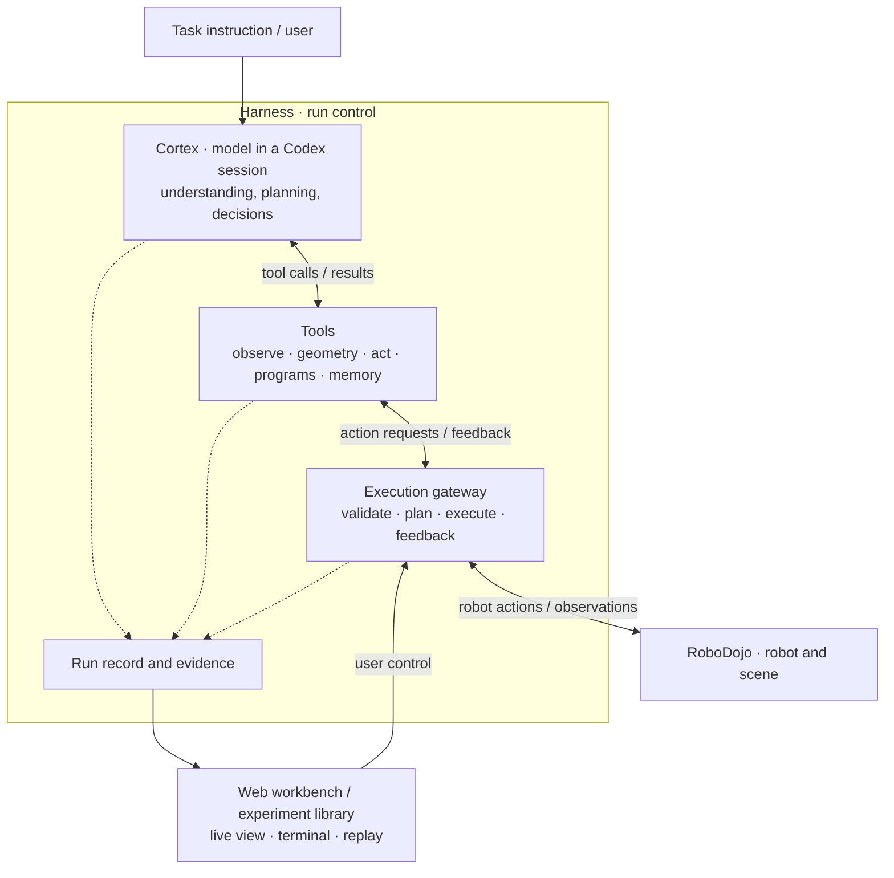

# Auriga

**Auriga is an agent harness for embodied manipulation.** A model runs in a persistent Codex session, looks at camera images and robot state, plans, calls tools, writes and reviews small programs, and moves a robot — while the harness owns the execution boundary, the run state and the evidence record. The current environment is the [RoboDojo](https://robodojo-benchmark.com/) simulation benchmark with a dual-arm ARX X5.

[中文说明](README.zh-CN.md) · [Documentation index](docs/README.md) · [Contributor guide](AGENTS.md)

> Most of the detailed documentation under `docs/` is written in Chinese. Tool contracts, code and the feature notes under `docs/*.md` are in English.

## Ideas

- **The model leads, tools assist.** The model decomposes the task, chooses tools and revises its plan from feedback. Tools provide general capabilities (observation, geometry, motion preview and execution, programs, history); they do not ship task-specific solutions.
- **Closed loop.** Candidate motions can be previewed before they run; every action returns images and the measured robot state, so the model decides whether to continue, look again or change course.
- **One physical entry point.** Every robot action — from the model, from a generated program or from an optional policy model — goes through `Harness.execute`, which applies permissions, state checks, budgets and stop handling.
- **Honest receipts.** Plans, commands, measured trajectories and task scores are recorded separately. "Motion completed", "program exited 0" and "task succeeded" mean different things; partial and unknown outcomes are kept as such and never retried silently.
- **Only necessary context.** The model receives observations, execution facts and short references; hashes and provenance metadata stay in the archive.

## Architecture



A run is an *observe → decide → act → feedback* loop. Before its first physical action the model submits a short task plan. `robot_action` previews a whole batch of stages (both arms, gripper moves, dependencies, optional observation checkpoints) and then executes the cached plan by `plan_id`. In RoboDojo the world is paused while the model thinks; simulated time only advances through actions or explicit waits. Benchmark scores come from the native evaluator, never from the model's own report.

## Tools the model sees

The catalogue depends on the configuration and the observation condition; ten entries are visible up front and the rest load on demand through Codex tool search. Each tool declares its input/output schema, units, defaults and ranges in its contract.

| Tool | Purpose |
| --- | --- |
| `task_plan` | Submit and revise the task plan and attention list; re-injected before each decision. |
| `robot_observe` | Current images plus joint / end-effector / gripper state; optional zoomed crops. |
| `robot_information`, `robot_capabilities` | Robot structure, calibration, native geometry and capabilities. |
| `robot_action` | Preview, execute and inspect single- or dual-arm stage batches. |
| `robot_wait` | Advance simulation to watch motion or let objects settle. |
| `robot_action_status` | Request and execution receipt of an action. |
| `program_run`, `program_status` | Run feedback loops or numeric programs; review the actions they request. |
| `geometry_query`, `robot_contact_overlay` | Calibrated geometry (stereo triangulation, pixel-to-plane) and robot reference overlays. |
| `vision_compare` | Measure local image change between two observations. |
| `history_*` | Look back at actions, trajectories and observations; annotate them. |
| `operation_memory` | Query or record operating experience for the task and across tasks. |
| optional: `robotic_view`, `stereo_guide`, `vision_review`, `depth_query`, `robot_policy_step` | Wrist-camera viewpoint solving, epipolar guidance, auxiliary visual review, RGB-D queries (only under an explicit depth condition), a π0.5 local policy. |

See [unified actions and program review](docs/development/unified-actions.md) and [tool contracts](docs/development/tool-plugins.md).

## Requirements

- Linux x86_64 and an NVIDIA GPU that runs Isaac Sim 5.1.
- [Miniforge](https://github.com/conda-forge/miniforge) (`mamba`). The project uses one conda environment named `Auriga` (Python 3.12, see `environment.yml`); do not create a `.venv`.
- Node.js 22 and npm to build the web UI.
- RoboDojo with Isaac Sim, IsaacLab and the task assets, pinned and patched as described in [RoboDojo environment](docs/development/robodojo-setup.md). It runs in its own interpreter.
- A Codex configuration (`~/.codex` by default) with credentials for a Responses-compatible provider that serves the configured model. The default is `gpt-6.1-sol` with reasoning effort `high`; the Codex SDK/CLI version is pinned in `requirements.lock.txt`.
- Optional: the [VGGT perception service](services/vggt_height/README.md). External perception is on by default and calls `http://127.0.0.1:8331`; without the service those attachments are reported as unavailable and the run continues. Set `"external_perception": false` to turn it off.

## Quick start

```sh
git clone https://github.com/lose4578/Auriga.git
cd Auriga
mamba env create -f environment.yml
npm --prefix web ci && npm --prefix web run build

# CPU checks: no GPU, simulator or model needed.
mamba run -n Auriga python -m unittest discover -s tests

# Show the effective configuration without starting anything.
mamba run -n Auriga python -m auriga.apps.gateway --print-config
```

Machine-specific settings (RoboDojo paths, Codex home, model) go into the git-ignored `configs/auriga.local.json` or a file passed with `--config`; see [configuration](docs/development/configuration.md) and the [full example](configs/auriga.example.json).

Run one benchmark episode. This starts the real model and the simulator; pick a free GPU and a new run directory:

```sh
mamba run -n Auriga python -u -m auriga.apps.gateway \
  --benchmark --task general_pickup --seed 0 --layout-id 0 \
  --gpu 0 --port 8767 --run-dir runs/my-first-task
```

Open <http://127.0.0.1:8767> to watch the cameras, the native Codex terminal, actions and the run record. Afterwards:

```sh
# Read-only replay of a copy of a run directory (no GPU, no model).
mamba run -n Auriga python -m auriga.apps.gateway --replay --run-dir runs/my-first-task --port 8767

# Experiment library: browse runs, live views and replays at http://127.0.0.1:8780.
mamba run -n Auriga python -m auriga.apps.library

# Re-simulate an archived run and render HD videos (needs the simulator, never calls the model).
mamba run -n Auriga python -m auriga.apps.replay.hd_replay --source-run runs/my-first-task --output runs/my-first-task-hd
```

Batch evaluation uses a manifest and the queue (`python -m auriga.apps.evaluation.queue`); the fixed groups in [`benchmarks/`](benchmarks) generate manifests: [`gpt-as-policy-10`](benchmarks/gpt-as-policy-10/README.md) (10 tasks, 50 cases) and [`robodojo-42-15`](benchmarks/robodojo-42-15/README.md) (all 42 official tasks × 15 scenes). The [run guide](docs/development/running.md) covers resume, interactive control, batch runs, reports and audits.

## Security

Generated code runs as your user. The OS sandbox is **off by default** (`features.sandbox_enabled=false`): native Codex commands, sub-agents and `program_run` can then read the files and use the network your user can, and only the harness's application-level boundaries apply (observation filtering, action admission, program review). On a Linux host with bubblewrap, Landlock ABI ≥ 4 and libseccomp you can enable it with `{"version": 1, "features": {"sandbox_enabled": true}}`; startup then fails instead of silently downgrading when isolation is unavailable. See [code execution sandbox](docs/development/configuration.md#代码执行沙箱). Keep credentials in your Codex home, never in the repository.

## Repository layout

```text
auriga/      Python package, six layers; module imports only point downward
  core/          contracts, configuration, information boundary, storage, model-facing presentation
  robot/         robot model and calibration, motion contracts and algorithms, RoboDojo backend
  perception/    image measurement, overlays, optional external perception, RGB-D, scene store
  cortex/        Codex session and sandbox, actor start-up context, turn supervision
  runtime/       Harness, robot_action orchestration, tool registry and plugins, programs, policy bridge
  apps/          gateway/workbench, experiment library, evaluation queue, HD replay, reference baseline
web/           workbench and experiment-library front end (built into the package)
configs/       default configuration, full example, image settings, presets, price cards
benchmarks/    fixed benchmark groups (cases and partitions)
scripts/       packaging, benchmark-group generator, compatibility entry points, probes
services/      optional VGGT perception service
contracts/     protocol fixtures used by tests
tests/         CPU contract and regression tests
third_party/   pinned third-party material with licences (Codex model catalog, RoboProbe)
docs/          development guides, design documents and feature notes
```

## Where to start

| You want to … | Read |
| --- | --- |
| run tasks and benchmarks | [run guide](docs/development/running.md), [configuration](docs/development/configuration.md), [RoboDojo environment](docs/development/robodojo-setup.md) |
| understand how a call flows | [architecture](docs/development/architecture.md), [shared protocol](docs/design/Astra具身Harness-共享接口与事件协议-v0.1.md) |
| add or change a tool | [tool contracts and plugins](docs/development/tool-plugins.md), [extension guide](docs/development/extensions.md) |
| add a robot or environment | [robot and environment integration](docs/development/robot-environment-integration.md), [backend boundaries](docs/development/robot-backend-boundaries.md) |
| know what the model may see | [information boundary](docs/development/actor-information-boundary.md) |
| work on the web UI | [web/README.md](web/README.md) |
| browse and replay experiments | [experiment library](docs/development/experiment-library.md), [HD replay](docs/development/hd-replay.md) |
| contribute | [AGENTS.md](AGENTS.md), [validation guide](docs/development/validation.md), [CONTRIBUTING.md](CONTRIBUTING.md) |

A short code tour: the CLI in `auriga/apps/gateway/cli.py` builds a `Workbench` (`apps/gateway/workbench.py`), which starts the Codex session (`cortex/session/codex.py`) and the `Harness` (`runtime/harness.py`). Tools are declared in `runtime/tools/definitions.py` and assembled in `runtime/tools/builtins.py`; `robot_action` lives in `runtime/actions/unified_actions.py`. Physical execution goes from `Harness.execute` over `robot/backends/robodojo/robot_process.py` to the worker `robot/backends/robodojo/robot_worker.py`, which runs inside the RoboDojo interpreter.

## Third-party material

`third_party/` keeps the upstream licences and provenance of vendored material: the Codex model catalog (Apache-2.0) and RoboProbe reference code (Apache-2.0). RoboDojo, Isaac Sim, IsaacLab, cuRobo and model weights are not distributed with this repository.

## License

Auriga is released under the [MIT License](LICENSE). Vendored third-party material keeps its own licence in `third_party/`.
