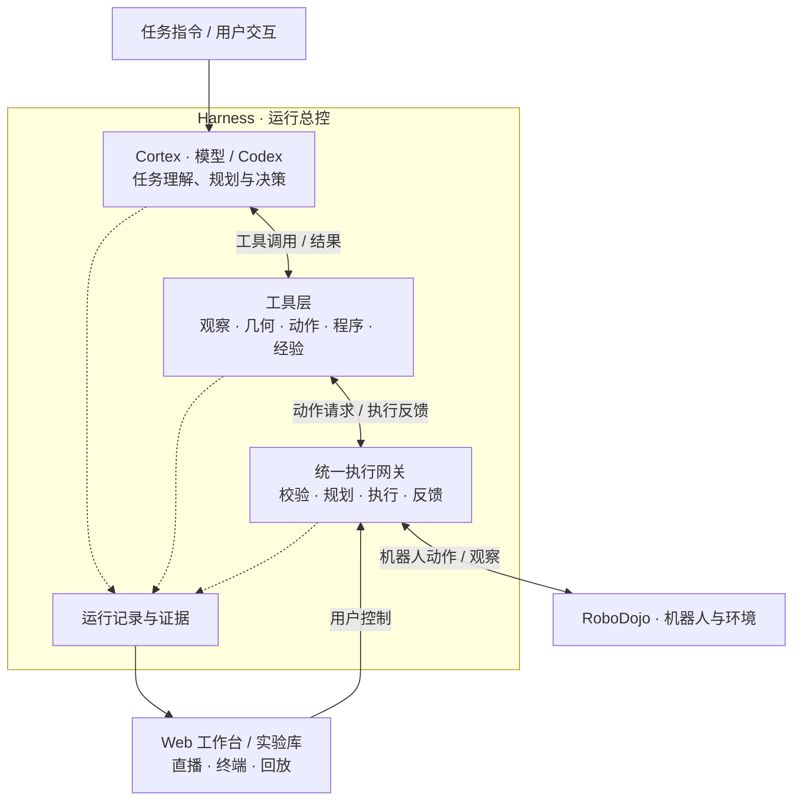

# Auriga

**Auriga 是面向具身操作的智能体执行框架（agent harness）。** 模型在持续的 Codex 会话中查看相机图像和机器人状态、制定计划、调用工具、编写并审批小程序、控制机器人；Harness 负责执行边界、运行状态和证据记录。当前运行环境是 [RoboDojo](https://robodojo-benchmark.com/) 仿真评测与双臂 ARX X5。

[English](README.md) · [文档索引](docs/README.md) · [开发约定](AGENTS.md)

## 设计理念

- **模型主导，工具辅助。** 模型自主拆解任务、选择工具并依据反馈修订方案；工具提供观察、几何、动作预览与执行、程序和历史查询等通用能力，不内置特定任务的解法。
- **以反馈形成闭环。** 动作前可预览候选轨迹，动作后返回图像和实测机器人状态，模型据此决定继续、补充观察或调整方案。
- **唯一物理执行入口。** 模型、生成程序及可选策略模型的所有机器人动作都经过 `Harness.execute`，由框架统一处理权限、状态校验、预算与停止。
- **诚实的回执。** 计划、命令、实测轨迹和任务评分分别记录。“运动完成”“程序以 0 退出”“任务成功”含义不同；部分执行和未知状态如实保留，不会静默重发动作。
- **上下文只承载必要信息。** 模型拿到观察、执行事实和短引用；哈希与来源元信息留在内部归档。

## 架构



一次运行围绕“观察 → 判断 → 行动 → 反馈”循环展开。首次物理动作前，模型提交简短的任务计划。`robot_action` 先整批预览各阶段（双臂运动、夹爪动作、依赖关系、可选观察检查点），再按 `plan_id` 执行同一缓存计划。RoboDojo 中模型思考期间世界暂停，物理时间只通过动作或显式等待推进。benchmark 分数来自原生 evaluator，不采信模型自报。

## 模型可用的工具

实际目录随配置和观察条件变化；10 个入口在初始目录中直接可见，其余通过 Codex 原生工具搜索按需加载。每个工具在契约中声明输入输出 schema、单位、默认值和范围。

| 工具 | 作用 |
| --- | --- |
| `task_plan` | 提交和修订任务计划与关注清单；每次决策前重新注入。 |
| `robot_observe` | 当前图像及关节 / 末端 / 夹爪状态；可按需局部放大。 |
| `robot_information`、`robot_capabilities` | 机器人结构、标定、原生几何与能力。 |
| `robot_action` | 单双臂阶段批次的预览、执行与证据检查。 |
| `robot_wait` | 推进仿真，观察运动或等待物体落稳。 |
| `robot_action_status` | 查询动作的原请求与执行回执。 |
| `program_run`、`program_status` | 运行反馈循环或数值程序，审批其请求的动作。 |
| `geometry_query`、`robot_contact_overlay` | 标定几何（双目三角化、像素平面交点）与机器人参考叠加图。 |
| `vision_compare` | 量化两次观察之间的局部图像变化。 |
| `history_*` | 回看动作、轨迹和观察，并添加注释。 |
| `operation_memory` | 查询或记录当前任务与跨任务的操作经验。 |
| 可选：`robotic_view`、`stereo_guide`、`vision_review`、`depth_query`、`robot_policy_step` | 腕部相机视点解算、双目极线引导、辅助视觉复核、RGB-D 数值查询（仅限显式深度条件）、π0.5 局部策略。 |

详见[统一动作与程序审批](docs/development/unified-actions.md)和[工具契约](docs/development/tool-plugins.md)。

## 运行要求

- Linux x86_64，能运行 Isaac Sim 5.1 的 NVIDIA GPU。
- [Miniforge](https://github.com/conda-forge/miniforge)（`mamba`）。项目只使用名为 `Auriga` 的 conda 环境（Python 3.12，见 `environment.yml`），不创建 `.venv`。
- 构建网页需要 Node.js 22 和 npm。
- 按 [RoboDojo 运行环境](docs/development/robodojo-setup.md) 固定版本并打好补丁的 RoboDojo、Isaac Sim、IsaacLab 与任务资产，使用其独立解释器。
- Codex 配置（默认 `~/.codex`），带有能提供所选模型的 Responses 兼容供应商认证。默认模型 `gpt-6.1-sol`、推理档位 `high`；Codex SDK/CLI 版本固定在 `requirements.lock.txt`。
- 可选：[VGGT 感知服务](services/vggt_height/README.md)。外部感知默认开启并访问 `http://127.0.0.1:8331`；服务不在时相应附加结果标为不可用，运行继续。不需要时设 `"external_perception": false`。

## 快速开始

```sh
git clone https://github.com/lose4578/Auriga.git
cd Auriga
mamba env create -f environment.yml
npm --prefix web ci && npm --prefix web run build

# CPU 检查：不需要 GPU、仿真器或模型。
mamba run -n Auriga python -m unittest discover -s tests

# 只打印有效配置，不启动任何服务。
mamba run -n Auriga python -m auriga.apps.gateway --print-config
```

本机相关的设置（RoboDojo 路径、Codex home、模型）写在 Git 忽略的 `configs/auriga.local.json`，或用 `--config` 传入自己的文件，见[配置说明](docs/development/configuration.md)和[完整示例](configs/auriga.example.json)。

运行一局 benchmark。该命令会启动真实模型和仿真器；选择本机空闲 GPU，并使用新的运行目录：

```sh
mamba run -n Auriga python -u -m auriga.apps.gateway \
  --benchmark --task general_pickup --seed 0 --layout-id 0 \
  --gpu 0 --port 8767 --run-dir runs/my-first-task
```

打开 <http://127.0.0.1:8767> 查看相机画面、原生 Codex 终端、动作与运行记录。结束后：

```sh
# 只读回放运行目录的副本（不需要 GPU 和模型）。
mamba run -n Auriga python -m auriga.apps.gateway --replay --run-dir runs/my-first-task --port 8767

# 实验库：在 http://127.0.0.1:8780 检索运行、直播与回放。
mamba run -n Auriga python -m auriga.apps.library

# 按归档动作重新仿真并导出高清视频（需要仿真器，不调用模型）。
mamba run -n Auriga python -m auriga.apps.replay.hd_replay --source-run runs/my-first-task --output runs/my-first-task-hd
```

批量评测使用 manifest 和队列（`python -m auriga.apps.evaluation.queue`）；[`benchmarks/`](benchmarks) 中的固定任务组可生成 manifest：[`gpt-as-policy-10`](benchmarks/gpt-as-policy-10/README.md)（10 个任务、50 个 case）和 [`robodojo-42-15`](benchmarks/robodojo-42-15/README.md)（官方 42 个任务 × 15 个场景）。会话恢复、交互控制、批量运行、报告与审计见[运行指南](docs/development/running.md)。

## 安全

生成的代码以启动用户的身份运行。OS 沙箱**默认关闭**（`features.sandbox_enabled=false`）：原生 Codex 命令、子代理和 `program_run` 可以访问启动用户有权访问的文件和网络，只剩 Harness 的应用层边界（观察过滤、动作准入、程序审核）。在具备 bubblewrap、Landlock ABI ≥ 4 和 libseccomp 的 Linux 上，可用 `{"version": 1, "features": {"sandbox_enabled": true}}` 开启；隔离不可用时启动直接失败，不会静默降级。详见[代码执行沙箱](docs/development/configuration.md#代码执行沙箱)。凭据只放在 Codex home，不要提交到仓库。

## 目录结构

```text
auriga/      Python 包，六层结构；模块级 import 只指向下层
  core/          协议契约、配置、信息边界、存储、模型侧展示
  robot/         机器人模型与标定、动作契约与运动算法、RoboDojo 后端
  perception/    图像测量、叠加图、可选外部感知、RGB-D、场景存储
  cortex/        Codex 会话与沙箱、actor 启动上下文、回合监督
  runtime/       Harness、robot_action 编排、工具注册与插件、程序、策略桥接
  apps/          网关/工作台、实验库、评测队列、高清重放、参考基线
web/           工作台与实验库前端（构建后打入包内）
configs/       默认配置、完整示例、图像设置、预设与价格卡
benchmarks/    固定 benchmark 任务组（case 与分组）
scripts/       打包、任务组生成器、兼容入口与开发探针
services/      可选 VGGT 感知服务
contracts/     测试使用的协议夹具
tests/         CPU 契约与回归测试
third_party/   带许可证的第三方固定资料（Codex 模型目录、RoboProbe）
docs/          开发指南、设计文档与功能说明
```

## 从哪里开始

| 你想要…… | 阅读 |
| --- | --- |
| 运行任务和 benchmark | [运行指南](docs/development/running.md)、[配置说明](docs/development/configuration.md)、[RoboDojo 运行环境](docs/development/robodojo-setup.md) |
| 理解一次调用怎样完成 | [实现架构](docs/development/architecture.md)、[共享协议](docs/design/Astra具身Harness-共享接口与事件协议-v0.1.md) |
| 新增或修改工具 | [工具契约与插件](docs/development/tool-plugins.md)、[扩展指南](docs/development/extensions.md) |
| 接入新机械臂或环境 | [机械臂与环境接入](docs/development/robot-environment-integration.md)、[机器人后端边界](docs/development/robot-backend-boundaries.md) |
| 了解模型能看到什么 | [信息边界](docs/development/actor-information-boundary.md) |
| 开发网页 | [web/README.md](web/README.md) |
| 检索和回放实验 | [实验库](docs/development/experiment-library.md)、[高清重放](docs/development/hd-replay.md) |
| 参与贡献 | [AGENTS.md](AGENTS.md)、[验证指南](docs/development/validation.md)、[CONTRIBUTING.md](CONTRIBUTING.md) |

代码导读：`auriga/apps/gateway/cli.py` 解析参数并构建 `Workbench`（`apps/gateway/workbench.py`），后者启动 Codex 会话（`cortex/session/codex.py`）和 `Harness`（`runtime/harness.py`）。工具在 `runtime/tools/definitions.py` 声明、由 `runtime/tools/builtins.py` 装配；`robot_action` 在 `runtime/actions/unified_actions.py`。物理执行从 `Harness.execute` 经 `robot/backends/robodojo/robot_process.py` 到达在 RoboDojo 解释器里运行的 `robot/backends/robodojo/robot_worker.py`。

## 第三方资料

`third_party/` 保留随仓库分发的第三方资料的上游许可证和来源：Codex 模型目录（Apache-2.0）与 RoboProbe 参考代码（Apache-2.0）。RoboDojo、Isaac Sim、IsaacLab、cuRobo 和模型权重不随本仓库分发。

## 许可证

Auriga 以 [MIT 许可证](LICENSE) 发布；`third_party/` 中的第三方资料保留各自的许可证。
