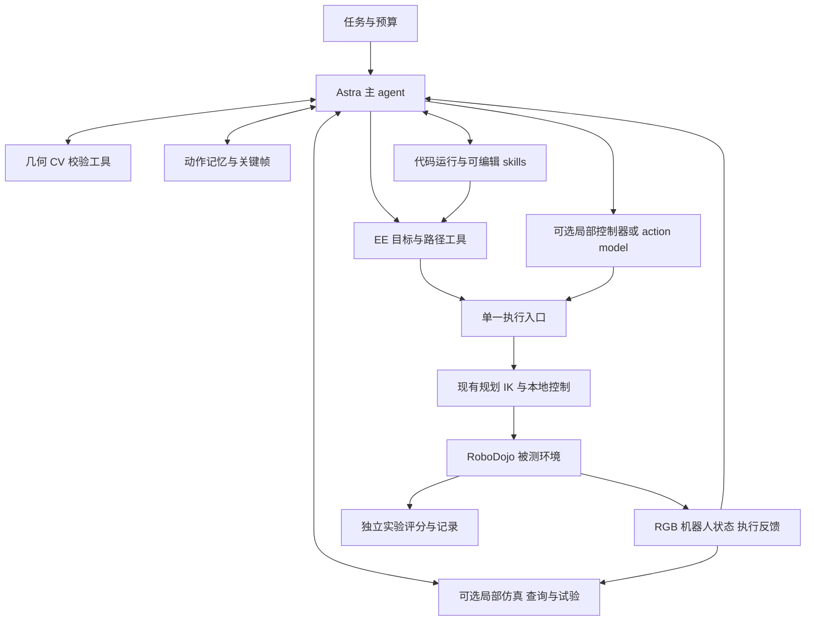
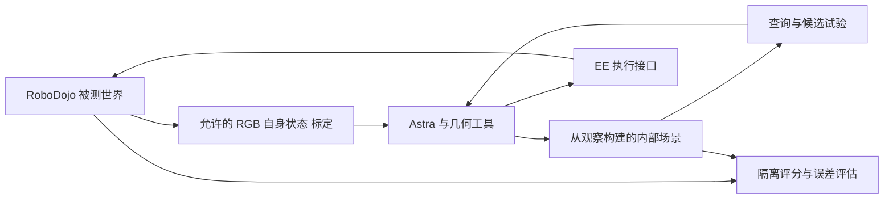

# Astra 具身 Harness 的 RoboDojo 实施方案与在线仿真探索

> 本文保留方案制订时（2026-09-30）的设计约定，描述扩展目标；其中“待实现”属于当时状态。当前支持范围以代码中的注册表、capabilities、工具契约及测试为准。

版本：v0.3，2026 年 9 月 30 日。用途：作为第一阶段开发与实验的设计基准。本版明确常驻原生 Codex 运行窗口，与机械臂画面并排显示。文中的接口是建议契约，尚未实现；文献结果是作者报告，本次没有运行机器人或复现成功率。

**第一阶段全部基于 RoboDojo。由一个 Astra agent 持续掌握任务理解、观察、动作选择、结果判断和修正；Astra 直接生成的机器人动作统一采用末端执行器 EE 表示，IK、轨迹定时与关节执行由现有库或仿真后端完成。Harness 提供丰富、可组合、可检查的能力，任务层的流程控制保持很薄。**

在此基础上，增加一个独立的研究方向：用交互过程中取得的相机图像和机器人状态，逐步构建可查询、可试验的局部仿真场景。先检验三维测量和运动预演能否帮助 Astra，再研究接触试错。这个方向有可行的工程起点，但不能预设视觉重建已经提供准确的物理环境。

本文作为当前实施方案，取代前两版方案中的默认弱模型分工、固定控制路由和多角色流水线建议；前两版保留作研究资料。已确定的原则与待验证的扩展在下文分别说明。

可单独分派的配套设计：

- [局部场景与短时仿真独立开发方案](./局部场景与短时仿真-独立开发方案-2026-09-30.md)：离线输入、场景构建、查询、Isaac worker、API、预算和验收。
- [网页可视化与 Codex 接入方案](./Astra具身Harness-网页可视化与Codex接入方案-2026-09-30.md)：机械臂画面、常驻原生 Codex 终端、粗粒度活动与同步回放。
- [共享接口与事件协议 v0.1](./Astra具身Harness-共享接口与事件协议-v0.1.md)：三个模块共同遵循的观察、EEAction、快照、身份及事件语义；发生细节差异时以此为准。

## 1 已确定的设计原则

| 项目 | 本方案的决定 |
|---|---|
| 初期环境 | 全部在 RoboDojo 测试开发，先把同一个环境中的接口、评测和问题查清 |
| 决策主体 | 一个 Astra 持有完整交互上下文，自由选择观察、测量、运动、编程和回看工具 |
| 动作表示 | Astra 直接输出 EE 位姿、增量或路径及夹爪命令；不让它手工解 IK 或逐控制周期生成关节数值 |
| 连续动作 | 确定性程序根据少量 EE 目标与路径约束生成连续轨迹；沿途可达性、定时和执行留给后端 |
| 精细执行 | 几何运动、局部闭环、生成程序和 action model 都是可选能力，由 Astra 根据任务和实测依据决定 |
| 工具职责 | 返回原始观测、可解释计算和执行结果；不暗藏抓取步骤、失败重试策略或固定任务阶段 |
| 记忆 | 动作前后 EE、关键帧、请求轨迹与实际运动为核心，按需读取；先用文件和索引 |
| 可视化 | 网页常驻机械臂画面与同一运行会话的原生 Codex 终端；节点和结构化检查器辅助定位，观察、动作与媒体用统一 ID 关联 |
| Skills | Astra 可以创建、查看、调用、修改的程序资源；不自动成为相似任务的必经流程 |
| 外层控制 | 管理 episode、预算、终止、环境故障和实验记录；本地执行约束持续生效 |
| 降成本 | 先减少重复计算、密集动作输出与重复上下文；核心具身判断先保留 Astra |
| 在线仿真 | 作为可选工具与实验支线，主控制闭环不依赖它先建好完整世界 |

RoboDojo 技术报告在相同接口下报告 Astra 的 Average SR 为 22.48%，GPT-5.5 为 0.88%；Astra 的 Precision SR 仍仅为 4.00%。Average 按五个能力轴等权，不能随意改成任务微平均。这些结果支持以 Astra 建立完整能力基线，也说明精确控制仍有缺口；没有实验支持默认把日常场景判断和成功判断交给弱模型。[RoboDojo 论文 Table 1](https://arxiv.org/html/2609.24170v1#S4.T1)

本方案要检验的是：在保留 Astra 判断能力的前提下，补充测量、表达、执行和试验能力，能否提高成功率、减少无效交互，并把已解决的问题沉淀成可复用程序。

## 2 总体结构与开发底座



图中的连线表示可用能力，不规定 Astra 必须依次经过哪些步骤。它可以看图后直接移动，也可以先测量、回看一次失败、写一个小程序，或者比较几个虚拟动作。

**开发底座采用 Codex Python SDK 承载 Astra 的会话、工具调用与编程能力，具身部分通过薄工具服务接入。** SDK 当前通过 JSON-RPC 控制本地 app-server；不需要自己重新实现一套编码 agent。MCP 或受控 Python client 都可作为机器人工具入口，底层复用同一执行服务。运行时、模型配置与工具版本需要固定记录。[Codex SDK 官方文档](https://learn.chatgpt.com/docs/codex-sdk)

同时保留 RoboProbe 的简单 API 闭环作为参考条件。Codex 接入、工具扩充、上下文改变是不同干预，分别比较；不能把新 runtime 的结果直接称为原报告复现。[RoboProbe](https://github.com/RoboProbe/RoboProbe)

第一版的自有代码集中在五处：RoboDojo 适配器、EE 工具、几何工具、动作日志、实验 runner。代码执行工作区与被测环境分离。后续的局部仿真服务单独加入；不先建设大型调度器、场景图服务或多 agent 平台。

需要并行分析记录、开发候选程序或跑独立实验时，可以让 Astra 委派工作；同一个被测机器人会话始终只有一个动作写入者。并行实验使用独立环境，不能让多个 agent 争写同一双臂状态。

## 3 观察信息与实验边界

Astra 默认能直接查看原始 RGB、机器人自身状态和执行反馈。几何结果、结构化状态与文字摘要都是附加材料，不替代原图；原图与 overlay 分开保留。

每次观察至少包含观测 ID、仿真时间与采集时间、各相机图像、实际关节反馈、后端可提供的夹爪字段及其来源、由规定坐标链得到的 EE 位姿、上一动作的执行状态与到位误差。图像与机器人状态应对应同一采样时刻；无法严格对齐时返回采样关联及可测时间差，避免用动作结束后的位姿解释动作中途的图像。不同时间源未建立映射时，不能直接相减当作传感延迟。

需要严格区分两种实验条件：

| 条件 | 允许输入与用途 | 结果如何描述 |
|---|---|---|
| 原参考条件 | 按固定版本 RoboProbe 协议提供 RGB、自身状态、指令与执行反馈；保持其动作、预算和上下文约定 | 只有核对一致后，才称参考复现 |
| 本方案的标定几何条件 | 在上述输入上，明确增加相机内参、畸变参数、相机安装外参，以及允许使用的自身机器人模型 | RoboDojo 上的增强工具或观察条件；单独报告增益 |

**RoboProbe 当前锁定的 Lite 主条件把 camera calibration 列为 evaluated system 不可获得的信息，所核 EEF 参考输入也没有 K 和外参接口。** 因此，利用准确 K 和手眼外参进行投影或三角化，本身就是需要披露的条件变化。即使这些信息在未来真机中可以合理标定，也不能据此声称与原 RGB-only 参考完全同条件。将来提交哪个官方 track，还需对照该 track 的规则。[RoboProbe 评测边界](https://github.com/RoboProbe/RoboProbe/blob/9ffacc54f372beef6479d61711bf4945e31ae4ce/docs/llm_benchmark_protocol.md)

在本方案条件下，相机标定和机器人 URDF 等属于明确提供的设备知识；待操作物体的真实位姿、隐藏网格、摩擦、接触状态、布局答案和奖励内部状态仍然不向 Astra 或其辅助工具开放。辅助工具也是 evaluated system 的一部分，不能在后台读取真值再把“计算结果”交给 Astra。

调试时可以用环境真值检验计算误差，但只在隔离的测试或评分进程中使用。若另做 oracle 上限实验，单独标注，不混入主结果。

## 4 EE 动作与连续轨迹

### 4.1 Astra 需要决定的内容

统一的模型侧动作表达是：使用哪只手或哪两个 TCP、在哪个坐标系中、到达哪些位姿、沿什么路径、采用什么速度和夹爪时序、何时返回反馈。TCP 指具体工具中心，不能混用法兰原点与夹持面中心。

起点由当前实际反馈确定。Astra 可以引用某个 `observation_id`，但不能生成一个起点后把它当成机器人当前位置。提交时若起点已经改变，执行器返回状态变化或按明确许可重新规划。

下面是建议工具族，不是要求模型每次依次调用的工作流：

| 工具能力 | 输入与行为 |
|---|---|
| `motion.move_ee` | 一只或两只手的 EE 目标；明确选用后端可行路径或直线模式 |
| `motion.follow_ee_path` | 多点、直线段、圆弧或曲线；定义位姿插值、容差、速度和必经点 |
| `motion.preview` | 可选地检查或投影候选路径，返回可达性、已检查的几何范围和预期时间 |
| `motion.status` | 查询同一动作的执行进度和实际状态 |
| `motion.cancel` | 请求后端停止，并返回实际停止进度；未确认停止时不假定已停稳 |
| `gripper.command` | 明确哪只手、开度或归一化含义，以及独立执行还是与运动同步 |

底层以米、秒和明确的旋转表示存储。建议内部使用 SE(3) 与归一化四元数 `xyzw`；模型侧可保留 RoboProbe 已定义的姿态角便利表示，由统一转换器处理。其 pitch、roll、yaw 和“朝下抓取”约定不能当成任意库的普通欧拉角顺序。增量还要明确沿世界轴还是工具轴，旋转是左乘还是右乘。

双臂轨迹共享时间基准，并检查两臂之间的运动关系；每只手单独可达不表示组合可行。未指定的维度或手臂保持什么状态，应由文档明确并绑定当前观测。

### 4.2 插值和 IK 怎样分工

**默认复用 RoboDojo 或已接入库的运动后端。** RoboProbe 的 EE 参考已有夹持面目标到法兰的转换、CuRobo 规划和原生关节动作回放。先核对并复用这条链，再补充它实际缺少的路径表达能力；首版不为此引入完整 ROS 系统。[EE 参考实现](https://github.com/RoboProbe/RoboProbe/tree/main/policy/RoboDojo_Agent_L3_Inspect_EEF)

| 路径要求 | 生成方式 | 必须保留的语义 |
|---|---|---|
| 直线 | 位置线性插值，姿态固定或在 SO(3) 上插值，再沿途求解可执行运动 | 终点 IK 成功不代表整条直线可达；不可行要返回原因 |
| 折线 | 多段直线 | 必经点停住，或显式允许一定半径的圆滑过渡 |
| 圆弧 | 由圆心或弧上点定义几何，配合姿态变化规则 | 方向、弧长及可表达范围明确 |
| 一般曲线 | 参数化曲线或样条，区分必经点与控制点 | 平滑后重新检验 EE 偏差；样条控制点通常不是必经点 |
| 自由路径 | 后端在约束下寻找到目标的路径 | 这是 Astra 许可的路径自由度，不能静默替代直线请求 |

IK、速度约束、关节连续性、时间参数化和轨迹跟踪由执行工具完成。Astra 收到 `unreachable`、`path_infeasible`、跟踪误差等有意义的结果，再决定换姿态、换路径或补观察；不要求它处理求解器迭代细节。

MoveIt/Pilz 是直线、圆弧和 sequence 的成熟参考；现有后端确实缺这些功能时再评估接入。Ruckig 适合状态间的速度、加速度和 jerk 约束，不负责 IK 和环境几何；其 Community 中间 waypoint 功能有云端边界。TOPPRA 适合给既定路径定时，也不生成避障路径。无需把这些库全部串成每次动作的固定链。[Pilz](https://moveit.picknik.ai/main/doc/how_to_guides/pilz_industrial_motion_planner/pilz_industrial_motion_planner.html)、[Ruckig](https://github.com/pantor/ruckig)、[TOPPRA](https://hungpham2511.github.io/toppra/index.html)

### 4.3 执行反馈与控制权

请求至少带动作 ID、episode ID、引用观测、工具版本、时间上限和动作参数。执行反馈区分接受、运行、完成、拒绝、取消和状态未知，并返回实际到位状态、位置与旋转误差、已执行区间和新观测引用。超时后查询原请求，避免盲目重发造成重复动作。

“完成轨迹”只表示运动执行完成。是否抓住、是否放稳、是否满足任务，仍由 Astra 根据可用证据判断；正式成功率由独立的 RoboDojo 评分器计算。模型的完成声明不能改写环境评分。

所有程序和 action model 都通过同一动作入口。切换时停止旧执行、处理未执行队列、确认可接管状态，再交出控制权。关节边界、速度限制和后端停止机制持续有效；这些是兑现动作请求的约束，不指定任务策略。

### 4.4 现有适配器需要保留和补齐的边界

当前 EE 参考面向 ARX X5，按每臂规划、双臂路径时间对齐、手臂阶段执行、夹爪阶段执行的方式工作。时间对齐不等于已完成双臂联合避碰；当前规划场景也不能代表全部任务物体、持物和动态障碍。任意 EE 曲线、夹爪与运动连续同步、运行中取消及持续反馈，均需在此基础上验证或扩展，不算参考代码已经提供的能力。[EE 执行源码](https://github.com/RoboProbe/RoboProbe/blob/9ffacc54f372beef6479d61711bf4945e31ae4ce/policy/RoboDojo_Agent_L3_Inspect_EEF/policy.py)

该版本的 `<arm>_ee_joint_state` 来自经过限幅的先前夹爪控制值，不能当真实手指位置或接触传感器。适配器为持续抓持保存最后请求的 gripper goal；日志要分别保存这个目标、下发值和可用反馈，不把读数回送成新的保持目标。Astra 仍需通过允许的观察判断是否持物。[夹爪控制](https://github.com/RoboDojo-Benchmark/RoboDojo/blob/726e9aabfaa642203722eb126f5eaf0f37f3e1ad/env/robot_manager/control_manager.py)、[观察字段来源](https://github.com/RoboDojo-Benchmark/RoboDojo/blob/726e9aabfaa642203722eb126f5eaf0f37f3e1ad/env/observation_manager/obs_manager.py)

## 5 传统几何与 CV 工具箱

优先提供让 Astra 自己检查假设的工具。其返回值包括结果、输入来源、坐标系与单位、成立条件、实际残差或退化状态；没有标定过的概率模型时不生成虚假的统一置信分数。

| 能力与候选实现 | 返回的信息 | 成立条件或限制 |
|---|---|---|
| FK 与坐标变换，已有后端或 Pinocchio | EE、相机、基座之间的位姿与相对误差 | 需要机器人模型、安装外参和采样时刻；目标位姿不是反馈位姿 |
| 像素射线，OpenCV `undistortPoints` | 相机中心与世界系射线方向 | 需要有效 K、畸变与外参；深度仍未知 |
| 射线与平面求交，解析公式 | 指定平面假设下的 3D 点与入射角 | 像素对应点必须在该平面；近平行时病态 |
| 轨迹与工具投影，`projectPoints` | 当前 EE、候选目标、轴与路径的图像 overlay | 2D 对齐不证明深度正确；同时提供原图 |
| 稀疏点追踪，LK 光流或特征匹配 | 像素位移、匹配点、追踪误差 | 遮挡、模糊和重复纹理会失效；不自动解释物体身份 |
| 多视角三角化，`triangulatePoints` | 3D 点、视差、重投影误差、退化诊断 | 同一物理点、有效平移基线，移动相机时目标需符合静态假设 |
| 轮廓与形状拟合，OpenCV | 线、圆、主方向、中心、像素尺度和残差 | 输出几何线索，不自动决定抓取目标 |
| 已知几何位姿，PnP 或 AprilTag | 位姿候选、内点和残差 | 已知尺寸和对应关系；贴标记属于额外条件 |
| 平面与表面测量，Open3D | 法线、平面、距离、支持区域 | 先有合格的米制点云；未知区域保持未知 |
| 碰撞与距离查询，FCL 或现有后端 | 指定几何及运动下的距离、碰撞位置 | 只对提供的模型有效，需说明离散采样还是连续检测 |

首批实现前六项。后四项按输入条件与实验需要开放；不把重型感知模型或完整三维重建设为所有动作的前置条件。数学工具可基于 [OpenCV 相机几何](https://docs.opencv.org/4.13.0/d9/d0c/group__calib3d.html)，追踪参考 [LK 光流](https://docs.opencv.org/4.13.0/d4/dee/tutorial_optical_flow.html)，空间查询参考 [Open3D](https://www.open3d.org/docs/release/python_api/open3d.t.geometry.RaycastingScene.html) 与 [FCL](https://github.com/flexible-collision-library/fcl)。

例如，去畸变后的像素生成射线 `X(λ)=C+λd`。若 Astra 显式提出该点位于平面 `nᵀX+b=0`，工具可计算 `λ=−(nᵀC+b)/(nᵀd)`。结果要连同平面假设返回；点击杯口时不能自动套用桌面高度。没有深度约束时，返回射线就是完整且正确的回答。

校验工具遵循同样原则：给出实际 EE 误差、指定点前后位移、夹爪开度或已有传感反馈、几何距离与图像比较。某个数值条件满足，不自动等价于任务成功；组合这些证据的判断留给 Astra。

## 6 Action model 与局部控制的角色

大段自由空间移动通常适合用 EE 路径表达，但不设定“粗动作必用程序、细动作必用 VLA”的固定规则。已知特征的精细对齐可由视觉伺服解决；经过验证的学习策略也可能更适合某些复杂接触。选择需要当前本体、相机与任务域的实测依据。

每个可选后端提供一张简短能力卡：所需观察、本体与动作格式、已测任务的成功数和尝试数、典型失败、推理延迟、预测长度、实际可执行长度、停止与接管方式。Astra 根据这些事实决定是否调用，不另建一个默认替它做判断的模型路由器。

可将 `policy.propose` 与 `policy.execute_prefix` 分开：先看候选动作或预演，再由 Astra 决定执行多长；也允许为已验证工具直接设定有界执行。推理次数、真实执行步数与停止原因都记录。[openpi 远程推理接口](https://github.com/Physical-Intelligence/openpi/blob/main/docs/remote_inference.md)

**Astra 自己给出的动作保持 EE 标准。** 外部策略若原生输出 joint action，由适配器处理其原生格式并明确记录；这段数值动作的生成者是该策略。不能把 joint chunk 做 FK 后再 IK 就宣称行为等价。如果后续要求所有后端也统一执行 EE，则选择支持该表示的策略或单独验证转换。

第一阶段先建立没有 action model 的可用主线，再按明确的能力缺口接入一个匹配后端。加入模型后的收益单独消融，不能只展示混合系统最好的几次轨迹。

## 7 可编程执行与技能积累

Astra 可以在专属工作区编写 Python，读取允许的观察与日志，调用几何和 EE 接口，生成局部反馈控制程序。工具说明提供输入输出、单位、错误和示例；不预写每个任务的完整解法。

程序可以包含循环、反馈和参数优化。高频循环读取本地最新信号并调用已支持的控制接口，不通过逐次远程大模型推理实现。普通 Python 脚本不天然具有实时保证；实际频率、反馈延迟和超时要测量。需要更紧时序时，生成的程序配置或调用已有本地控制器。

一次成功程序先保留为候选，记录适用条件与成功、失败轨迹。复用前重新获取当前场景参数，不把上一布局的绝对坐标直接当作下一布局的解。晋升为常用 skill 时，在留出布局与已有任务上检查；允许 Astra 继续绕过或修改它。

技能目录只需包含：说明、可执行代码、参数约定、版本以及可追溯的试验结果。暂不需要常驻“技能管理员”。开发集可以反复试验，冻结评测集不参与代码修改；费用报告同时计入技能开发成本和后续执行成本。

## 8 简洁的动作记忆

每次动作留一条索引，核心是前后 EE、轨迹和关键帧。补充 q、夹爪、时间和来源，是为了以后能解释偏差，不引入复杂的记忆决策层。

| 记录项 | 最小内容 |
|---|---|
| 来源 | 工具或程序或策略名称、版本、参数、依据的观察 ID |
| 动作前 | 时间、实际 q、EE、夹爪目标与可用字段及来源、各相机关键帧引用 |
| 请求与计划 | Astra 给出的 EE 目标或路径，规划器或策略的输出文件引用 |
| 下发与反馈 | 实际下发命令及采样时间；实际反馈轨迹另存 |
| 动作后 | 相同状态与关键帧，执行到哪里、误差和异常 |
| Astra 备注 | 可选的判断和下次尝试想法，与测量事实分开 |

计划、已发送命令、实际反馈是三种记录。由关节反馈经 FK 得到的 EE 注明来源；不能把发送动作的返回值当成传感器实测运动。

实现采用 `actions.jsonl`、图像文件和带时间的轨迹数组；设备、标定与坐标约定每个 episode 存一次。默认存动作前后图像，异常、中断或模型指定时再增加关键帧，密集视频按需保留。

给 Astra 开放 `history.list_actions`、`history.read_action`、`history.view_observation`、`history.read_trace` 即可。默认上下文保留当前原图、近期反馈和简短动作索引，旧证据始终可以读取。不要让不可回溯的自动摘要成为它获取历史的唯一入口。

若加入自建仿真，记录必须注明 `observed_world` 或 `internal_simulation`。虚拟试验的图像与成功不能写成被测环境已经发生的事实。

## 9 在线构建仿真映射的可行范围

**值得做，建议从随任务更新的局部近似场景开始。** 目标是让 Astra 更容易测量空间、比较行动方案、发现明显不可行的运动，并在有证据支持的范围内做短时物理试验。起步不要求整间房外观逼真，也不要求第一次观察就识别全部物理参数。

“不依赖真实环境模型”可以落实为不预先提供该场景的完整 CAD、物体位姿与物理属性。系统仍需要已知的机器人运动学、可用的标定信息、物理引擎，以及从观察中建立的环境近似。相机没有直接观测到的背面、质量、摩擦和关节阻力，不能因为放进了仿真就变成已知事实。

| 仿真用途 | 初期可行性判断 | 实际需要的准确性 |
|---|---|---|
| 3D 查询与空间记忆 | 优先做 | 相关表面、对象位置与坐标对齐达到任务所需精度 |
| 自由空间接近与路径预检 | 优先做 | 机器人、障碍与持物体积可靠；对未知区域和误差留余量 |
| 刚体抓放候选比较 | 有条件尝试 | 局部几何与夹爪模型较准；抓持假设要独立验证 |
| 推动与抽屉短时试验 | 第二步研究 | 还需摩擦、质量、铰链或滑轨约束与执行时序的合理范围 |
| 紧配合插入、柔性物、液体、快速碰撞 | 暂不作为首版仿真决策依据 | 接触、形变、材料与控制动态难由普通视频完整辨识 |

这是工程判断，不是已有成功率。三维外观、碰撞几何和动力学准确性是三个目标：一份渲染图像看起来相似的模型，仍可能有错误的厚度、接触面或关节轴。反过来，一个粗糙盒子模型可能已经足以排除撞桌路径。

### 9.1 HomeBody 提供的参考与证据边界

HomeBody 展示了 Astra 调用技能并利用空间记忆的 G1 系统。作者以自主探索收集的图像、LiDAR SLAM、关节状态和路点构建 Isaac Sim 场景，再用定位与 ICP 对齐；抓取还使用 D435i 双目深度。它支持“空间模型可以辅助部署推理”的方向，不能作为纯单目重建已解决的证据。[HomeBody 项目页](https://tml.stanford.edu/homebody/)

公开页面的流程是探索、重建、执行任务，没有给出持续在线重建、动态物体同步或多候选物理试错的验证。仓库仍标注代码即将发布；网页里的 twin cleanup 是预制动画回放，不能算在线规划实验。[官方仓库](https://github.com/Stanford-TML/homebody/tree/77d2c333fe0adc12ed35172fe086b382bcd5772b)、[网页播放实现](https://github.com/Stanford-TML/homebody/blob/77d2c333fe0adc12ed35172fe086b382bcd5772b/docs/scripts/site.js)

因此，本文增加的“任务过程中持续更新＋仿真分支试验＋根据偏差再校准”，是我们的研究提案。

## 10 只有相机时怎样获得米制几何

没有 LiDAR 不等于没有三维信息。决定可观测性的关键是相机数量、能否移动、有效基线、标定、对象是否静止，以及允许提供哪些尺寸或平面约束。

| 相机条件 | 可以采用的路径 | 主要限制 |
|---|---|---|
| 一台固定 RGB | 射线、已知平面、已知尺寸或已知模型约束 | 任意像素的深度无法唯一确定；机械臂移动不会产生新的相机视角 |
| 可移动腕部 RGB | 由手眼标定与 FK 得到相机米制位姿，匹配多视角特征并三角化 | 需要有效平移视差；纯旋转不够；对象运动与误匹配会破坏重建 |
| 两台或多台 RGB | 在重叠视野内利用已知相对位姿做立体或多视几何 | 跨相机对应、同步、遮挡及共同视野是条件 |
| RGB 加 IMU | 使用视觉惯性估计辅助相机运动与尺度 | 需要标定、同步与足够激励；不保证每个弱纹理场景都可用 |
| RGB-D 或双目深度相机 | 直接使用经过质量检查的深度或视差估计 | 没有 LiDAR，但比纯单 RGB 多了输入；需要单独标注实验条件 |

RoboDojo 的多视角和腕部相机适合作为起点，但多台相机本身不保证能匹配同一点。先检查任务区域是否有共同视野；没有重叠时由 Astra 决定是否主动移动相机，而不是硬编码每个任务都先扫描一圈。

对腕部相机，若 `T_A_B` 表示 B 到 A 的变换，则 `T_world_camera(t) = T_world_base × FK(q(t)) × T_link_camera`。这条已标定坐标链提供米制基线；没有标定的纯视觉单目重建通常仍有尺度问题。图像曝光时间、滚动快门、机器人模型误差和安装偏差都会影响最终几何。[OpenCV 标定与三维重建](https://docs.opencv.org/4.13.0/d9/d0c/group__calib3d.html)

一个理想化误差计算可以帮助选择观察位置。水平双目的深度近似为 `Z=fB/d`，由一阶误差传播得到 `σ_Z≈Z²σ_d/(fB)`。假设焦距 600 px、视差误差 1 px：距离 0.5 m、基线 8 cm 时，深度误差约 5.2 mm；距离 1 m、基线 2 cm 时，约 83 mm。**这是公式示例，不是系统实测精度**，且尚未计入标定误差。它说明“小视差但投影很准”仍可能对应很差的深度。

因此，首版推荐“已标定的运动相机＋局部稀疏或多视几何＋简单物体代理”。固定单 RGB 条件保留为更难的独立实验。学习型深度、分割和重建以后可以作为附加工具，但要标注它们是模型估计；无需让这些模型替代 Astra 的场景判断。

## 11 局部仿真如何构建和更新

### 11.1 保留最少的场景表示

局部场景文件只保存当前任务相关内容：已知机器人与相机、静态支撑面和障碍、若干可交互物体、明确的未知区域，以及对应关键帧。物体先使用盒、圆柱、凸包或可验证的局部网格。

每个对象保留一个稳定 ID、几何与位姿、来源图像、更新时间、哪些维度已测量、哪些只是暂定假设。未量化的误差写未量化；有误差模型时保留区间或样本。语义标签由 Astra 给出或确认，几何测量工具不擅自把“最大平面”标成桌面、把某个轮廓标成最佳抓取点。

物理属性用单独字段表示，例如质量范围、摩擦范围、转轴或滑轨假设。默认值只表示仿真暂用参数。遮挡背面可以先用保守体积近似，同时保留未知标记，不把补全结果伪装成观测。

### 11.2 对齐依靠测量与误差检查

桌面实验优先以机器人基座为稳定参考，将相机、EE、重建点和自建仿真统一到该坐标系。基座移动后必须重新处理坐标关系。所有变换带版本，几何点能追溯到采集时的图像与 q。

用投影叠加、独立视角的重投影误差、已知机器人几何、平面残差和必要的标定物检查对齐。不能仅凭 Astra 觉得两张图相似就认定米制几何正确。ICP 可以细化两个已有几何之间的配准，但依赖初值、重叠和几何质量；它不能凭空补回单目缺失的尺度。

做完一次可能改变场景的动作后，重新观察受影响区域。静态背景可以累计融合，移动物体单独跟踪并更新位姿；不能把桌上物体被搬走后的旧表面继续当固定障碍。夹在手中的物体也不能直接与 TCP 永久刚性绑定，除非已有足够抓持证据；滑动与掉落会使旧假设失效。

“同步更新”实现为增量处理观测，可在后台运行；它不表示重建在每个控制 tick 完成。Astra 能查询最新场景版本与滞后时间，也能在场景不足时直接依据当前原始观察行动或要求补测。长时间重建不阻塞基础 EE 闭环。

### 11.3 向 Astra 开放仿真工具

| 建议接口 | 能力与返回内容 |
|---|---|
| `scene.update` | 从指定观测更新几何，返回改了什么、支持证据和冲突；新假设与实测项分开 |
| `scene.query` | 射线、距离、表面法线、间隙、可见性和对象相对关系，带场景版本 |
| `sim.fork` | 从内部场景快照建立可丢弃的分支，不复制被测世界的隐藏状态 |
| `sim.rollout` | 对 EE 轨迹或生成程序做有界试验，返回视频、轨迹、碰撞和指定测量量 |
| `sim.compare` | 在同一场景版本及参数集合下比较候选，不替 Astra 决定任务策略 |
| `scene.check_alignment` | 将当前模型投影回真实观察或被测世界观察，报告残差与缺失区域 |

这些接口可被单独调用。Astra 决定什么时候值得预演，比较哪些候选，是否需要修订场景，以及最终执行哪个动作。新增场景构建代码与工具也由同一工作区管理，生成资产可以编辑和回滚。

### 11.4 让试错结论对模型误差有抵抗力

首先用仿真排除明显不合理的几何动作，再研究“哪个动作更可能成功”。对质量、摩擦、物体位置和接触参数不确定的情况，可以在一组合理参数下重复短试验，返回成功条件、失败模式与敏感性。

这些参数样本通常不是已校准的真实概率分布。因此，“10 个参数场景中 8 个完成”只能说覆盖了 8 个测试条件，不能直接宣称现实成功概率 80%。候选 A、B 排名随参数频繁交换，说明当前模型还不足以可靠选择。

执行时采用短段承诺：在被测世界做一段可观察动作，比较实际结果与预测，再由 Astra 决定继续、改动作或修改场景。仿真预测本身不提交任务完成状态。

例如推一个方块到指定区域：先测量桌面、方块及局部障碍，比较几条 EE 推动路径；若不同摩擦假设下位移差异很大，Astra 可以先做小幅推试并观察，再缩小参数范围。仿真还不够准时，它仍能通过真实闭环完成任务。这个例子说明一种可选的使用方式，不是所有任务的固定流程。

## 12 仿真与重建组件的取舍

用户提到的 NVIDIA Isaac，在这里具体指 **Isaac Sim** 的场景、渲染与物理能力；Isaac Lab 面向机器人学习工作流，不是从 RGB 自动生成可交互世界的重建工具。

**主实验环境继续使用 RoboDojo。内部仿真先复用相同 Isaac Sim 环境栈的独立场景或实例，避免同时引入第二套机器人适配。** 独立场景只导入允许的机器人资产与我们构建的几何，不能直接加载原任务环境作为“重建结果”。是否能在单进程中隔离 scene、重置、时钟和物理状态，需要实际集成验证；首个原型可选择更容易审计的独立进程。

| 需求 | 初期选择 | 后续再增加的条件 |
|---|---|---|
| 坐标、投影、稀疏匹配与三角化 | 已有 FK、OpenCV、少量解析几何 | 先把来源、尺度与残差做正确 |
| 局部点云与简单几何 | Open3D，按任务生成 primitive 或局部网格 | 稠密表面确实改善查询时再增加重建复杂度 |
| 场景与短时刚体试验 | 与 RoboDojo 版本匹配的 Isaac Sim | 验证资产生成、碰撞体、状态重置与离屏渲染 |
| 快速重复简单刚体试验 | 先测已有栈的成本 | 若成为瓶颈，再评估 MuJoCo 后端及其额外适配误差 |
| 稠密 TSDF 或 ESDF | 暂不列核心依赖 | 已有可用深度与相机位姿时再考虑 nvblox |
| 未知物体位姿跟踪 | 先从所需局部几何开始 | 只有匹配输入与模型条件时才评估 FoundationPose 等工具 |

Isaac Sim 已有程序化场景与机器人控制 API，但视觉重建、对象关联、误差管理和物理参数辨识仍需我们实现。可视网格、碰撞体、刚体和关节属性需要分别定义；例如凸包碰撞体可能封住视觉网格中的孔，导致插入预测错误。nvblox 的融合输入包含深度、相机位姿与内参；FoundationPose 标准演示也使用 RGB-D 等输入，不能把它们列为单张 RGB 的直接替代解。[Isaac Sim 物理建模](https://docs.isaacsim.omniverse.nvidia.com/latest/physics/simulation_fundamentals.html)、[nvblox 接口](https://nvidia-isaac.github.io/nvblox/v0.0.10/pages/core_library_interface.html)、[FoundationPose 演示源码](https://github.com/NVlabs/FoundationPose/blob/main/run_demo.py)

cuRobo 的版本也不能混用：本次所读 V2 文档已有内部深度融合 ESDF 与 TSDF，可先评估复用；这不代表 RoboDojo 当前固定的 CuRobo fork 具备同样 API。初期沿用兼容后端，不为了增加孪生功能先升级整条运动链。[cuRoboV2 技术说明](https://nvlabs.github.io/curobo/latest/technical_reports.html)

选相同物理引擎可以减少工程成本，但也使仿真内实验偏乐观：真实传感噪声、执行器偏差和跨物理引擎差异仍未覆盖。RoboDojo 成功后，后续真实相机实验必须重新检验这些环节。

## 13 从 RoboDojo 开始验证在线仿真

用两个不同权限的世界验证这个想法：



被测世界在实验中扮演外部现实。Astra 不能复制它的 scene graph、精确网格、对象位姿、物理参数或随机种子对应答案，也不能从安装目录、进程接口或生成脚本绕过观察边界。让 agent 可以编程时，仅过滤某个工具返回值不够，代码工作区与环境服务也需要隔离。内部场景只能从许可观察与明确先验重建。

开发阶段，隔离评分器可以访问真值以计算几何与预测误差；actor 不读这些诊断来完成当前测试 episode。若允许开发者据此调整算法，应使用开发集，冻结测试后再报告。

### 13.1 先做能够区分贡献的对照

| 条件 | 内容 | 回答的问题 |
|---|---|---|
| R0 | 固定版本原参考闭环 | 参考行为和工具链是否跑对 |
| R1 | Astra agent 加开放 EE 路径、代码运行和简单历史；保持原观察边界 | 动作表达、编程和记忆是否有用 |
| R2 | R1 加明确披露的标定信息与传统几何工具 | 米制测量和投影是否改善决策 |
| R3 | R2 加局部场景与空间查询，无物理 rollout | 三维记忆是否在即时几何之外提供收益 |
| R4 | R3 加多候选短时仿真与参数扰动 | 仿真试错是否在地图查询之外提供收益 |
| R5 | 在对应条件上增加一个匹配 action model | 动作模型补足了哪些具体任务能力 |

R1 内可再分别关闭历史回看或代码执行，避免把整包改动的收益归到某个组件。R2 的标定信息本身也可以作为独立消融。R3 与 R4 使用相同观测，才能更清楚地检验 rollout 的增量价值。

另设 oracle 场景作为诊断上限，有助于区分“场景不准”与“即便场景准也不会选动作”；这项不参与非特权主结果。它也不能只因名字叫 oracle 就当作任务成功率理论上界，其他控制误差仍可能存在。

### 13.2 任务与预算

建议先用 3 类任务做接口冒烟检查，再固定一个覆盖抓取、空间对齐、推动、堆叠、精细接触和历史依赖的开发小集。候选包括 `general_pickup`、`align_blocks`、`push_T`、`build_tower`、`insert_tubes`、`imitate_sorting_sequence`；实际名称与布局可用性以所固定环境版本为准。

一个可执行的初步规模是每类 10 个布局、每布局 3 次重复，共 180 episodes/条件。这是建议起始规模，不是统计充分性的保证。预算不足时先缩小开发筛查，正式比较再根据方差确定样本。保留不易成功的任务，避免只从 baseline 已成功布局中选样本。

固定模型与推理设置、相机条件、初始布局、环境步数、LLM 调用、墙钟时间和每任务费用上限。额外记录内部仿真的 rollout 数、GPU 时间与场景构建时间。虚拟试验不能免费抵消被测环境的真实交互预算。

明确 Astra 思考、写代码和内部 rollout 时，被测世界是继续走时钟还是暂停；动态任务尤其受影响。所有对照保持同样时钟策略，同时记录模拟时间与墙钟时间。暂停世界的实验不能直接推断实时机器人表现。

## 14 指标与完成判据

### 14.1 主控制闭环

报告首次尝试成功率、固定预算内完整成功率、过程 Score、每任务成功数与总次数，并同时保留与官方一致的聚合方法。失败类型至少区分语义、空间测量、路径或 IK、跟踪、接触、超时和未知；分类可以事后抽查，不要求在线固定路由。

费用与耗时包括模型、工具、重建、虚拟试验、失败重试与复位；不能只统计成功轨迹。每成功任务成本在零成功时不定义，必须同时报告总花费和零成功。技能开发费用单独列出，另给随复用次数变化的摊销值。

同布局的成败变化、样本量和不确定区间一并报告。工具执行频率、本地程序循环频率和 Astra 决策频率分别记录。

### 14.2 局部场景与预演

| 层次 | 需要测量的量 |
|---|---|
| 几何 | 任务相关位置、尺寸与表面误差，未覆盖区域，重投影残差；不能只看渲染相似度 |
| 更新 | 观察到可查询场景的延迟，移动物体的跟踪丢失与错误关联 |
| 预测 | 同一动作下，内部场景与被测世界的末端、物体轨迹及接触结果差异 |
| 决策价值 | 候选排序是否改变、改变后是否减少真实失败、是否错杀本来能成功的动作 |
| 成本价值 | 在相同总预算下，R4 相比 R3 的任务收益是否覆盖额外构建与试验开销 |

精度阈值从任务容差推导。例如任务间隙为 5 mm、局部几何误差仍达 10 mm，就不能把该场景用于判断精密插入；它可能仍能用于远处接近。不同用途分别验收，不设置一个对所有任务通用的“孪生合格分数”。

如果局部场景只改善可视化而没有改善任务结果，可保留为调试工具；如果几何查询有效但物理 rollout 无增益，就先停在查询能力。是否值得继续，不以建模画面是否逼真作为判据。

## 15 分阶段实施与最小交付

| 阶段 | 具体交付 | 进入下一阶段的依据 |
|---|---|---|
| 1 参考链路 | 固定环境版本、RoboProbe EE 参考、原始观察与日志、独立评分、离线网页回放 | 坐标与图像同步正确，复位可重复，能完整记录成功与失败；点击动作可定位前后观察 |
| 2 Astra 工具闭环 | Codex 接入、EE 目标与路径、可中断执行、关键帧记忆、代码工作区、网页实时活动与详情 | Astra 可自主组合工具，动作请求与反馈一致；Codex item 与真实动作可追溯；无隐藏任务策略 |
| 3 标定几何 | K 与外参配置、射线、投影、追踪、三角化，输入条件清单 | 合成几何与留出标定场景测量通过，退化情况如实返回 |
| 4 局部场景 | 从许可观察构建桌面与刚体代理，查询与增量更新 | 与真值隔离，几何精度足够支持所选查询，R3 的价值可测 |
| 5 短时预演 | 独立场景分支、候选 EE rollout、参数扰动、预测对照 | R4 在固定预算下比 R3 有可重复收益，误差不会造成更多失败 |
| 6 选择性扩展 | 匹配 action model、可复用 skills，必要时再试真实相机 | 针对具体能力缺口有证据；保留 Astra 主导和完整回看 |

阶段是研发依赖关系，不是机器人执行任务的固定流程。第一版验收以阶段 1 至 3 为核心；阶段 4 至 5 是独立可开关的研究支线，不阻塞主线控制实验。

建议仓库组织如下，名字仅为实现规划：

```text
agent/                 Astra 会话与工具注册
adapters/robodojo/      观察 EE 执行与版本适配
tools/                 几何 CV 反馈与轨迹工具
programs/              Astra 当前生成的局部程序
skills/                有说明和实验记录的可复用程序
runs/                  JSONL 图像 轨迹与实验配置
twin/                  可选场景表示 构建 查询和 rollout
evaluation/            独立评分 对照协议和统计
contracts/             共享类型 版本与离线 fixture
observability/         原始事件 关联索引和媒体映射
web/                   机器人画面 活动列表 Codex 详情及回放
```

初期省钱主要依靠固定代码完成数值计算与连续执行、按需读取历史、复用已验证程序。廉价模型可先用于可客观检查的离线整理和统计；若要替代在线场景解释、动作选择或完成判断，另做同条件实验，不预设替代比例。

当前最值得检验的贡献是两项：丰富的原始能力是否让 Astra 更有效地自主行动；由观察构建的局部场景是否能以可控误差帮助选择行动。整套系统的收益需要实验给出，不能由不同项目的演示或成绩拼接推算。

## 16 接入版本与首轮验收记录

本次核查的 RoboProbe 为 `9ffacc54f372beef6479d61711bf4945e31ae4ce`，RoboDojo 为 `726e9aabfaa642203722eb126f5eaf0f37f3e1ad`。后者安装脚本声明 Isaac Sim 5.1.0 和 Python 3.11。这些是源码快照，尚未联合部署验证，不能当作已测试的软件镜像。[RoboDojo 安装脚本](https://github.com/RoboDojo-Benchmark/RoboDojo/blob/726e9aabfaa642203722eb126f5eaf0f37f3e1ad/scripts/install.sh)

实际落地时还需固定子模块、资产、布局和渲染配置；安装脚本中的 `submodule update --remote` 可能改变子模块，不能只锁父仓库。当前参考默认 170 次模型调用，而旧报告材料有 100 次描述，复现历史结果应采用对应运行配置。图像同步也存在版本差异，按所用代码核对 frame 交付与 physics state 的关联，不把旧文档的“两次 render”作为通用修复。[RoboProbe setup](https://github.com/RoboProbe/RoboProbe/blob/9ffacc54f372beef6479d61711bf4945e31ae4ce/docs/setup.md)、[当前 render 同步实现](https://github.com/RoboDojo-Benchmark/RoboDojo/blob/726e9aabfaa642203722eb126f5eaf0f37f3e1ad/env/camera_manager/capture/render_sync.py)

首轮验收保留四组证据：小幅 EE 运动前后的正确图像与反馈；超界、不可达和中途结束时的真实执行范围；夹爪目标保持及双臂时序；代码工作区无法读取隐藏场景和评分内部信息。随后再验收投影、三角化、局部场景和 rollout。最终交付实验配置、全部运行索引、可回看的轨迹及汇总结果，明确区分接口跑通、局部实验、完整协议复现与官方认可成绩。

## 17 网页工作台与独立开发的接合点

网页属于主 harness 首期交付。左侧主相机画面，右侧常驻原生 Codex 运行窗口，下方简洁活动节点与回放时间轴。用户可以持续看到 Codex 的实际输出、工具与命令活动；选中节点另外展开模型输入、EE 请求、实际反馈和原始事件，不替换或隐藏正在运行的终端。节点来自已发生的事件，不构成固定任务状态机。

接入底座采用同一 Codex app-server/thread：官方 TUI 通过 `--remote` 连接，在后端 PTY 中运行，再经网页终端展示；独立事件客户端保存结构化记录。持续会话在推理、工具执行和等待间交替，不要求每一时刻都进行模型推理。只保留一个任务推进与审批输入所有者，网页刷新不重发任务。原生 TUI 对运行中 turn 的附着与配置保持仍需在固定版本验收。媒体复用 RoboProbe recorder/viewer；DSH、全 Isaac 视口流和 Rerun 按需后续接入。[官方 remote TUI 文档](https://learn.chatgpt.com/docs/app-server)

局部场景团队只需消费许可 ObservationBundle 和共享 EEAction，用离线 fixture 即可开发，不等待在线 Astra。它向主系统返回不可变 scene/snapshot、内部 rollout 结果和标准事件；只有主执行入口能把动作提交到被测 RoboDojo。网页也不拥有第二套执行入口。

三个模块的首个共同验收是：从一个 Codex item 找到真实输入 observation、EE 请求、实际动作区间及终态观察；从一个内部 job 找到它使用的 snapshot、参数假设和预测。历史记录不被新场景覆盖，reset 后旧动作被拒绝，网页重连不重发动作。界面、主控制与场景服务可以分别开发，按同一份共享协议联调。
