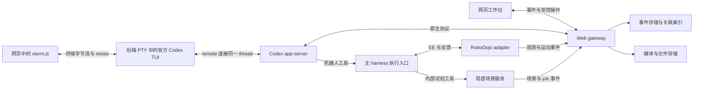

# Astra 具身 Harness：网页可视化与 Codex 接入方案

> 本文保留方案制订时（2026-09-30）的设计约定，描述扩展目标；其中“待实现”属于当时状态。当前支持范围以代码中的注册表、capabilities、工具契约及测试为准。

版本 v0.2，2026 年 9 月 30 日。状态：实施设计；尚未连接实际 Codex 会话与 RoboDojo。本版按用户明确要求，将原生 Codex 持续运行窗口设为常驻主面板。本文中的 `/v1/...` 接口、事件投影和目录是本项目拟定义的内容，不是上游已经提供的接口。

**采用一个网页工作台：左侧机械臂画面，右侧常驻原生 Codex 终端，下面是紧凑的动作节点与回放。用户可以持续看 Codex 实际如何工作，无需先点击节点。** 推荐用浏览器终端连接后端 PTY，PTY 中运行官方 Codex TUI 并连接同一 app-server/thread；结构化事件另行采集，用于动作关联和历史检查。

配套：[主实施方案](./Astra具身Harness-RoboDojo实施方案与在线仿真探索-2026-09-30.md)、[局部场景与短时仿真](./局部场景与短时仿真-独立开发方案-2026-09-30.md)、[共享接口与事件协议 v0.1](./Astra具身Harness-共享接口与事件协议-v0.1.md)。字段、坐标、状态和权限语义以共享协议为准。

## 1 界面首先解决三个问题

1. Astra 现在在做什么：观察、测量、生成或调用程序、提交运动、检查结果，还是等待工具。
2. 这次操作与机械臂有什么关系：它基于哪一帧，要求哪个 EE 目标，后端规划了什么，实际运动到了哪里。
3. 需要追查时能够继续展开：原始参数、工具输出、代码改动、日志、图像和异常，均能回到原始记录。

默认同时显示 Codex 原生运行过程与机械臂画面。原始 JSON、完整工具参数、轨迹差异等审计资料仍按需展开。运行节点提供索引，不替代持续运行窗口，也不强迫 Astra 按固定阶段执行。

## 2 简洁且有层级的布局

### 2.1 默认：现场与原生 Codex 并排

顶部只放任务名、运行状态、Live/回放模式和一个明确的运行控制入口。模型、环境和 seed 等信息收在运行详情里；不放无助于当前判断的统计卡片。

桌面默认约 50/50 分栏：左侧显示一个主要相机画面，右侧提供足够宽的原生 Codex 工作窗口。分隔线可拖动，两侧都可临时放大；不把终端挤成窄日志条。相机选择放在画面上缘；其他相机按需展开。下方保留一条紧凑时间轴和粗粒度动作节点，不再用它们占据整个右栏。

下方节点显示短标题、执行状态和必要的耗时。选中节点与画面中的目标或轨迹共享一种低饱和强调色。中性色背景、细分隔线、清楚的文字层级；不用彩虹节点、发光连线、渐变大卡片和重复徽标。终端采用可读的等宽文字和克制配色，不对输出重新做摘要或改写。

在窄屏下改为机械臂与 Codex 上下排列，原生运行窗口仍可直接看到；结构化检查器保持可折叠。生产终端支持自己的滚动区和回到底部，保留合理列宽与 scrollback；布局变化发送 PTY resize。终端宽度不能影响机器人执行或更改模型上下文。

### 2.2 选中：动作检查器

点击动作，页面保持当前位置，检查器展开以下三层，第一层默认可见：

| 层级 | 显示内容 | 用途 |
|---|---|---|
| 摘要 | 基于哪次观察、请求了什么、正在执行或得到什么结果 | 快速理解 |
| 证据 | 输入图像、请求 EE 路径、后端规划、实际 EE 反馈、执行后观察 | 检查动作与结果 |
| 原始记录 | Codex item、工具参数和返回、stdout/stderr、关联文件、原始事件 | 调试与复现 |

“Astra 输入”与“环境当前画面”是两个不同的画面身份。用户查看旧动作时，机械臂区域和检查器进入回放并固定选择；右侧原生 Codex 继续呈现当前运行，标题明确其仍在直播。不能为了跳转历史 item 把实时终端内容替换成摘要。需要历史原始记录时打开独立检查器；点击“返回实时”再恢复画面跟随。

“请求 / 规划 / 下发 / 实际”四条轨迹可分别打开。没有实际反馈时写“未记录”，不能用请求轨迹代替实际轨迹。前端叠加像素目标时，必须具备对应帧标定；否则仅展示三维坐标和路径数据，不画看似准确的投影。

### 2.3 持续监看与深入检查

原生 Codex 终端从 episode 开始持续显示：CLI 实际呈现的消息、工具/命令、输出与错误、忙碌/等待状态和交互请求。它使用真实 TUI 的显示方式；原生终端本身折叠或省略的内容，仍可通过终端操作或结构化检查器查看，不承诺输出 CLI 本身未公开的内部信息。

同一个 episode 使用持续的 Codex thread，工具结果进入该会话后继续模型与工具循环。进程和会话常驻不等于模型每毫秒都在推理；等待运动、等待输入或一个 turn 完成时要显示真实状态。若任务尚未结束而需启动下一 turn，由唯一运行协调器按既定任务与预算推进，不能每个机械臂动作都新建一个独立 Codex。

原始参数、代码差异、图像证据和长日志保留在可展开检查器。终端观看流和结构化事件日志并存，后者承担可检索、关联和回放的事实记录。

内部仿真是画面区的一个明确页签，进入后标明“内部预测”、scene version、snapshot、branch。第一版用与被测世界相同相机视角的渲染和轨迹对照；需要检查空间结构时再嵌入三维查看器。默认不同时打开两套大场景。对比分支时明确共享的起点和各自时间，不能把预测结果混进现场回放。

## 3 原生终端是首选，结构化记录继续保留

| 路线 | 可以省下什么 | 主要限制 | 采用位置 |
|---|---|---|---|
| 原生 Codex app 或 CLI 与机器人窗口并排 | 几乎无需重做会话 UI | 没有确认可直接嵌入网页的桌面组件；独立窗口不提供同页布局 | 最快开发入口 |
| 浏览器终端 → PTY → 官方 Codex TUI → 同一 app-server/thread | 持续看到真实 CLI 界面，保持 shell 看它工作的体验 | 需 PTY 生命周期、重连和输入所有权；ANSI 不替代结构化记录 | 当前推荐主窗口 |
| Codex app-server + 薄网页界面 | 原生会话、item、工具、流式输出、审批和输入事件可被结构化处理 | 需实现显示组件，不是原生 TUI | 后端事实源与辅助检查器 |
| DSH + Codex relay 插件 | 复用已有网页聊天、工具及交互 UI，减少前端工作 | 第三方版本兼容与原始事件关联需验证；默认增强模式可能改变模型行为 | 并行做一次短接入验证 |
| ChatKit 自定义后端 | 已有聊天控件 | 仍需将 Codex 协议适配到另一套聊天协议，机器人媒体和关联逻辑也要实现 | 当前不优先 |

Codex 官方将 app-server 定位为构建丰富客户端的接口，支持 thread、turn、item 生命周期和服务端请求。它比抓取终端屏幕更适合逐条关联，但它本身不是完整网页 UI。[Codex app-server 文档](https://learn.chatgpt.com/docs/app-server)

**当前官方文档已明确支持原生 CLI 连接 app-server。** 本机核查为 `codex-cli 0.159.0`，`codex --help` 和 `codex resume --help` 都包含 `--remote`。因此不必先重做一个仿 Codex 聊天界面；可将官方 TUI 放进真正的 PTY，再用 xterm.js 等成熟终端组件显示。官方支持连接能力与本项目的多客户端联调是两件事，本轮未对运行中的任务做 attach 测试。[官方远程 TUI 说明](https://learn.chatgpt.com/docs/app-server)、[CLI 命令说明](https://learn.chatgpt.com/docs/developer-commands)

以下是待接入的命令形态，仅用于说明。服务由 run supervisor 启动并保存其身份；示例 socket 必须由该 run 分配，不使用本机现有 Codex app 的共享 socket：

```sh
codex app-server --listen unix:///path/to/run/codex.sock
codex resume --remote unix:///path/to/run/codex.sock THREAD_ID
```

第二条命令在后端 PTY 中运行，不携带新 prompt、不新建 thread。网页刷新只重连同一终端流，不重复启动模型或重发任务。如果部署版本无法无副作用地附着当前运行 turn，首期改为让该 TUI 从一开始持有任务启动权，事件采集器只订阅同一运行实例；不能启动第二个 agent 假装监看第一个。

DeepSeek 的 DSH 官方项目提供可扩展网页 shell；其内置一次性 Codex subagent 工具不等于本方案的长期主 agent 会话。第三方 `relay-dsh-plugin-codex` 把 DSH Session 绑定到持久 Codex thread，其源码保留 thread/turn/item 关联并投影到 DSH 工具记录。这是值得先验证的复用入口，但 README 仍声明部分命令输出可能为空、导入历史只补用户/助手终态消息且不持续同步；本次没有运行集成验收。[DSH 官方仓库](https://github.com/deepseek-ai/deepseek-harness)、[Codex relay 插件及限制](https://github.com/yangbobo2021/relay-dsh-plugin-codex)、[关联投影源码](https://github.com/yangbobo2021/relay-dsh-plugin-codex/blob/main/codex-adapter.js)

具体决策：先实现原生 TUI 的持续观看和独立事件采集。DSH 是后续可选的结构化会话界面，不阻塞原生窗口交付；需要时再验证其关联 item、跳转、原始事件与提示词/工具注入。任何 UI 选择都必须指向同一运行实例，插件固定 commit 并记录实际改动。

ChatKit 可以连接自定义后端，但没有证据表明它是 Codex app-server 的免适配替代品。现在增加另一套 agent 会话抽象收益有限。[ChatKit 自定义后端文档](https://developers.openai.com/api/docs/guides/custom-chatkit)

## 4 后端结构：一个事件入口，两个独立事实来源



Gateway 可以和主 harness 同进程起步；接口上仍分清运行控制、只读查询与机器人执行的所有权。网页不持有 app-server 或机器人后端的直接执行凭据。只有主 harness 执行入口能写被测环境。

浏览器结构化事件使用本项目的 HTTPS/SSE；终端字节流使用自己的鉴权 WebSocket/PTY 网关。终端与事件客户端都连接同一 supervisor 管理的 app-server，优先使用显式本地 Unix socket；不采用两个互不相通的 stdio 实例。浏览器不会直接连接 app-server。TCP WebSocket transport 当前标为实验性，Origin 请求有限制；这不妨碍服务端 TUI 经受控本地连接访问它。[app-server transport 与客户端文档](https://learn.chatgpt.com/docs/app-server)

PTY supervisor 负责终端尺寸、UTF-8/ANSI 字节、有限 scrollback、流序号及重连画面恢复；可复用成熟终端持久化机制，避免浏览器关闭时发出 SIGHUP 杀掉运行。多浏览器共享同一 PTY 输出，默认只监看；网关不转发键盘、粘贴或 Ctrl-C。若以后提供人工接管，由协调器先移交 turn/审批输入权，再开放输入。原生终端的 Ctrl-C 也不能代替机械臂停止确认。

推荐最小组件：现有 harness 后端增加事件适配与轻量 HTTP 服务；前端用 React/TypeScript；数据存储为 SQLite WAL 加文件目录。后端语言跟随最终 harness 的既有技术栈，不为网页额外拆出不必要的服务。大量视频、图像和轨迹用 artifact 引用传输。

## 5 Codex 运行详情怎样记录

保存两层数据：一层原样记录 app-server 的通知、请求和响应；一层派生为前端所需的消息、工具、审批、代码差异、运行节点。原始记录保留 native method、JSON-RPC request ID、thread/turn/item ID 与未知字段，避免投影损失信息后无法查证。

适配层在初始化完成后才启动 thread/turn；按当前固定的 app-server schema 实现能力协商。原生方法名、事件版本和生成的类型以所使用的 Codex build 为准，不在业务代码中凭字符串猜测兼容。当前文档描述的 `thread/start`、`thread/resume`、`thread/read`、`turn/start`、`turn/interrupt` 及 item 通知可作为接入起点。[官方生命周期与 API](https://learn.chatgpt.com/docs/app-server)

需要支持的显示对象：用户消息与附件、assistant 可见输出、工具调用参数和结果、shell 输出、文件改动、审批与用户问题、错误、turn 终态，以及该版本实际暴露的 reasoning summary。展示公开可见的推理摘要不等于获取隐藏思维链；界面不宣称展示“全部思考”。

不要把流式 delta 每次都渲染成独立节点。按 item 聚合文本，以约 50–100 ms 的前端刷新节奏批量显示；这只是 UI 默认建议。原始顺序记录保持完整。长输出折叠、分页，二进制附件通过引用加载。

一个关键限制是关联信息不会自动出现：工具桥接层必须把当前原生 item/tool call 与 `observation_id`、`action_id` 绑定。如果使用执行脚本而不是直接 MCP 工具，提供带上下文的受控 EE client，并把关联身份作为可信调用上下文传入。脚本不能靠任意声明别人的 ID 获得动作归属。缺少映射时显示“未关联”，不可按发生时间硬配。

持久 thread 的任务推进由一处协调器或指定 TUI 持有；同时只允许一个 turn/审批输入所有者。另一个客户端只订阅观察。必须验收 TUI attach 时的运行中 item 补齐、后续事件订阅、配置是否改变及审批路由；不能由 `--remote` 存在就推断这些边界全部通过。

监看状态必须区分实时连接、历史回放和断线。当前官方 TUI 源码存在 live resume 失败后回退到历史显示的路径，因此“看到了旧消息”不是实时监控成功证据；验收必须看到附着后的新输出与当前 turn 终态。普通 resume 也不等于无副作用的 observer API，要比较接入前后 model、effort、cwd、权限、工具与指令。源码为核查时的 main，不能替代固定 build 的实际测试。[TUI 会话生命周期](https://github.com/openai/codex/blob/main/codex-rs/tui/src/app/session_lifecycle.rs)、[TUI 会话参数](https://github.com/openai/codex/blob/main/codex-rs/tui/src/app_server_session.rs)

## 6 粗粒度节点怎样生成

采用确定性的事件投影，不额外让一个小模型持续解释日志，也不新增固定控制流程。最小节点类型为观察、计算/工具、运动、内部试验、结果检查；没有可靠类别时显示真实工具名。

| 输入事实 | 节点行为 |
|---|---|
| 工具开始并请求观察 | 显示“获取观察”，完成后链接 observation |
| 接收 EE action | 显示模型提出的动作摘要，状态为等待或规划 |
| 后端确认 action.started | 转为执行中，并关联环境步区间 |
| 收到 action.completed/failed/stopped | 使用已确认的动作终态，保留部分执行范围 |
| 收到 action.status_unknown | 显示状态待核实及最后已知执行范围；允许后续对账恢复状态，不当作已确认终态 |
| 内部 job 开始/结束 | 显示“内部预演”，链接 snapshot 与 branch |
| assistant 声称任务完成 | 显示“模型判断完成”；权威分数仍由 evaluator 单列 |

“计划做某事”与“已执行某事”必须使用不同状态。Codex 工具返回 job ID、item completed 或 turn completed，都不能代替机器人完成。动作失败也不自动等于整个 turn 失败。

第一版为顺序活动列表加少量嵌套子项。只有一个动作产生多个内部候选，或并行工具确实存在时，才局部展开分支图；完整关系图放在调试层，不占默认界面。展开后的父子关系来自 causal/correlation 记录，而非字符串相似度。

## 7 如何与 RoboDojo 机械臂运动同步

必须保留这条可追溯链：

`Codex item → 工具调用 → 输入 observation → EEAction → 规划/执行 → 反馈与视频 → 执行后 observation`。

共享协议已定义 run、episode、环境实例及 generation、action、observation、frame、branch 和 job ID。事件存储的 `server_seq` 只表示收到事件的顺序；不能把它当作真实动作先后，也不能直接用不同机器的墙钟估算延迟。

RoboDojo adapter 在动作生命周期处发事件，并保存动作开始、最后已执行和结束的 sim step。相机 sidecar 保存 camera/frame ID、环境代次、step、采集时钟，以及若被模型使用则对应的 observation ID。视频导出时保存 frame 到 PTS 的映射，允许暂停、丢帧和变帧率。

点击某动作时同时选择：输入观察、关联 Codex item、实际执行区间和执行后观察。时间轴拖动时选择覆盖该 step 的动作与可用帧；如果只有邻近帧，显示步差；如果没有则显示缺失。未成功关联的调用仍可查看，但不显示虚假的同步高亮。

直播和回放共享同一套选择模型。直播由最新事件推进显示游标；回放由用户推进游标。内部试验使用自己的 branch timeline；比较的是同一 snapshot 起点及候选动作进度，不是假设两边墙钟相等。

## 8 媒体与三维显示尽量复用已有实现

### 8.1 第一版复用 RoboProbe

RoboProbe 已有离线 `trace_viewer.py`，包含多相机 MP4、工具调用列表、帧级导航、参数与结果，以及工具到环境步/帧区间的对应关系；其媒体 HTTP 实现支持适合视频跳转的 Range/HEAD。`utils/live_frames.py` 可在现有观察产生时写 JPEG 和追加索引，不需要为每个网页订阅者重新触发渲染。[固定版 viewer 源码](https://github.com/RoboProbe/RoboProbe/blob/9ffacc54f372beef6479d61711bf4945e31ae4ce/policy/RoboDojo_Agent_L3_Inspect/trace_viewer.py)、[live recorder 源码](https://github.com/RoboProbe/RoboProbe/blob/9ffacc54f372beef6479d61711bf4945e31ae4ce/utils/live_frames.py)

接入时复用其记录思路、可移植代码和媒体读取路径，补足统一 ID、env generation、输入观测身份和视频映射。现有 live frame 索引主要使用 seq/time/step/turn/tool/cameras，不能直接冒充本项目完整协议。是否直接扩展原 viewer 或抽出媒体服务，取决于其当前代码边界；保留许可证与来源。

固定源码还有四个具体补齐点：live 索引里的 step 目前是 policy step，同一动作内可能重复；viewer 使用帧号/fps 近似 seek，尚无逐帧 PTS 映射；逐 waypoint 已读取的实际 state 没有完整存成轨迹；最后一次动作必须显式保存终态观察，不能总等待下一 turn。显示 JPEG 经过有损重编码，不能声称与模型输入字节一致；模型真正收到的图像另存引用与变换。JPEG 编码/写盘也有成本，需测量而非宣称零扰动。[共享执行与记录源码](https://github.com/RoboProbe/RoboProbe/blob/9ffacc54f372beef6479d61711bf4945e31ae4ce/policy/RoboDojo_Agent_L3_Inspect/deploy.py)

“实时画面”先定义为最近一次已发布的环境帧。若模型长时间推理而仿真仍在运动，需要 adapter 独立、限速采样；若仿真只在工具调用中 step，必须显示环境暂停或等待，而不是通过网页额外 step。采样目标可从 2–10 Hz 起测，记录实际帧龄与带宽；不能将建议频率说成已测性能。

### 8.2 三维先考虑 Rerun

需要空间检查时，优先验证 Rerun 的 Web Viewer。它已有机器人状态、图像、轨迹和时序数据的查看能力；官方 JS/React 嵌入接口比一个不可控 iframe 更适合与主界面互相选中。官方 API 提供时间更新、当前时间、active timeline 和 selection 等控制；记录的时间轴仍要显式映射到共享协议。[嵌入文档](https://rerun.io/docs/howto/integrations/embed-web)、[WebViewer API](https://ref.rerun.io/docs/js/stable/web-viewer/classes/WebViewer.html)

第一版可以先打开按 episode 导出的 RRD，再验证实时流；两者分开验收。固定 SDK 与 Viewer 兼容版本，限制点云规模和保留时长。Rerun 负责空间呈现，本项目负责跨 Codex/动作/观察的语义关联。不要同时重新写一套功能等同的三维时间轴。

### 8.3 Isaac 原生全视口流是可选增强

RoboDojo 当前依赖 Isaac Sim 5.1。该版本官方流媒体对硬件、客户端和并发有限制，包括一个实例一个客户端以及 NVENC 要求；A100 不支持该 NVENC 路径。不能因为最新 Isaac 文档支持某种浏览器方案，就承诺 RoboDojo 的 5.1 环境直接可用。[Isaac Sim 5.1 流媒体文档](https://docs.isaacsim.omniverse.nvidia.com/5.1.0/installation/manual_livestream_clients.html)

因此浏览器完整工作台不依赖 Isaac 原生 WebRTC。首期相机帧/视频已可查看机器人运动；原生流作为需要自由绕场观察时的后续增强，单独验证驱动、GPU、端口和 5.1 兼容性。研究者的自由视角不自动传给 Astra。

## 9 控制、重连与异常显示

界面操作必须语义明确：

| 操作 | 后端语义 |
|---|---|
| 暂停回放 | 只停止页面游标跟随，不改变机器人或 agent |
| 中断本轮 | 请求中断 agent turn，机器人执行状态继续独立确认 |
| 停止运行 | 禁止新动作，协调 agent 中断和当前动作停止，等待各自回执 |
| 暂停仿真 | 单独的环境时钟操作，仅在后端能力允许时提供 |

首期默认只暴露必要的“停止运行”，高级操作收在菜单。停止状态使用“正在请求 / 已确认 / 未确认”，没有回执时不能变成绿色“已停止”。网页关闭或网络断开不自动意味着机器人停止。后端的单写入者、限位和执行约束独立于网页存在。

网关自己的事件日志负责 SSE 重连，使用 `Last-Event-ID/server_seq` 续传并按 event ID 去重。上游 app-server 掉线则重新读取 thread/item 对账，保留原始 gap 标记；不会从事后完整消息重建并伪称逐 token 历史完整。游标超过保留范围时转 run snapshot 并提示缺口。

审批与用户输入按原生 request ID 展示和回复；重复点击幂等，已过期请求不能重新触发。多窗口写入控制权由服务端租约或运行协调器管理，其他窗口保持只读；权限不能只靠前端隐藏按钮。日志中的 token、密钥和私有附件在出网前处理，actor 与 observer/evaluator 的数据视图分开。

## 10 建议接口与文件边界

下面均是拟实现接口：

| 接口 | 行为 |
|---|---|
| `GET /v1/runs/{id}` | 配置、能力、当前状态、事件游标 |
| `GET /v1/runs/{id}/events?after=...` | SSE 续传与实时事件 |
| `GET /v1/runs/{id}/nodes` | 粗节点投影，支持按游标分页 |
| `GET /v1/actions/{id}` | 请求、规划、实际反馈及媒体关联 |
| `GET /v1/observations/{id}` | 许可范围内的不可变观察包 |
| `GET /v1/codex/items/{id}` | 原始 item 与聚合文本；查询同时限定 run/thread |
| `GET /v1/artifacts/{id}` | 按权限解析图像、视频、轨迹或文件 |
| `POST /v1/runs/{id}/control` | 带 request ID 的明确控制命令 |
| `POST /v1/runs/{id}/interactions/{id}/reply` | 原生审批或输入请求的定向响应 |
| `GET /v1/runs/{id}/terminal` | terminal_session_id、绑定 thread、连接模式与尺寸；不创建新任务 |
| `WS /v1/terminals/{id}/stream` | 鉴权后的 PTY 输出、游标及 resize；监看模式拒绝输入字节 |

建议代码边界为 `codex_adapter`、`pty_supervisor`、`terminal_gateway`、`robot_event_adapter`、`event_store`、`node_projector`、`media_index`、`web_gateway`、`web_app`。单独提供契约类型与 fixture；终端流与事件流分别存储，不从 ANSI 文本猜 action_id。

## 11 可独立开发的顺序与验收

**第一步：无模型、无 GPU 的回放闭环。** 根据共享协议制作明确标记 synthetic 的 fixture，包含若干观察、两个动作、一个失败、一个内部分支、Codex 原始事件和媒体。网页能点击节点并同时定位对应图像、动作与 Codex item；拖动时间轴可重复得到同样结果。检查 320/736/1024/1440 px 和键盘操作。

**第二步：真实 Codex 的独立接入。** 原生 TUI 在 PTY 中连接固定 app-server/thread，网页终端持续显示。接 mock 机器人工具，验证多 item、流式命令输出、原生交互请求、取消与上游断线。重点检查任务进行中附着、网页刷新、关闭再打开、尺寸变化、查看历史节点，都不重启 agent、不重发 prompt、不修改任务配置；两处显示指向同一 thread。再核对结构化事件完整性。没有 GPU 也能进行。

**第三步：真实 RoboDojo 的独立接入。** 固定脚本提交 EE 动作，验证请求/规划/实际轨迹的区别，相机与 step 的映射，reset 后旧动作拒绝，以及无模型情况下媒体延迟和资源占用。

**第四步：Astra 联调。** 点击一次模型工具调用，必须可以看到它真正使用的观察、真实提交的目标、实际反馈区间与结果；两种来源缺失任何一项都如实显示。验证 turn 完成而机器人尚未完成时，页面仍显示动作执行中。

**第五步：内部仿真与三维。** 场景团队按相同协议提供 scene/job/branch 事件和媒体，网页增加内部页签即可接入。场景 head 更新不得改写历史快照；内部成功不能在现场列表变成已完成动作。Rerun 在此阶段按需要加入。

前四步是主 harness 首期范围；独立场景模块不阻塞它们。完成判据是跨三种记录的真实关联和可回放，而不是单独把三块窗口摆在一起。

## 12 当前证据与待核验项

本方案核查了官方 app-server、ChatKit、Rerun、Isaac 5.1 文档，以及 RoboProbe 与 DSH relay 的公开实现。未运行这些组件的集成测试，没有实测 UI 延迟、帧率、停止延迟或恢复完整性。依赖清单应在启动开发时冻结 exact build/commit；上游 README 的兼容声明单独列为待 smoke test。

还需由首轮实现给出的证据：DSH 是否完整暴露原生关联；Codex 具体 provider/build 是否提供预期事件；RoboDojo feedback 的实际字段；媒体 capture/step 同步误差；不同 GPU 上可承受的相机采样与内部仿真开销。这些不影响接口先行和离线开发，但会影响最终性能参数。
