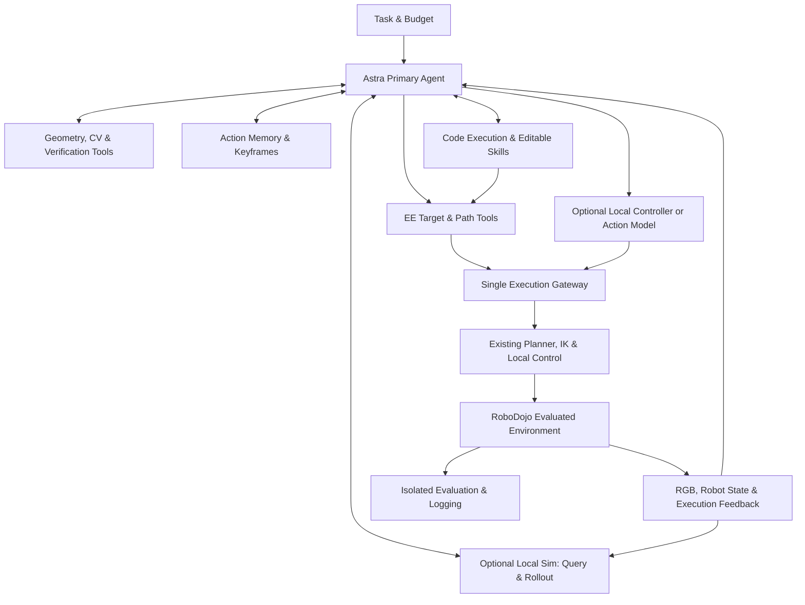
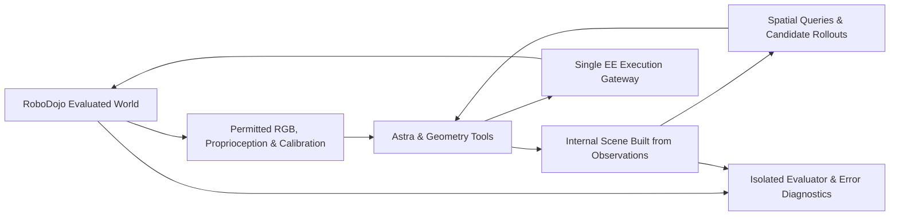

# Astra Embodied Harness: RoboDojo Implementation Plan and Online Simulation Exploration

> This document preserves the initial design conventions established on 2026-09-30 and outlines long-term extension goals. References to "unimplemented" features reflect the state at that time. For the current supported scope, refer to the code registries, capability declarations, tool contracts, and test suites.

Version: v0.3, September 30, 2026. Purpose: Design baseline for Phase 1 development and experimentation. This revision explicitly specifies a persistent native Codex execution window displayed side-by-side with the robot camera view. Interfaces described herein are proposed contracts; literature results are cited from their respective authors without new physical robot runs or reproduced success rates in this document.

**Phase 1 is built entirely on RoboDojo. A single Astra agent continuously retains ownership of task comprehension, observation, action selection, outcome evaluation, and error recovery. All robot actions directly generated by Astra use an end-effector (EE) representation, while inverse kinematics (IK), trajectory timing, and joint-level execution are handled by existing libraries or the simulation backend. The Harness provides rich, composable, and inspectable capabilities while keeping task-level control flow thin.**

Building on this foundation, we introduce an independent research track: incrementally constructing a queryable, testable local simulation scene from camera images and robot states collected during interaction. We first evaluate whether 3D geometric measurement and motion previewing assist Astra before investigating contact-rich trial-and-error rollouts. While this direction has a practical engineering starting point, it does not assume that visual reconstruction immediately yields an accurate physical environment.

This document serves as the current implementation plan, superseding earlier proposals that relied on default weak-model task delegation, fixed control routing, and multi-role pipelines (earlier drafts are retained as research archive material). Established design principles and extensions awaiting empirical validation are detailed separately below.

Companion design specifications that can be dispatched independently:

- [Local Scene and Short-Horizon Simulation Plan](./local-scene-and-rollout.md): Offline inputs, scene construction, spatial queries, Isaac worker, APIs, budgets, and acceptance criteria.
- [Web Workbench and Codex Integration Plan](./web-workbench-and-codex.md): Robot camera views, persistent native Codex terminal, coarse-grained activity nodes, and synchronized replay.
- [Shared Interfaces and Event Protocol v0.1](./shared-protocol.md): Observation bundles, `EEAction`, scene snapshots, identifiers, and event semantics shared across all three modules. In case of any discrepancy in field-level details, the shared protocol governs.

## 1 Established Design Principles

| Dimension | Design Decision |
|---|---|
| Initial Environment | Develop and test exclusively in RoboDojo first to thoroughly establish interfaces, evaluation protocols, and failure diagnostics within a single environment. |
| Decision Maker | A single Astra agent holds the full interaction context and freely selects among observation, measurement, motion, programming, and history inspection tools. |
| Action Representation | Astra outputs EE poses, deltas, or paths along with gripper commands directly; it never manually solves IK or generates per-tick joint values. |
| Continuous Motion | Deterministic routines generate continuous trajectories from sparse EE targets and path constraints; path feasibility, timing, and tracking are delegated to the backend. |
| Fine Manipulation | Geometric motion, local closed-loop control, synthesized programs, and action models are optional capabilities chosen by Astra based on task needs and empirical evidence. |
| Tool Responsibilities | Return raw observations, interpretable geometric computations, and execution receipts; never embed hidden grasp sequences, retry heuristics, or fixed task stages. |
| Action Memory | Centered on pre- and post-action EE states, keyframes, requested trajectories, and actual motion traces, read on demand using flat files and indices first. |
| Visualization | Web workbench featuring a persistent robot view beside a native Codex terminal attached to the same live session; activity nodes and structured inspectors aid navigation via unified IDs linking observations, actions, and media. |
| Skills | Program resources that Astra can create, inspect, invoke, and modify; they never automatically become mandatory pipelines for similar tasks. |
| Outer Loop Control | Manages episodes, budgets, termination, environment faults, and experiment logging while enforcing local execution constraints continuously. |
| Cost Efficiency | First reduce redundant computation, dense action token output, and repeated context; retain Astra for core embodied reasoning. |
| Online Simulation | Provided as an optional toolset and research track; the primary control loop does not depend on pre-building a complete world model. |

Under identical interfaces, the RoboDojo technical report cites an Average Success Rate (SR) of 22.48% for Astra versus 0.88% for GPT-5.5, while Astra's Precision SR remains at 4.00%. Because Average SR weights five capability axes equally, it must not be replaced by a task micro-average. These findings justify establishing a full-capability baseline around Astra while highlighting the remaining gap in precision control; there is no empirical basis for delegating routine scene interpretation or success judgment to weaker models by default. ([RoboDojo Paper Table 1](https://arxiv.org/html/2609.24170v1#S4.T1))

The core hypothesis tested by this plan is whether augmenting Astra's reasoning with geometric measurement, expressive motion primitives, closed-loop execution, and virtual trial-and-error can improve task success rates, reduce wasted interactions, and distill solved problems into reusable programs.

## 2 Overall Architecture and Development Foundation



Edges in the diagram represent available capabilities rather than a mandatory sequential pipeline. Astra may inspect an image and move immediately, or choose to measure geometry, review a prior failure, write a short Python script, or compare candidate actions in simulation.

**The development foundation uses the Codex Python SDK to host Astra's session, tool invocations, and coding capabilities, while embodied capabilities are exposed through a thin tool service.** The SDK controls a local `app-server` over JSON-RPC, eliminating the need to reimplement a bespoke coding agent. Either MCP or a controlled Python client can serve as the robot tool interface backed by the same execution service. Runtime versions, model configurations, and tool schemas are pinned and recorded per run. ([Codex SDK Documentation](https://learn.chatgpt.com/docs/codex-sdk))

We also retain RoboProbe's simple API loop as a reference condition. Integrating Codex, expanding tools, and modifying context represent distinct interventions that must be evaluated separately; results from the new runtime must not be conflated with a direct reproduction of the original benchmark report. ([RoboProbe](https://github.com/RoboProbe/RoboProbe))

Phase 1 custom code focuses on five components: the RoboDojo adapter, EE motion tools, geometric tools, action ledger, and experiment runner. The code execution workspace is strictly isolated from the evaluated environment. The local simulation service is added as a separate module without prematurely building a heavyweight orchestrator, scene-graph platform, or multi-agent framework.

When parallel log analysis, candidate program development, or independent experiments are needed, Astra may delegate work to subagents; however, any evaluated robot session has exactly one action writer at all times. Parallel experiments run in isolated environment instances so multiple agents never contend for the same bimanual robot state.

## 3 Observation Information and Experimental Boundaries

By default, Astra has direct access to raw RGB images, robot proprioception, and execution feedback. Geometric measurements, structured state summaries, and text descriptions serve as supplementary context rather than replacements for raw images; raw frames and visual overlays are stored separately.

Each observation bundle includes at minimum an `observation_id`, simulation time and capture timestamp, multi-camera images, measured joint states, backend-provided gripper fields with provenance metadata, EE poses computed via a documented kinematic chain, and the execution status and tracking residuals of the preceding action. Images and robot states should correspond to the same sampling instant; when strict hardware synchronization is unavailable, the bundle reports sample associations and measurable time offsets so post-motion poses are never used to interpret mid-motion images. Timestamps from unaligned clock domains must never be subtracted directly to estimate sensor latency.

Two experimental conditions must be strictly distinguished:

| Condition | Permitted Inputs and Scope | Reporting Convention |
|---|---|---|
| Original Reference Condition | Provides RGB, proprioception, task instruction, and execution feedback strictly following the pinned RoboProbe protocol, preserving its action space, budget, and context conventions. | Reported as a reference reproduction only after full protocol verification. |
| Calibrated Geometry Condition (This Plan) | Explicitly adds camera intrinsics, distortion parameters, camera extrinsics, and permitted self-robot kinematic/mesh models on top of the reference inputs. | Reported as an enhanced tool or observation condition on RoboDojo, with gains attributed separately. |

**RoboProbe's pinned Lite primary track designates camera calibration as unavailable to the evaluated system, and the inspected EEF reference implementation does not expose intrinsics (`K`) or extrinsics.** Consequently, using calibrated intrinsics and hand-eye extrinsics for projection or triangulation constitutes an explicit condition change that must be disclosed. Even though camera calibration is standard practice on physical robots, results obtained under calibrated conditions must not be claimed as strictly equivalent to the RGB-only reference baseline. Official benchmark submissions must adhere to the specific rules of the target track. ([RoboProbe Benchmark Protocol](https://github.com/RoboProbe/RoboProbe/blob/9ffacc54f372beef6479d61711bf4945e31ae4ce/docs/llm_benchmark_protocol.md))

Under our calibrated condition, camera parameters and the robot URDF represent explicitly provided equipment specifications. Ground-truth poses of manipulated objects, hidden collision meshes, friction coefficients, contact states, layout solutions, and internal reward states remain strictly off-limits to both Astra and its auxiliary tools. Because auxiliary tools are part of the evaluated system, they must never read simulator ground truth behind the scenes and return it to Astra disguised as "computed measurements."

During debugging, simulator ground truth may be used to quantify geometric reconstruction errors, but only within isolated testing or evaluation processes. Any oracle upper-bound experiments must be labeled separately and excluded from primary non-privileged results.

## 4 End-Effector Actions and Continuous Trajectories

### 4.1 Decisions Owned by Astra

The unified model-facing action representation specifies: which arm (or both TCPs) to move, in which coordinate frame, through which target poses, along what path geometry, with what velocity profile and gripper timing, and when to return execution feedback. The Tool Center Point (TCP) refers to a well-defined tool frame and must never conflate the wrist flange origin with the grasp center between the fingers.

Every motion starts from the robot's current measured feedback state. While Astra may reference a specific `observation_id`, it cannot invent an arbitrary starting pose and instruct the controller to treat it as the current state. If the robot state has drifted by the time an action is submitted, the execution gateway either rejects the stale request or replans within explicitly permitted tolerances.

The following table outlines the core motion tool family (representing available capabilities rather than a rigid sequence of calls):

| Tool Capability | Input and Behavior |
|---|---|
| `motion.move_ee` | Single-arm or bimanual EE targets, explicitly selecting either backend free-space planning or linear Cartesian motion. |
| `motion.follow_ee_path` | Multi-waypoint paths, linear segments, circular arcs, or smooth curves with configurable pose interpolation, tolerances, speed profile, and stop/blend behavior. |
| `motion.preview` | Optionally validates or projects a candidate path, returning kinematic reachability, checked geometric clearance, and estimated duration. |
| `motion.status` | Queries live execution progress and measured state for an in-flight action. |
| `motion.cancel` | Requests backend motion termination and reports actual stopping progress; never assumes the robot is stationary before stop confirmation. |
| `gripper.command` | Specifies target arm, aperture in meters or normalized units, and whether execution is standalone or synchronized with arm motion. |

Internally, quantities are stored in meters, seconds, and unambiguous rotation representations—specifically `SE(3)` poses with normalized `xyzw` quaternions. Model-facing tools may continue to accept RoboProbe's ergonomic orientation angles via a unified conversion layer, taking care not to confuse its custom pitch/roll/yaw and top-down grasp conventions with standard Euler angle sequences in third-party libraries. Relative delta actions must also specify whether translations apply along world axes or tool-local axes, and whether rotations are left- or right-multiplied.

Bimanual trajectories share a unified time base and check inter-arm clearance; individual arm reachability does not imply joint bimanual feasibility. Behavior for unspecified degrees of freedom or idle arms must be explicitly documented and bound to the referenced observation.

### 4.2 Division of Labor Between Interpolation and IK

**By default, we reuse the motion backend provided by RoboDojo or integrated planning libraries.** RoboProbe's EEF reference already implements grasp-center-to-flange frame transforms, CuRobo motion planning, and native joint trajectory playback. We first verify and reuse this pipeline before adding missing Cartesian path primitives, avoiding the overhead of a full ROS stack in Phase 1. ([EEF Reference Implementation](https://github.com/RoboProbe/RoboProbe/tree/main/policy/RoboDojo_Agent_L3_Inspect_EEF))

| Path Geometry | Generation Method | Required Semantic Guarantees |
|---|---|---|
| Linear | Linear position interpolation with fixed orientation or `SO(3)` SLERP, solved for feasible joint motion along the entire segment. | Terminal IK feasibility does not guarantee linear path feasibility; infeasibility must return a specific diagnostic reason. |
| Polyline | Sequence of linear segments. | Either comes to a full stop at via-points or applies an explicitly requested blend radius. |
| Circular Arc | Defined by center or three arc points paired with an orientation evolution rule. | Direction, arc length, and valid geometric domain are explicitly specified. |
| General Curve | Parametric curve or spline distinguishing mandatory via-points from control points. | Re-verifies maximum EE path deviation after smoothing; spline control points are generally not exact via-points. |
| Free-Space Path | Backend planner searches for a collision-free path to the goal under constraints. | Represents path freedom explicitly granted by Astra; must never silently substitute for a rejected linear path request. |

Inverse kinematics, velocity limits, joint continuity, time parameterization, and trajectory tracking are handled by the execution backend. Astra receives actionable diagnostics—such as `unreachable`, `path_infeasible`, or `tracking_error`—and decides whether to adjust grasp orientation, modify the path, or acquire a new viewpoint, without micromanaging solver iterations.

MoveIt/Pilz serves as a mature reference for industrial linear, circular (`CIRC`), and sequence blending motions if the current backend lacks them. Ruckig is well-suited for state-to-state jerk-limited online trajectory generation (note that intermediate waypoints in Ruckig Community involve cloud boundary considerations and do not handle IK or obstacle geometry). TOPP-RA is effective for time-parameterizing fixed geometric paths without obstacle avoidance. These libraries do not need to be chained into every single motion call by default. ([Pilz](https://moveit.picknik.ai/main/doc/how_to_guides/pilz_industrial_motion_planner/pilz_industrial_motion_planner.html), [Ruckig](https://github.com/pantor/ruckig), [TOPP-RA](https://hungpham2511.github.io/toppra/index.html))

### 4.3 Execution Feedback and Control Ownership

Every action request carries an `action_id`, `episode_id`, referenced `observation_id`, tool version, timeout, and motion parameters. Execution receipts distinguish among `accepted`, `running`, `completed`, `rejected`, `cancelled`, and `status_unknown`, reporting actual terminal poses, positional and rotational residuals, executed step intervals, and the resulting `observation_id`. On timeout, the caller queries the original action status rather than blindly resending and causing duplicate physical motion.

Completing a trajectory only confirms that the motor execution finished. Whether an object was securely grasped, stably placed, or satisfied the task goal remains Astra's judgment based on observable evidence, while official task success is computed by the isolated RoboDojo evaluator. An agent's self-reported completion never overrides the environment evaluator.

All synthesized programs and external action models submit commands through the same single execution gateway. Handing over control requires stopping active motion, clearing pending queues, and confirming a safe takeover state. Joint limits, velocity caps, and emergency stop mechanisms remain active at all times as physical execution invariants rather than task-specific heuristics.

### 4.4 Boundaries to Preserve and Extend in the Existing Adapter

The current EEF reference targets the bimanual ARX X5 robot, operating via per-arm planning, bimanual trajectory time alignment, sequential arm execution, and subsequent gripper execution. Time alignment alone does not guarantee joint bimanual collision avoidance, nor does the default planning scene capture all dynamic task objects, held items, or unmodeled obstacles. Arbitrary Cartesian curves, continuous simultaneous gripper-arm coordination, mid-trajectory cancellation, and streaming progress feedback require explicit verification and extension beyond the baseline adapter. ([EEF Execution Source](https://github.com/RoboProbe/RoboProbe/blob/9ffacc54f372beef6479d61711bf4945e31ae4ce/policy/RoboDojo_Agent_L3_Inspect_EEF/policy.py))

In this environment version, `<arm>_ee_joint_state` reflects the clamped prior gripper command rather than true finger position or tactile contact sensing. While the adapter caches the last requested gripper goal to maintain grasp holding, the action ledger must record the requested goal, dispatched command, and measured feedback separately—never feeding a command echo back as if it were a physical sensor reading. Astra must verify grasp success through permitted visual and proprioceptive observations. ([Gripper Control](https://github.com/RoboDojo-Benchmark/RoboDojo/blob/726e9aabfaa642203722eb126f5eaf0f37f3e1ad/env/robot_manager/control_manager.py), [Observation Field Provenance](https://github.com/RoboDojo-Benchmark/RoboDojo/blob/726e9aabfaa642203722eb126f5eaf0f37f3e1ad/env/observation_manager/obs_manager.py))

## 5 Classical Geometry and Computer Vision Toolbox

We prioritize tools that enable Astra to formulate and test geometric hypotheses explicitly. Every tool response includes the computed result, input provenance, coordinate frame and physical units, conditioning assumptions, and actual residuals or degeneracy flags—never fabricating uncalibrated scalar confidence scores.

| Capability and Candidate Implementation | Returned Information | Preconditions and Limitations |
|---|---|---|
| Forward Kinematics (FK) & Frame Transforms (Backend or Pinocchio) | Relative poses and residuals between EE, cameras, and robot base. | Requires robot kinematic model, mounting extrinsics, and sampling timestamp; target pose is distinct from measured pose. |
| Pixel Ray Back-Projection (OpenCV `undistortPoints`) | Camera optical center and unit ray direction in the world frame. | Requires valid intrinsics `K`, distortion coefficients, and extrinsics; metric depth remains undetermined along the ray. |
| Ray-Plane Intersection (Analytical Geometry) | 3D intersection point and incidence angle under an explicit plane hypothesis. | The target pixel must physically lie on the specified plane; ill-conditioned near grazing incidence. |
| Trajectory & Tool Projection (OpenCV `projectPoints`) | Image overlay showing current EE, candidate targets, coordinate axes, and paths. | 2D visual alignment in a single view does not prove metric depth accuracy; raw image is preserved alongside the overlay. |
| Sparse Point Tracking (Lucas-Kanade Optical Flow or Feature Matching) | Pixel displacements, matched correspondences, and tracking residuals. | Degrades under occlusion, motion blur, or repetitive textures; does not automatically infer semantic object identity. |
| Multi-View Triangulation (OpenCV `triangulatePoints`) | 3D metric points, parallax angle, reprojection error, and degeneracy diagnostics. | Requires corresponding physical points across views, sufficient translational baseline, and static scene points when moving a single camera. |
| Contour & Primitive Fitting (OpenCV) | Fitted lines, circles, principal axes, centroids, pixel scales, and fitting residuals. | Provides 2D geometric cues without automatically dictating a 3D grasp pose. |
| Known-Geometry Pose Estimation (PnP or AprilTag) | Candidate `SE(3)` poses, inlier counts, and reprojection residuals. | Requires known metric object dimensions and 2D-3D correspondences; fiducial markers constitute an altered experimental condition. |
| Plane & Surface Measurement (Open3D) | Surface normals, plane equations, point-to-surface distances, and bounded support polygons. | Requires valid metric point clouds; unobserved regions remain explicitly marked as unknown. |
| Collision & Distance Queries (FCL or Motion Backend) | Minimum distances and contact locations for specified geometries along a path. | Valid only for explicitly modeled geometry; must declare whether checking is discrete or continuous. |

Phase 1 implements the first six capabilities, unlocking the remaining four as input conditions and experimental needs warrant, without making heavy perception models or dense 3D reconstruction a prerequisite for basic motion. Mathematical implementations draw upon [OpenCV Camera Calibration and 3D Reconstruction](https://docs.opencv.org/4.13.0/d9/d0c/group__calib3d.html), [Lucas-Kanade Optical Flow](https://docs.opencv.org/4.13.0/d4/dee/tutorial_optical_flow.html), [Open3D Raycasting](https://www.open3d.org/docs/release/python_api/open3d.t.geometry.RaycastingScene.html), and [FCL](https://github.com/flexible-collision-library/fcl).

For example, an undistorted pixel defines a 3D ray $X(\lambda) = C + \lambda d$. If Astra explicitly hypothesizes that the point lies on a plane $n^\top X + b = 0$, the tool computes $\lambda = -(n^\top C + b) / (n^\top d)$ and returns the 3D coordinate alongside the conditioning plane assumption—preventing silent errors such as intersecting a cup rim pixel with the tabletop plane. When no depth constraint is supplied, returning the ray itself is the complete and exact geometric answer.

Verification tools follow the same philosophy: reporting measured EE tracking errors, before-and-after feature displacements, gripper aperture readings, geometric clearances, and visual diffs. Satisfying a numerical threshold never automatically declares task success; synthesizing these pieces of evidence remains Astra's responsibility.

## 6 Role of Action Models and Local Controllers

While large free-space motions are naturally expressed as EE paths, we avoid rigid routing rules such as "always use scripted paths for coarse motion and VLA models for fine manipulation." Visual servoing over known geometric features can solve many precision alignment tasks, whereas a validated learned policy may excel in complex contact dynamics. Selecting between them requires empirical evidence on the target robot embodiment, camera setup, and task domain.

Each optional policy backend exposes a concise capability card documenting its required observations, robot embodiment, native action space, benchmarked task success counts and trial counts, typical failure modes, inference latency, prediction horizon, safe execution horizon, and stopping/takeover semantics. Astra consults these factual specifications to decide whether to invoke a policy, without an opaque router model making the decision behind the scenes.

Policy invocation can separate `policy.propose` from `policy.execute_prefix`, allowing Astra to inspect or preview candidate trajectory chunks before committing to a bounded execution horizon, or to configure bounded execution directly for validated policies. Inference call counts, executed physical steps, and termination triggers are logged in full. ([openpi Remote Inference Interface](https://github.com/Physical-Intelligence/openpi/blob/main/docs/remote_inference.md))

**Actions authored directly by Astra strictly adhere to the EE standard.** If an external learned policy natively outputs joint-space action chunks, the adapter executes its native format and logs the policy as the action generator—never running FK followed by re-solving IK on a joint chunk and claiming behavioral equivalence. If a future protocol requires strictly unified EE execution across all policies, we will either select EE-native policies or benchmark the conversion loss independently.

Phase 1 establishes a strong baseline without external action models first, integrating a matched policy backend only to address demonstrated capability gaps. Any performance gains from adding an action model must be isolated via controlled ablation rather than cherry-picking successful hybrid rollouts.

## 7 Programmable Execution and Skill Accumulation

Within its isolated workspace, Astra can write Python code that reads permitted observations and action logs, invokes geometric and EE motion APIs, and implements local closed-loop feedback routines. Tool documentation specifies input/output schemas, physical units, error codes, and concise examples without pre-scripting task-specific solutions.

Generated programs may incorporate loops, sensor feedback, and parameter search. High-frequency control loops read the latest local state and invoke compiled/native motion interfaces directly rather than making round-trip LLM inference calls at every step. Because standard Python scripts lack hard real-time guarantees, actual loop rates, feedback latencies, and timeouts are measured and reported; tight timing constraints are delegated to underlying native controllers configured by the script.

A newly successful program is initially saved as a candidate skill alongside its preconditions and a ledger of successful and failed runs. Before reusing a skill on a new episode, the agent must re-estimate scene-specific parameters rather than replaying hardcoded absolute coordinates from a previous layout. Promoting a candidate to the standard skill library requires validation on held-out layouts and existing tasks, and Astra always retains the freedom to bypass or edit any skill.

The skill registry requires only a clear specification, executable code, parameter schema, version tag, and auditable trial history—no autonomous "skill manager" persona is needed. While development layouts may be iterated on freely, frozen evaluation splits are never used to tune code, and evaluation reports account for both initial skill development costs and subsequent execution costs.

## 8 Concise Action Memory

Each executed action appends an entry to a structured index centered on pre- and post-action EE poses, trajectories, and visual keyframes. Joint configurations (`q`), gripper states, timestamps, and provenance metadata are recorded to diagnose tracking discrepancies without introducing a heavyweight memory-management subsystem.

| Record Field | Minimum Content |
|---|---|
| Provenance | Tool, program, or policy name, version, parameters, and the conditioning `observation_id`. |
| Pre-Action State | Timestamp, measured `q`, FK-derived EE pose, gripper target and available feedback fields with provenance, and per-camera keyframe references. |
| Request & Plan | Astra's requested EE targets or path spec, plus references to planner or policy output artifacts. |
| Dispatch & Feedback | Dispatched commands with sampling timestamps, linked to separately stored measured feedback trajectories. |
| Post-Action State | Post-motion state and keyframes, executed interval, terminal tracking residuals, and any anomaly flags. |
| Astra Notes | Optional agent hypotheses and next-step notes, stored strictly separate from objective sensor measurements. |

Planned paths, dispatched command schedules, and measured feedback traces are stored as three distinct records. EE poses computed via forward kinematics from measured joint angles carry explicit provenance (`fk_from_measurement`), ensuring that command return values are never mistaken for physical sensor measurements.

Storage relies on `actions.jsonl`, image artifacts, and timestamped trajectory arrays, with robot kinematics, camera calibration, and frame conventions recorded once per episode manifest. By default, pre- and post-action keyframes are saved, supplemented by intermediate frames on anomalies, interruptions, or explicit agent requests, while dense video is recorded on demand.

Exposing `history.list_actions`, `history.read_action`, `history.view_observation`, and `history.read_trace` gives Astra complete access to prior evidence. The default prompt context retains current raw images, recent execution receipts, and a compact action index while keeping full historical artifacts retrievable on demand—never trapping the agent behind lossy, irreversible text summaries.

When internal simulation rollouts are enabled, every record is tagged with `observed_world` or `internal_simulation` so virtual rollout frames and simulated outcomes are never confused with events in the evaluated environment.

## 9 Feasibility Scope for Online Simulation Mapping

**Constructing a task-scoped local approximate scene online is a high-value research direction.** Its goal is to help Astra measure 3D spatial relationships, compare candidate action plans, filter out kinematically or geometrically infeasible motions, and conduct short-horizon physical rollouts where supported by observational evidence. Phase 1 neither requires photorealistic room-scale rendering nor expects full physical parameter identification from a single initial glance.

Operating "without a pre-supplied environment model" means the agent is not given ground-truth CAD meshes, object poses, or physical material properties of the task scene in advance. The system legitimately relies on known self-robot kinematics, disclosed camera calibration, a physics engine, and approximate scene geometry reconstructed from live observations. Unobserved object backsides, masses, friction coefficients, and joint damping never become "known facts" merely because default values were instantiated in a simulator.

| Simulation Use Case | Phase 1 Feasibility | Required Modeling Accuracy |
|---|---|---|
| 3D Spatial Queries & Memory | High Priority | Task-relevant support surfaces, object locations, and coordinate frame alignment within task tolerances. |
| Free-Space Approach & Path Preview | High Priority | Reliable robot kinematics, obstacle envelopes, and held-object volumes, with safety margins for occluded regions. |
| Rigid-Body Grasp & Place Comparison | Conditional | Accurate local contact geometry and gripper kinematics; grasp stability hypotheses require independent verification. |
| Short-Horizon Push & Drawer Rollouts | Phase 2 Research | Requires plausible bounds on friction, mass, hinge/prismatic joint axes, and controller timing. |
| Tight-Tolerance Insertion, Deformables, Liquids & High-Speed Impacts | Out of Scope for Phase 1 | Contact compliance, deformation, fluid dynamics, and high-rate control dynamics cannot be reliably identified from sparse RGB video alone. |

These tiers represent engineering scope boundaries rather than claimed benchmark scores. Visual appearance, collision geometry, and multibody dynamics have distinct accuracy requirements: a visually convincing mesh may have incorrect wall thickness, sealed internal holes, or misaligned joint axes, whereas a coarse bounding box proxy is often sufficient to rule out a table collision.

### 9.1 Reference Context and Evidence Boundaries from HomeBody

Stanford's HomeBody demonstrates a Unitree G1 humanoid invoking skills backed by spatial memory: the authors collect images, LiDAR SLAM maps, joint states, and waypoints during autonomous exploration to build an Isaac Sim scene aligned via localization and ICP, supplemented by RealSense D435i stereo depth for grasping. While HomeBody supports the broader premise that spatial scene models aid deployment reasoning, it relies on LiDAR and RGB-D sensing and therefore does not constitute evidence that pure monocular RGB physical reconstruction is solved. ([HomeBody Project Page](https://tml.stanford.edu/homebody/))

Furthermore, the publicly documented HomeBody workflow follows a staged explore-reconstruct-execute pipeline without demonstrating continuous online scene updating, dynamic object synchronization, or multi-candidate physical trial-and-error rollouts during manipulation. At the time of review, its repository lists code as forthcoming, and the interactive "twin cleanup" on the project website is a pre-baked animation playback rather than an online planning experiment. ([Official Repository](https://github.com/Stanford-TML/homebody/tree/77d2c333fe0adc12ed35172fe086b382bcd5772b), [Web Playback Script](https://github.com/Stanford-TML/homebody/blob/77d2c333fe0adc12ed35172fe086b382bcd5772b/docs/scripts/site.js))

Accordingly, our design for continuous in-task scene updating, branched simulation rollouts, and residual-driven recalibration represents a novel research investigation within this project.

## 10 Recovering Metric Geometry from Cameras Alone

Lacking LiDAR does not mean lacking 3D metric observability. Recovering metric geometry depends on the number of cameras, camera mobility, effective baseline length, calibration accuracy, scene staticity, and available planar or dimensional priors.

| Camera Configuration | Viable Geometric Reconstruction Paths | Primary Physical Limitations |
|---|---|---|
| Single Fixed RGB Camera | Ray back-projection, intersection with known planes, or PnP with known object dimensions. | Metric depth along an arbitrary pixel ray is unobservable; moving the robot arm does not create new camera viewpoints. |
| Movable Wrist-Mounted RGB Camera | Metric camera poses via hand-eye calibration and robot FK, enabling multi-view feature matching and triangulation. | Requires sufficient translational parallax (pure rotation yields zero baseline); moving target objects or false matches corrupt triangulation. |
| Two or More Fixed/Movable RGB Cameras | Stereo or multi-view triangulation across overlapping fields of view using known relative extrinsics. | Requires cross-view correspondence, temporal synchronization, unobstructed visibility, and shared workspace overlap. |
| RGB + IMU | Visual-inertial odometry (VIO) to estimate camera motion and metric scale. | Requires IMU-camera calibration, tight synchronization, and sufficient inertial excitation; prone to drift in low-texture scenes. |
| RGB-D or Stereo Depth Camera | Direct metric depth or disparity maps after quality filtering. | Avoids LiDAR, but introduces an explicit depth input modality that must be reported as a distinct experimental condition. |

RoboDojo's multi-view and wrist-mounted cameras provide a natural starting point, though having multiple cameras does not guarantee overlapping visibility of every task feature. Tools first check whether target regions lie within shared fields of view; when overlap is insufficient, Astra decides whether to actively reposition a wrist camera rather than executing a hardcoded exploratory scan at the start of every episode.

For a wrist-mounted camera, where $T_{A\_B}$ denotes the rigid transform from frame $B$ to frame $A$, the camera pose in the world frame at time $t$ is given by the calibrated kinematic chain:
$$T_{\text{world\_camera}}(t) = T_{\text{world\_base}} \times \text{FK}(q(t)) \times T_{\text{link\_camera}}$$
This kinematic chain supplies a true metric baseline, whereas uncalibrated monocular structure-from-motion suffers from scale ambiguity. Exposure timing, rolling shutter effects, kinematic modeling errors, and extrinsic mounting tolerances all bound the achievable reconstruction accuracy. ([OpenCV Camera Calibration and 3D Reconstruction](https://docs.opencv.org/4.13.0/d9/d0c/group__calib3d.html))

An idealized first-order error propagation illustrates how viewpoint geometry governs depth uncertainty. For a horizontal stereo pair with focal length $f$, baseline $B$, and disparity $d$, depth is $Z = fB / d$, yielding a depth standard deviation of:
$$\sigma_Z \approx \frac{Z^2 \sigma_d}{f B}$$
Assuming $f = 600\text{ px}$ and a disparity error $\sigma_d = 1\text{ px}$: at range $Z = 0.5\text{ m}$ with baseline $B = 8\text{ cm}$, depth uncertainty is approximately $5.2\text{ mm}$; at range $Z = 1.0\text{ m}$ with a short baseline $B = 2\text{ cm}$, uncertainty balloons to roughly $83\text{ mm}$. **This analytical example illustrates geometric conditioning rather than measured system accuracy** (and omits extrinsic calibration errors), demonstrating why a small-baseline view with low 2D reprojection error can still suffer from severe depth error along the viewing ray.

Consequently, Phase 1 focuses on calibrated movable/multi-view cameras combined with sparse multi-view geometry and simple bounding primitives, reserving single fixed-RGB manipulation as a harder standalone track. Learned monocular depth, segmentation, and 3D reconstruction models may be added later as optional tools whose outputs are explicitly tagged as model estimates without replacing Astra's scene reasoning.

## 11 Constructing and Updating the Local Simulation Scene

### 11.1 Minimal Task-Relevant Scene Representation

The local scene manifest stores only task-relevant entities: known robot kinematics and cameras, static support surfaces and obstacles, a small set of manipulable objects, explicitly tracked unknown/occluded regions, and their source keyframes. Manipulable objects are initially represented using analytic primitives (boxes, cylinders), convex hulls, or verified local surface meshes.

Each entity maintains a stable ID, geometry, pose, source observation references, last-updated timestamp, and an explicit breakdown of which dimensions are observationally constrained versus provisionally assumed. Unquantified uncertainties are marked `unquantified`, while modeled uncertainties store intervals or parameter ensembles. Semantic labels are proposed or confirmed by Astra; low-level geometric fitting routines never autonomously label the largest plane as "tabletop" or designate a contour as an "optimal grasp point."

Physical parameters—such as mass intervals, friction ranges, and revolute or prismatic joint axes—are stored in dedicated hypothesis fields where defaults clearly denote provisional simulation values. Occluded object backsides may be bounded by conservative collision volumes while retaining an `unknown` visibility tag so extrapolated geometry is never mistaken for observed surface data.

### 11.2 Grounding Alignment in Metric Measurements and Residual Checks

Tabletop manipulation anchors all coordinate frames—cameras, EE poses, triangulated points, and the internal simulation scene—to the fixed robot base frame (re-anchoring if a mobile base moves). All frame transforms are versioned, and every reconstructed geometric primitive traces back to its source image frames and measured joint configurations `q`.

Scene alignment is validated using visual projection overlays, held-out multi-view reprojection residuals, known robot self-geometry, planar fitting residuals, and known calibration fixtures where permitted—never relying solely on Astra's subjective visual impression that two rendered images "look similar." While Iterative Closest Point (ICP) can refine alignment between two existing 3D surfaces given a good initial guess and sufficient overlap, it cannot recover missing metric scale from uncalibrated monocular vision.

After any physical action that could alter the environment, affected spatial regions are marked stale until re-observed. Static background structures may be fused incrementally over time, whereas movable objects are tracked individually; once an object is moved, its prior footprint must be cleared rather than left behind as a phantom static obstacle. Similarly, an object grasped by the gripper is never permanently welded to the TCP unless supported by ongoing visual or proprioceptive grasp evidence, since in-hand slip or drop invalidates rigid attachment assumptions.

"Online scene updating" is implemented as asynchronous incremental observation processing so that heavyweight geometric fitting never blocks the primary EE control loop. Astra can query the latest committed `scene_version` and its staleness lag, or act directly on raw current observations and request targeted new viewpoints whenever the scene model is insufficient.

### 11.3 Exposing Simulation Tools to Astra

| Proposed Tool Interface | Capability and Returned Information |
|---|---|
| `scene.update` | Updates scene geometry from specified observations, returning committed diffs, supporting evidence, and conflicts while separating measured dimensions from provisional assumptions. |
| `scene.query` | Evaluates ray intersections, clearances, surface normals, gaps, visibility, and relative object poses against an explicit `scene_version`. |
| `sim.fork` | Creates a disposable simulation branch from an immutable internal scene snapshot without copying hidden ground-truth state from the evaluated world. |
| `sim.rollout` | Executes a bounded trial of an `EEAction` or candidate program on an internal branch, returning rendered media, trajectories, contact events, and requested metric measurements. |
| `sim.compare` | Evaluates multiple candidate actions across identical scene snapshots and parameter ensembles, returning comparative metrics without dictating the final policy choice. |
| `scene.check_alignment` | Projects the current internal scene model onto observed camera frames, reporting per-view reprojection residuals and unmodeled regions. |

These tools are independently callable: Astra decides when a motion warrants virtual previewing, which candidates to compare, whether the scene model requires revision, and which action to finally submit to the real execution gateway. Scene construction scripts and generated geometric assets live in the same versioned workspace, supporting inspection and rollback.

### 11.4 Making Trial-and-Error Robust to Modeling Error

Simulation is used first to filter out geometrically infeasible or collision-prone motions before attempting to rank subtle contact outcomes. When object mass, friction, exact pose, or contact compliance are uncertain, short rollouts can be repeated across a structured ensemble of plausible parameter hypotheses to surface success conditions, failure modes, and parameter sensitivity.

Because a discrete parameter ensemble is not a calibrated probability distribution over reality, "8 out of 10 parameter hypotheses succeeded" must be reported strictly as passing 8 of 10 test conditions—not as an "80% real-world success probability." If the relative ranking between candidate actions A and B flips frequently across plausible parameter perturbations, the simulator is signaling that current scene uncertainty is too high to discriminate between them reliably.

Physical execution therefore follows a short-horizon commitment strategy: execute a bounded, observable motion segment in the evaluated environment, compare actual sensor feedback against simulated predictions, and let Astra decide whether to continue, adjust the motion, or update the scene model. Simulated rollout completion never marks a task as completed in the evaluated environment.

Consider pushing a block into a target zone: Astra can first measure the tabletop, block, and nearby obstacles, then compare several candidate EE pushing trajectories in simulation. If simulated block displacement varies wildly across plausible friction coefficients, Astra can execute a short diagnostic nudge in the evaluated environment, observe the actual displacement to narrow the friction range, and then complete the push—retaining full closed-loop adaptability even when the initial simulation is coarse. This example illustrates one optional capability pattern rather than a mandatory script for pushing tasks.

## 12 Selecting Simulation and Reconstruction Components

References to NVIDIA Isaac in this architecture specifically denote **Isaac Sim**'s scene description, rendering, and multibody physics capabilities (whereas Isaac Lab targets reinforcement learning workflows rather than reconstructing interactive worlds from live RGB observations).

**RoboDojo remains the primary evaluated environment, while internal simulation reuses an isolated scene or worker process built on the exact same Isaac Sim version stack to avoid maintaining two disparate robot adapters.** The internal worker loads only permitted self-robot assets and observationally reconstructed geometry—never loading the ground-truth task USD stage as a shortcut. Because isolating USD stages, physics clocks, and reset states within a single process requires careful verification, Phase 1 isolates the internal simulator in a dedicated OS process for clean auditability.

| System Requirement | Phase 1 Baseline Choice | Criteria for Future Expansion |
|---|---|---|
| Coordinate Transforms, Projection, Sparse Matching & Triangulation | Existing FK, OpenCV, and analytical geometry. | Establish exact provenance, metric scale, and residual reporting first. |
| Local Point Clouds & Simple Primitives | Open3D for plane/box fitting and local surface queries. | Upgrade to denser surface reconstruction only when sparse primitives limit query accuracy. |
| Internal Scene & Short-Horizon Rigid-Body Rollouts | Isolated Isaac Sim worker matched to RoboDojo's version. | Verify programmatic asset creation, collision approximations, deterministic resets, and offscreen rendering. |
| High-Throughput Simple Rigid-Body Rollouts | Benchmark existing Isaac Sim worker overhead first. | Evaluate a secondary backend (e.g., MuJoCo) only if Isaac stepping becomes a proven bottleneck and cross-engine adapter discrepancy is acceptable. |
| Dense TSDF or ESDF Mapping | Not a Phase 1 dependency. | Consider `nvblox` only when calibrated depth maps and continuous camera poses are available. |
| 6-DoF Unknown Object Pose Tracking | Start with task-relevant local geometric primitives. | Evaluate tools like `FoundationPose` only under experimental tracks that provide required RGB-D and mesh inputs. |

While Isaac Sim provides programmatic USD stage creation and articulation control APIs, visual reconstruction, cross-frame object association, uncertainty tracking, and physical parameter identification must be implemented by our service. Visual meshes, collision approximations, rigid-body properties, and joint constraints require distinct definitions—for instance, a default convex-hull collider will seal open holes in a visual mesh and cause false collision predictions during insertion tasks. Furthermore, standard `nvblox` pipelines require depth inputs alongside camera poses and intrinsics, and standard `FoundationPose` demos rely on RGB-D inputs; neither can be treated as a drop-in solution for monocular RGB scenes. ([Isaac Sim Physics Fundamentals](https://docs.isaacsim.omniverse.nvidia.com/latest/physics/simulation_fundamentals.html), [nvblox Interface](https://nvidia-isaac.github.io/nvblox/v0.0.10/pages/core_library_interface.html), [FoundationPose Demo Source](https://github.com/NVlabs/FoundationPose/blob/main/run_demo.py))

Similarly, CuRobo versions must not be conflated: while recent cuRobo V2 documentation describes built-in depth fusion for ESDF/TSDF collision worlds, RoboDojo pins a specific CuRobo fork that does not necessarily expose V2 APIs. Phase 1 stays on the compatible pinned motion backend rather than upgrading the entire motion stack prematurely. ([cuRoboV2 Technical Reports](https://nvlabs.github.io/curobo/latest/technical_reports.html))

Sharing the same underlying physics engine between the evaluated world and internal worker minimizes engineering friction, though it makes simulated rollouts optimistic with respect to cross-engine model mismatch, real camera noise, and physical actuator dynamics. Transferring to physical hardware later will require re-validating these factors independently.

## 13 Validating Online Simulation Starting from RoboDojo

We validate the online simulation loop using a strict two-world privilege separation:



In our experiments, the RoboDojo evaluated world stands in for external physical reality. Astra and its auxiliary services are strictly forbidden from copying the evaluated world's scene graph, ground-truth object meshes, exact poses, physical material properties, or random-seed layout tables, as well as from bypassing observation boundaries via filesystem inspection, process memory, or scene generation scripts. Because the agent has a programmable Python workspace, filtering tool return payloads alone is insufficient—the coding sandbox and environment processes must be isolated at the OS/filesystem level so the internal scene is constructed exclusively from permitted observations and disclosed priors.

During development, an isolated evaluator process may inspect ground truth to quantify geometric reconstruction and rollout prediction errors, but these diagnostic metrics are never fed back to the actor during an active evaluation episode. Algorithm tuning must be performed on designated development layouts before running frozen evaluation benchmarks.

### 13.1 Controlled Ablations to Isolate Component Contributions

| Condition | Enabled Capabilities | Research Question Answered |
|---|---|---|
| `R0` | Pinned original reference loop. | Does the baseline environment and reference toolchain reproduce expected behavior? |
| `R1` | Astra agent + expressive EE paths, Python execution workspace, and concise action memory under original observation boundaries. | Do richer motion primitives, programmability, and action memory improve manipulation on their own? |
| `R2` | `R1` + explicitly disclosed camera calibration and classical geometric/CV tools. | Does metric 3D measurement and visual projection improve decision-making? |
| `R3` | `R2` + persistent local scene construction and spatial queries (without physics rollouts). | Does accumulating a 3D spatial memory provide gains beyond single-step geometric queries? |
| `R4` | `R3` + multi-candidate short-horizon physics rollouts and parameter perturbation ensembles. | Do physical trial-and-error rollouts provide net gains over static spatial queries within the same budget? |
| `R5` | Augments the corresponding condition with a matched external action model. | Which specific manipulation bottlenecks are resolved by a learned visuomotor policy? |

Within `R1`, history inspection and Python code execution can be ablated individually to avoid attributing bundle-wide improvements to a single feature. Similarly, `R2` explicitly isolates the effect of disclosing camera calibration. Running `R3` and `R4` under identical observation streams cleanly isolates the incremental value of physical rollouts.

Adding an `oracle_scene` diagnostic condition—where the internal simulator is initialized with ground-truth object geometry and poses—helps disentangle reconstruction errors ("the scene map was inaccurate") from decision/control errors ("even with a perfect map, the chosen action failed"). This diagnostic condition is excluded from non-privileged primary results and is not treated as a theoretical 100% ceiling given remaining controller and kinematic constraints.

### 13.2 Benchmark Tasks and Resource Budgets

We recommend starting with 3 representative tasks for end-to-end interface smoke testing, then locking a balanced development subset spanning grasping, spatial alignment, planar pushing, stacking, precision insertion, and history-dependent sequences—such as `general_pickup`, `align_blocks`, `push_T`, `build_tower`, `insert_tubes`, and `imitate_sorting_sequence` (exact task names and layout indices follow the pinned RoboDojo commit).

A practical initial evaluation scale is 10 layouts per task category with 3 repeats per layout, totaling 180 episodes per experimental condition. This serves as a structured starting point rather than a universal guarantee of statistical power; if compute budgets are tight, preliminary screening can use a smaller subset before sizing formal comparisons based on observed variance. Evaluation sets must retain challenging layouts where the baseline struggles rather than filtering solely for layouts where the baseline already succeeds.

All comparisons lock the LLM model, reasoning effort, camera configuration, initial layout seeds, environment step limits, maximum LLM turns, wall-clock timeout, and per-episode cost ceiling. For simulation conditions, we additionally log internal rollout counts, GPU compute time, and scene reconstruction latency; virtual rollouts are charged against the overall computational and wall-clock budget rather than treated as free interactions.

Experiments must explicitly specify and hold constant the world-clock policy—whether the evaluated RoboDojo physics clock pauses or continues ticking while Astra reasons, writes code, or runs internal rollouts (which critically affects dynamic tasks). Both simulated time and wall-clock time are logged, and results obtained under a paused-world protocol are never claimed as real-time deployment proof.

## 14 Evaluation Metrics and Completion Criteria

### 14.1 Primary Control Loop Metrics

We report first-attempt success rate, full-budget success rate, progressive rubric `Score`, and per-task success/trial counts, alongside the official benchmark aggregation methodology. Failure analyses categorize episodes into at least semantic misinterpretation, spatial measurement error, path/IK infeasibility, trajectory tracking error, contact/slip failure, budget timeout, and unknown status (assigned via post-hoc audit rather than hardcoded online routing).

Cost and latency accounting covers LLM inference, tool execution, scene reconstruction, internal rollouts, failed retries, and environment resets across **all** episodes—never restricting cost averages to successful episodes alone. Because "cost per successful episode" is undefined when success count is zero, reports always state total expenditure alongside zero-success outcomes. Skill development costs are reported both as upfront overhead and amortized across subsequent evaluation runs.

Paired per-layout outcome diffs, sample sizes, and uncertainty intervals are reported alongside separate frequency measurements for tool invocations, local Python control loops, and high-level Astra reasoning turns.

### 14.2 Local Scene and Rollout Evaluation Metrics

| Evaluation Layer | Quantified Metrics |
|---|---|
| Geometric Accuracy | Task-relevant object position, dimension, and support-plane errors, unmodeled occlusion ratios, and held-out view reprojection residuals (never evaluated by visual rendering similarity alone). |
| Update Dynamics | Latency from observation capture to committed queryable scene, plus moving-object tracking loss and identity swap rates. |
| Rollout Prediction | Discrepancy between internal rollout predictions and evaluated-world ground truth for EE trajectories, object displacements, and contact timing under identical `EEAction` inputs. |
| Decision Utility | Rate at which simulation alters candidate action rankings, reduces real-world execution failures, or causes false-negative rejection of viable actions. |
| Net Budget Value | Whether `R4` outperforms `R3` on task success within an identical total wall-clock and compute budget after accounting for scene building and rollout overhead. |

Acceptable geometric error thresholds derive directly from physical task tolerances: a local scene with $10\text{ mm}$ positional error cannot guide a $5\text{ mm}$-clearance peg insertion, even if it remains useful for coarse collision-free approach planning. Each simulation capability is validated against its specific use case rather than aggregated into a single arbitrary "digital twin quality score."

If local scene construction improves human debugging visibility without improving agent task performance, it is retained strictly as an observability tool; if static 3D spatial queries (`R3`) improve success rates while physics rollouts (`R4`) yield no net gain, the default agent configuration stops at `R3`. Continuation decisions are governed by empirical task metrics rather than visual realism.

## 15 Phased Implementation and Minimum Deliverables

| Phase | Concrete Deliverables | Gate Criteria for Advancing |
|---|---|---|
| 1. Reference Pipeline | Pinned RoboDojo/RoboProbe versions, EEF reference loop, raw observation & action logging, isolated evaluator, and offline web replay. | Verified coordinate/image synchronization, deterministic resets, complete success/failure logs, and click-to-seek linking actions to pre/post observations. |
| 2. Astra Tool Loop | Codex SDK integration, EE target/path tools, interruptible execution, keyframe memory, Python workspace, and live web workbench with native terminal. | Astra composes tools autonomously; action requests match execution receipts; Codex items trace deterministically to physical actions with zero hidden task heuristics. |
| 3. Calibrated Geometry | Intrinsics `K` and extrinsics configuration, ray back-projection, image overlays, optical flow tracking, triangulation, and condition manifests. | Passes analytical synthetic benchmarks and held-out calibrated scene checks while accurately flagging geometric degeneracies. |
| 4. Local Scene (`R3`) | Tabletop and rigid-body proxy reconstruction from permitted observations, spatial queries, and incremental versioning. | Strictly isolated from simulator ground truth; achieves sufficient metric accuracy to support target spatial queries and measure `R3` task impact. |
| 5. Short-Horizon Rollouts (`R4`) | Isolated Isaac worker branches, candidate `EEAction` rollouts, parameter ensembles, and prediction-vs-reality audits. | Demonstrates repeatable net task gains for `R4` over `R3` under fixed budgets without introducing net negative transfer from modeling errors. |
| 6. Selective Extensions | Matched external action model (`R5`), reusable skill library, and optional physical camera validation. | Justified by specific empirical capability gaps while preserving Astra's supervisory control and end-to-end auditability. |

These phases define engineering dependencies rather than a rigid runtime sequence during task execution. Phase 1 acceptance centers on Stages 1 through 3, while Stages 4 and 5 operate as modular, toggleable research tracks that never block primary control experiments.

The conceptual repository layout below illustrates the planned separation of concerns:

```text
agent/                 Astra session management & tool registration
adapters/robodojo/     Observation capture, EE execution & version adaptation
tools/                 Geometry, CV, verification & trajectory tools
programs/              Task-scoped Python routines synthesized by Astra
skills/                Reusable programs with specs & empirical trial ledgers
runs/                  JSONL ledgers, image artifacts, traces & run manifests
twin/                  Optional local scene representation, queries & rollouts
evaluation/            Isolated scoring, ablation protocols & statistical reports
contracts/             Shared schemas, versioning & offline synthetic fixtures
observability/         Raw event streams, correlation indices & media mappings
web/                   Robot camera view, native Codex terminal, activity nodes & replay
```

Initial cost reductions come from offloading numerical geometry and continuous trajectory tracking to compiled code, retrieving historical observations on demand, and reusing validated programs. Smaller, cheaper models may be used for objectively verifiable offline log indexing; any proposal to replace Astra's online scene interpretation, action selection, or completion judgment requires a dedicated controlled experiment rather than unverified delegation assumptions.

Ultimately, this architecture tests two central hypotheses: whether a rich, transparent set of embodied tools empowers Astra to act more effectively on its own, and whether an observation-driven local scene model with bounded uncertainty can guide better physical decisions. System-wide gains must be demonstrated through controlled end-to-end experiments rather than extrapolated from isolated component demos.

## 16 Pinned Upstream Revisions and Initial Acceptance Records

At the time of this specification, upstream repositories are inspected at RoboProbe commit `9ffacc54f372beef6479d61711bf4945e31ae4ce` and RoboDojo commit `726e9aabfaa642203722eb126f5eaf0f37f3e1ad` (whose installation script specifies Isaac Sim 5.1.0 and Python 3.11). These hashes identify source code snapshots prior to joint deployment verification and must not be cited as pre-validated container images. ([RoboDojo Install Script](https://github.com/RoboDojo-Benchmark/RoboDojo/blob/726e9aabfaa642203722eb126f5eaf0f37f3e1ad/scripts/install.sh))

Production deployment must also pin Git submodules, USD assets, layout definitions, and rendering configurations, noting that `git submodule update --remote` in upstream install scripts can silently advance submodule commits if not explicitly locked. In addition, current upstream code defaults to a 170-call model budget whereas earlier paper descriptions reference 100 calls, so historical baseline reproductions must match the exact target configuration. Camera frame synchronization also varies across upstream commits: engineers must verify exact frame-to-physics-state bindings in the active codebase rather than assuming legacy "double-render" workarounds apply universally. ([RoboProbe Setup Guide](https://github.com/RoboProbe/RoboProbe/blob/9ffacc54f372beef6479d61711bf4945e31ae4ce/docs/setup.md), [Current Render Sync Implementation](https://github.com/RoboDojo-Benchmark/RoboDojo/blob/726e9aabfaa642203722eb126f5eaf0f37f3e1ad/env/camera_manager/capture/render_sync.py))

Phase 1 acceptance requires archiving four foundational evidence bundles:
1. Verified pre- and post-motion camera frames and proprioceptive feedback for small EE displacements;
2. Accurate reporting of executed step intervals when motions hit joint limits, become kinematically unreachable, or terminate mid-path;
3. Verified gripper holding state persistence and bimanual trajectory timing; and
4. Executable isolation checks proving that the agent's Python workspace cannot read hidden simulator scene graphs or evaluator internals.

Subsequent phases validate projection overlays, multi-view triangulation, local scene queries, and short-horizon rollouts in order. Final experiment deliverables archive run manifests, complete event indices, replayable media traces, and statistical summaries—clearly distinguishing among interface smoke tests, localized ablations, full-protocol reproductions, and official benchmark submissions.

## 17 Integration Points for the Web Workbench and Independent Modules

The web workbench is a core Phase 1 deliverable of the primary Harness: displaying the primary robot camera feed on the left, a persistent native Codex terminal on the right, and a compact activity timeline with synchronized replay controls below. Users can watch Codex's live reasoning output, tool calls, and shell activity continuously without clicking through node trees, while selecting any activity node opens an inspector showing the conditioning observation, requested `EEAction`, measured feedback trajectory, and raw protocol events without hiding or replacing the live terminal. Activity nodes are projected deterministically from recorded events rather than imposing a fixed task state machine.

Under the hood, both the web workbench and event collector attach to the same Codex `app-server` and `thread_id`: the official Codex TUI runs inside a backend PTY via `--remote` and streams to the browser terminal, while a parallel event subscriber archives structured JSON-RPC notifications. A persistent agent thread naturally alternates among LLM inference, tool execution, and motion completion waits rather than running token generation nonstop. Exactly one run coordinator (or designated TUI owner) holds turn-advancement and approval-input privileges at any time, ensuring that browser page refreshes simply reattach to the existing PTY stream without restarting the agent or duplicating task prompts. Live mid-turn TUI attachment and configuration preservation are verified against the pinned Codex CLI build, while media recording and playback build upon RoboProbe's recorder/viewer architecture (with DSH, native Isaac viewport streaming, and Rerun 3D viewers evaluated as optional later enhancements). ([Official Remote TUI Documentation](https://learn.chatgpt.com/docs/app-server))

Meanwhile, the local scene and simulation team consumes only permitted `ObservationBundle` records and shared `EEAction` payloads, enabling full offline development against recorded fixtures without waiting for a live Astra session. Their service returns immutable `SceneSnapshot` records, internal `RolloutResult` artifacts, and standard `EventEnvelope` streams to the primary Harness—while physical execution privileges on the evaluated RoboDojo environment remain exclusively with the primary Harness execution gateway (never exposed to either the simulation service or the web UI).

The first joint integration milestone across all three modules verifies two end-to-end traceability chains:
1. Tracing from any Codex `item_id` to its exact conditioning `observation_id`, submitted `EEAction`, executed simulation step interval, and post-action `result_observation_id`; and
2. Tracing from any internal rollout `job_id` to its frozen `snapshot_id`, parameter hypothesis ensemble, and simulated trajectory predictions—confirming that scene updates never mutate historical snapshots, environment resets reject stale action requests, and browser reconnections never trigger duplicate robot motions.
