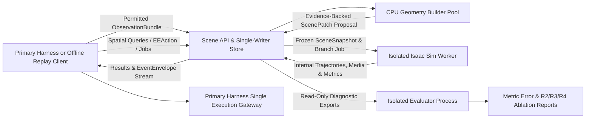

# Local Scene and Short-Horizon Simulation: Standalone Development Plan

> This document preserves the initial design conventions established on 2026-09-30 and outlines long-term extension goals. References to "unimplemented" features reflect the state at that time. For the current supported scope, refer to the code registries, capability declarations, tool contracts, and test suites.

Version: Design v0.1, September 30, 2026. Status: Actionable interface and acceptance specification for independent module development prior to joint deployment. All HTTP APIs, directory layouts, and CLI commands described herein represent proposed contracts rather than already deployed services.

**We architect this capability as a standalone service decoupled from live Astra inference: it ingests recorded or real-time permitted `ObservationBundle` records, maintains a task-scoped local scene representation, answers provenance-backed 3D geometric queries, and executes bounded short-horizon physics rollouts of candidate `EEAction` payloads inside an isolated Isaac Sim worker. The service returns only geometric measurements and simulated predictions; write permissions to execute physical actions in the evaluated RoboDojo environment remain exclusively with the primary Harness.**

Phase 1 takes known self-robot kinematics, raw RGB frames, measured joint states `q`, and explicitly disclosed camera calibration as inputs to reconstruct local planar support surfaces, bounding-box object proxies, tracked object states, and explicitly bounded unknown/occluded regions. Room-scale dense reconstruction, automatic system identification of arbitrary physical material parameters, tight-clearance insertion prediction, and unconstrained execution of arbitrary synthesized Python scripts are explicitly excluded from the MVP prerequisites. Engineering proceeds incrementally along dependency milestones, while at runtime Astra freely chooses whether and when to invoke these tools—never enforcing a rigid "scan, reconstruct, simulate, then execute" pipeline across every task.

This specification builds upon two governing documents: the [Embodied Harness Design Plan](./embodied-harness-design.md), which establishes task and evaluation boundaries, and the [Shared Interfaces and Event Protocol v0.1](./shared-protocol.md), which serves as the single authoritative source of truth for `ObservationBundle`, `EEAction`, `SceneSnapshot`, identifier semantics, and `EventEnvelope` schemas. This document defines only module-specific constraints and internal types; if any field-level discrepancy arises, the shared protocol contract is updated and version-bumped rather than maintaining divergent interpretations across repositories.

## 1 Scope of Standalone Deliverables and Acceptance Tiers

| Deliverable Component | Value Provided to Primary Harness / Researchers | Phase 1 Scope Boundary |
|---|---|---|
| Local Scene Service | Reconstructs versioned scene manifests, object proxies, and geometric evidence from permitted observations with incremental updates and historical lookback. | Covers the immediate manipulation workspace and a small number of rigid objects; does not attempt full-room photorealistic mapping. |
| Geometric Query Engine | Evaluates pixel rays, surface intersections, relative object poses, minimum clearances, swept path volumes, and unmodeled occlusion flags. | Valid strictly over reconstructed geometry and explicit conditioning assumptions; never treats unobserved regions as guaranteed free space. |
| Snapshots & Branches | Produces immutable, content-addressed `SceneSnapshot` records and isolated parameter perturbation branches (`BranchManifest`). | Clones only our observation-reconstructed scene model; never clones the evaluated environment's ground-truth USD stage, hidden physics state, or reward functions. |
| Isolated Isaac Sim Worker | Executes bounded short-horizon rollouts under identical `EEAction` semantics and motion planning adapters, recording trajectories, contacts, and metric measurements. | Explicitly reports initialization settling drift and contact assumptions; never claims simulated outcomes are identical to physical reality. |
| Offline Replay & Evaluation CLI | Replays recorded `ObservationBundle` streams, runs synthetic fixtures, audits prediction vs. reality errors, and exports diagnostic reports. | Operates completely offline without LLM API keys, an active Astra session, or a live RoboDojo instance. |
| Primary Harness Client (`TwinClient`) | Thin Python client and tool registration wrappers supporting asynchronous job polling, cancellation, and artifact retrieval. | Contains zero credentials or code paths for submitting physical actions, resetting the evaluated environment, or declaring task completion. |

We enforce a strict separation across three levels of acceptance:
1. **Service Correctness:** The API, geometry builder, and worker run deterministically on synthetic fixtures and recorded logs.
2. **Local Prediction Fidelity:** Reconstructed geometry and short-horizon rollout trajectories achieve bounded metric error against held-out ground truth.
3. **End-to-End Agent Utility:** Enabling spatial queries (`R3`) or physics rollouts (`R4`) yields statistically meaningful net task gains over the calibrated geometry baseline (`R2`) under an identical total budget.

Visually appealing 3D renderings never substitute for quantitative validation on Levels 2 and 3.

## 2 Deployment Architecture and Process Isolation

Phase 1 uses a lightweight Python service backed by SQLite metadata in WAL mode and a content-addressed flat-file blob store—avoiding distributed message brokers or heavy microservice platforms. The REST API process runs in a standard CPU Python environment without importing Isaac Sim. The physics rollout worker runs in a separate OS process using an isolated Isaac Sim environment aligned with RoboDojo's pinned dependency stack (initially targeting Isaac Sim 5.1.0 and Python 3.11 per upstream install scripts, with exact container digests, robot assets, and motion planner builds locked upon joint integration). ([RoboDojo Pinned Install Script](https://github.com/RoboDojo-Benchmark/RoboDojo/blob/726e9aabfaa642203722eb126f5eaf0f37f3e1ad/scripts/install.sh))



| Process / Module | Ownership and Core Responsibilities | Permitted Data & Filesystem Access |
|---|---|---|
| `scene_api` | Hosts HTTP endpoints, schema validation, job state machines, single-writer scene commits, and the transactional event outbox. | Reads permitted observations, scene/job records, and shared contracts; holds zero credentials for the evaluated environment. |
| `geometry_builder` | Stateless CPU worker pool executing feature tracking, multi-view triangulation, primitive fitting, object association, and `ScenePatch` generation. | Reads assigned input image blobs, disclosed calibration, and self-robot kinematics; submits candidate patches exclusively via `scene_api`. |
| `isaac_worker` | Dedicated GPU process executing one simulation branch job at a time: builds a clean USD stage from a snapshot, steps physics, samples metrics, and tears down/resets. | Read-only access to frozen `SceneSnapshot` blobs, `BranchManifest` parameters, whitelisted robot URDF/USD assets, and an isolated job output directory. |
| `replay_client` | Streams recorded `ObservationBundle` and `EEAction` fixtures sequentially, optionally injecting network delays, drops, or cancellations. | Reads sanitized recording archives conforming to actor observation boundaries; has no connection to a live RoboDojo environment. |
| `evaluator` | Computes metric reconstruction errors and rollout trajectory discrepancies against simulator ground truth. | Runs in an isolated privileged context reading ground-truth logs and read-only service exports; never writes back to active actor episodes. |

The `scene_api` layer is built with FastAPI and Pydantic, importing shared types directly from the canonical `contracts` package. Binary blobs are stored by their SHA-256 hex digest. While CPU geometry jobs run in a bounded multiprocessing pool, GPU rollout workers claim time-bounded job leases from `scene_api` so multiple processes never write to SQLite concurrently. Committing a job outcome executes as an atomic database transaction updating the result reference, terminal job status, and `EventEnvelope` outbox after all binary artifacts have been fsynced and hash-verified in the blob store.

For local development, the service binds to loopback (`127.0.0.1`), requiring explicit token authentication when deployed across network hosts. Critically, neither `geometry_builder` nor `isaac_worker` mounts the evaluated RoboDojo installation directory, ground-truth task USD stages, reward calculation scripts, or execution sockets; permitted self-robot kinematic/mesh assets are packaged via an explicit whitelist manifest.

**Note that OS process isolation does not automatically guarantee GPU resource isolation.** Phase 1 supports serial execution on a single GPU; when sharing a GPU with the evaluated RoboDojo environment, the runner logs rendering and stepping contention latencies, throttling worker concurrency or moving the worker to a dedicated GPU as needed. Any wall-clock slowdown caused by internal worker GPU contention is charged honestly against `R4`'s experimental budget.

## 3 Shared Identity, Time Domain, and Provenance Rules

All cross-module payloads carry `schema_version="0.1"` and use `snake_case` field names governed by the shared protocol:

- `run_id`, `episode_id`, `env_instance_id`, and `env_generation` uniquely bind the evaluated environment context. Whenever an environment resets or increments `env_generation`, prior scene versions are marked stale for live execution rather than silently carried over.
- `observation_id` references an immutable permitted observation bundle, and `action_id` references a canonical `EEAction`. While a single `action_id` may be tested across multiple internal branches, an internal rollout completion never implies the action was executed in the `observed` world.
- `scene_version` increments monotonically within a specific `(run_id, episode_id, env_instance_id, env_generation)` namespace and must always be qualified by that environment identity.
- `snapshot_id`, `branch_id`, and `job_id` are minted by the scene service as globally unique, non-reusable identifiers (omitted or set to `null` before creation rather than populated with sentinel strings).

Every artifact and event is tagged with `world_kind="observed"` (raw observations and physical execution receipts from the evaluated environment) or `world_kind="internal"` (reconstructed geometry, simulated camera renders, predicted trajectories, and virtual contact records). Reconstructing an internal proxy from `observed` keyframes never alters the `world_kind` of simulated media outputs to `observed`.

Outbound events wrap payloads in the standard `EventEnvelope` schema (`event_id`, environment identity, `source`, `source_instance_id`, `source_seq`, `server_seq`, `type`, `occurred_at`, `received_at`, `sim_step`, `step_domain`, `sim_time_s`, `clock_domain`, `correlation`, and `payload` / `payload_ref`). The scene service maintains a monotonically increasing `source_seq` per `source_instance_id` inside its persistent SQLite outbox (minting a fresh `source_instance_id` on process restart), while leaving run-wide `server_seq` assignment to the primary Harness event store upon ingestion. State transitions are governed deterministically by job revision numbers, `base_scene_version` preconditions, and explicit correlation IDs rather than network arrival order.

Time domains are kept strictly separated:

| Time Domain | Governing Rules and Valid Comparisons |
|---|---|
| `observed` `sim_step` / `sim_time_s` | Scoped to a specific `env_generation` in the evaluated world; comparable only against observations and actions within the same clock domain. |
| `internal` `sim_step` / `sim_time_s` | Scoped to a specific internal `branch_id` timeline starting from its snapshot initialization; never added to or equated with evaluated-world step counts. |
| Camera `capture_time` | Records the host/sensor `clock_domain` and binds to verified control or physics steps via `frame_id` and `step_domain`. |
| API Queueing & Worker Compute Durations | Measured using monotonic server clocks (`time.monotonic()`) for latency accounting, while UTC timestamps (`occurred_at`) aid cross-log correlation. |

Without an explicit cross-clock calibration map, the system never subtracts `sim_time_s` from wall-clock UTC time to estimate "camera latency," nor does it claim joint angles `q` and camera frames are synchronized merely because their timestamps appear close. Latency telemetry breaks down ingestion-to-scene-commit time, queue wait time, worker compute time, and verifiable sensor lag separately.

## 4 Module Validation Requirements for Shared Contracts

The table below specifies the mandatory ingress checks enforced by the local scene service when consuming shared protocol types:

| Shared Protocol Type | Required Module Validation Checks | Behavior When Fields Are Missing or Invalid |
|---|---|---|
| `ObservationBundle` | Verifies environment identity, `observation_id`, raw RGB blob digests, `frame_id`, per-frame step association/sync status, measured joint names/order (`q`), and device/calibration references. | Stores and serves raw 2D RGB frames if valid, but halts 3D metric reconstruction with an explicit `missing_calibration` or `unsynchronized_observation` status rather than substituting fake defaults. |
| Device & Calibration Refs | Verifies intrinsic matrix `K`, distortion coefficients, native image dimensions/crop transforms, static camera extrinsics or wrist `T_link_camera` mounting transforms, robot model ID, base frame convention, and content digest. | Never substitutes an uncalibrated default focal length or identity extrinsic matrix to force metric triangulation through. |
| Robot State (`robot_state_ref`) | Verifies `source_kind` (`measurement`, `estimate`, or `command`) for `q`, available $\dot{q}$, gripper fields, and last active control targets. | Computes FK camera poses strictly from `measurement` or explicitly flagged `estimate` states; never treats command-echo gripper fields as physical contact measurements. |
| `EEAction` | Validates `action_id`, environment/observation bindings, TCP and coordinate frame IDs, path geometry kind, orientation encoding, velocity/tolerance profiles, and gripper event semantics using the shared validator. | Immediately rejects unsupported path kinds or unimplemented bimanual synchronization modes with `unsupported_capability`. |
| `SceneSnapshot` | Verifies frozen `scene_version`, conditioning observation IDs, initial robot state, calibration/robot/builder digests, geometry/physics hypotheses, unknown region bounds, and closed transitive blob digests. | Verifies referential closure before creation; prohibits worker jobs from reading mutable "latest" configurations at runtime. |

The primary Phase 1 operating profile is **`rgb_proprio_calibrated_v1`** (raw RGB + measured `q` + disclosed camera calibration + permitted self-robot model)—strictly excluding simulator depth buffers, ground-truth object poses, privileged CAD meshes, ground-truth friction coefficients, and internal reward states. Any future experiments incorporating stereo depth, RGB-D sensors, fiducial markers, or known object CAD models must declare a distinct `observation_profile` and report results separately.

Metric camera poses follow the shared kinematic convention. For a wrist-mounted camera on a fixed-base robot:
$$T_{\text{world\_camera}} = T_{\text{world\_base}} \times \text{FK}(q_{\text{measured}}) \times T_{\text{link\_camera}}$$
Multi-view triangulation requires that matched 2D features correspond to the same physical 3D point and that the target object remained stationary across views (whereas a single fixed camera viewing a static scene yields zero translational baseline and supports only conditional ray-surface queries). ([OpenCV 4.13.0 Camera Calibration and 3D Reconstruction](https://docs.opencv.org/4.13.0/d9/d0c/group__calib3d.html))

For standalone offline development, a self-contained recording archive requires only the shared run manifest, `observations.jsonl`, RGB image blobs, calibration manifest, whitelisted robot asset manifest, and optional candidate `EEAction` payloads—**never requiring the original task USD stage or a live RoboDojo process snapshot.** Privileged ground-truth files for evaluator scoring are stored in a separate directory inaccessible to both `replay_client` and `scene_api`.

## 5 Local Scene Representation, Declarative Patches, and Immutable Snapshots

### 5.1 `SceneHead` as a Lightweight Version Pointer

Each scene namespace is scoped by `(run_id, episode_id, env_instance_id, env_generation)`. `scene_api` is the single authoritative writer, advancing `scene_head` by committing a new immutable scene manifest with an incremented `scene_version` whenever a valid patch is applied. Existing `scene_version` manifests are never overwritten in place.

A local scene manifest contains six structured sections:

| Manifest Section | Minimum Recorded Information |
|---|---|
| Reference Frames | Cryptographic digests of active camera calibration and robot kinematic model; all entity poses are expressed in the canonical base frame with explicit transform provenance. |
| Geometric Entities | Stable `entity_id` values, analytic primitives (`plane`, `box`) with metric dimensions and poses, observationally supported surface bounds, and separate references for visual vs. conservative collision proxies. |
| Object Tracking State | Last observed timestamp and `observation_id`, lifecycle status (`tracked`, `occluded`, `lost`, `retired`), pose/velocity provenance, and bounded swept-volume uncertainty regions. |
| Observational Evidence | Source `observation_id` / `frame_id` / pixel correspondences, geometric fitting residuals, triangulation parallax angles, inlier counts, conditioning assumptions, and builder version digest. |
| Physical Hypotheses | Known values or plausible intervals for mass, friction, center of mass, inertia, and joint constraints, each tagged with `source_kind` (`measurement`, `explicit_prior`, or `provisional_default`). |
| Coverage & Unknown Regions | Observationally verified surface polygons, self-occluded backsides, unconstrained vertical thickness/height bounds, and spatial regions marked `dirty` after robot interaction. |

The scene representation never emits uncalibrated scalar confidence scores (such as `"confidence": 0.93`). Instead, geometric uncertainty is represented via fitting residuals, triangulation condition numbers, bounded intervals, or explicit parameter ensembles—and marked `unquantified` wherever analytical bounds are unavailable.

### 5.2 `ScenePatch`: Declarative Updates with Compare-and-Swap Preconditions

A module-specific `ScenePatch` proposal specifies the environment identity, precondition `base_scene_version`, conditioning `observation_id` list, builder configuration digest, ordered list of declarative operations, supporting evidence/hypothesis references, affected spatial bounding box, and compute timestamps. Permitted Phase 1 patch operations are strictly restricted to:
- `upsert_geometry`
- `update_pose`
- `set_physics_hypotheses`
- `mark_unknown`
- `mark_lost`
- `retire_entity`

Arbitrary JSON path mutations, executable Python payloads, or external USD file URIs are rejected at ingress.

Every patch operation declares whether its fields derive from observational geometric fitting or explicit conditioning priors. While Astra may supply semantic labels, 2D bounding-box ROIs, candidate pixel correspondences, or physical parameter hypotheses, agent-supplied priors are tagged as `explicit_prior` rather than recorded as sensor measurements. Similarly, if human-annotated correspondences are used in an offline unit-test fixture, the manifest records that provenance explicitly so assisted fixtures are never conflated with autonomous perception runs.

Committing a patch enforces atomic compare-and-swap (CAS) against `base_scene_version`: if `scene_head` has advanced past `base_scene_version`, `scene_api` returns HTTP 409 (`scene_version_conflict`) while archiving the rejected proposal for diagnostics. Phase 1 performs no implicit three-way semantic merging of concurrent scene patches; the builder may recompute once against the new head if budget permits, or return the conflict to the caller. Late-arriving observations from earlier steps cannot overwrite newer object state estimates silently; they may only be recorded as historical evidence or trigger an explicit full rebuild.

Updating camera calibration, the robot kinematic model, or base frame conventions constitutes a structural model change that invalidates or triggers recomputation of all dependent 3D geometry rather than merely relabeling coordinate frame strings. Re-submitting an existing `observation_id` with a different content digest is rejected as an integrity conflict.

### 5.3 Distinguishing `SceneSnapshot` from `BranchManifest`

A `SceneSnapshot` freezes a specific `scene_version` manifest alongside the anchor `observation_id` and robot state used to initialize simulation rollouts. Because some scene entities may have been last observed several steps prior to the anchor observation, each entity retains its own `last_observed_at` timestamp rather than pretending all objects were simultaneously measured at the anchor step.

Every `snapshot_id` resolves to an immutable manifest whose referenced blobs are locked by SHA-256 digests. Advancing `scene_head` or upgrading builder/engine versions never alters an existing snapshot.

A module-specific `BranchManifest` binds a `snapshot_id`, a concrete parameter realization drawn from the snapshot's declared hypothesis intervals, an RNG `seed_manifest`, engine/controller/planner configuration digests, and an explicit initialization strategy (`cold_quasistatic`, etc.). Changing frozen snapshot geometry or expanding hypothesis bounds requires minting a new `SceneSnapshot`, whereas sampling a different friction coefficient or initial pose perturbation within the snapshot's declared bounds mints a new `BranchManifest`. In Phase 1, every rollout job initializes cleanly from its `BranchManifest` via a cold build or controlled reset; running two jobs on the same `branch_id` executes two independent replays from the branch origin rather than chaining state implicitly from the end of the first job.

Simulation branches share only read-only input blobs; runtime USD stages, articulation controllers, command queues, RNG states, and output directories are completely isolated. Rollout outcomes can propose candidate model revisions for review, but never automatically overwrite object poses or physical properties in the `observed` scene head.

## 6 Minimum Viable Pipeline for RGB Scene Construction

### 6.1 Input Processing and Sparse Multi-View Geometry

The Phase 1 `geometry_builder` implements modular, independently callable geometric operators rather than a monolithic black-box pipeline:

1. **Ingress & Undistortion:** Validates observation identity and frame-to-`q` synchronization, applying intrinsic matrix `K` and lens distortion correction at native image resolution while archiving raw frames and visual overlays separately.
2. **Metric Camera Pose via FK:** Computes world-frame camera poses from measured joint angles `q` and disclosed hand-eye calibration, optionally projecting the known robot self-mesh into the image with a safety dilation margin to mask out self-occlusions without accidentally masking adjacent tabletop objects.
3. **ROI Feature Correspondence:** Extracts sparse correspondences within specified 2D regions of interest using OpenCV feature matching or Lucas-Kanade optical flow, filtering matches via forward-backward consistency, epipolar residuals, and motion-blur checks (without claiming open-vocabulary segmentation of arbitrary unknown objects).
4. **Metric Triangulation & Conditioning Audit:** Triangulates matched rays across views with known metric baselines, verifying positive depth (cheirality), translational parallax angle, and multi-view reprojection residuals. Pure camera rotation, sub-threshold parallax, desynchronized joint readings, or moving target objects return explicit degeneracy flags (`insufficient_parallax`, `inconsistent_correspondence`).
5. **Bounded Primitive Fitting:** Fits bounded planar patches and oriented 3D bounding boxes (`box`) to validated metric points. Fitted planes record their convex hull of supporting inlier points rather than extrapolating an infinite mathematical plane across the entire room.

When a box's vertical height, yaw orientation, or self-occluded back face is unconstrained by current camera views, the entity record preserves explicit parameter intervals or candidate hypotheses rather than hallucinating a single exact 3D box from a single 2D bounding rectangle. Cylinders, convex hulls, and local surface meshes are deferred to subsequent milestones as required by specific tasks.

Because sparse RGB triangulation recovers only observed surface patches rather than a dense volumetric occupancy grid or ESDF, clearance queries strictly report **"minimum distance to reconstructed surface proxies"** alongside explicit `unknown` flags for unobserved regions—never treating empty point-cloud space as verified collision-free space. Conservative collision envelopes store their inflation margins separately from raw fitted surface dimensions.

### 6.2 Cross-Frame Object Association and Dynamic State Invalidation

In Phase 1, object entity IDs are initialized either from explicit agent-supplied 2D ROIs/seed hypotheses or from validated foreground structures in prior observations. Cross-frame tracking combines visual appearance descriptors, 3D projection gating, and rigid-body motion consistency; when identical objects cross paths, undergo prolonged occlusion, or exhibit physically impossible jumps, the tracker marks the association `ambiguous` or `lost` rather than silently swapping object identities.

Movable task objects are managed separately from static background support surfaces: when an object moves, its entity pose is updated in place without leaving a ghost obstacle fixed in the background map. When tracking is lost, the entity retains its last verified evidence while expanding its positional uncertainty region (causing dependent clearance queries to return `conditional` or `unknown`). Spatial regions swept by the robot arm or gripper during physical execution are immediately flagged `dirty` until re-observed.

Crucially, issuing a gripper close command never proves an object is securely held: attaching an object proxy rigidly to the TCP requires supporting visual or proprioceptive evidence. In Phase 1, branches where an object is assumed held under unverified contact conditions are restricted to conditional kinematic clearance previews (`geometry_only`) rather than treated as reliable starting states for contact-rich dynamic rollouts. Any visual evidence of in-hand slip, drop, or gripper release immediately invalidates prior attachment assumptions.

Object linear and angular velocities are estimated only across multiple synchronized observations within the same clock domain alongside explicit estimation error bounds; when single-frame observations provide no velocity observability, velocity is marked `unknown`, and any quasi-static zero-velocity initialization (`v = 0`) is recorded as an explicit branch assumption rather than a measured fact.

### 6.3 Bounding Contact Uncertainties via Parameter Ensembles

Phase 1 does not attempt to infer exact object mass, center of mass, or friction coefficients from RGB appearance alone. Instead, manipulable objects declare plausible physical parameter intervals, and short-horizon rollouts evaluate candidate actions across structured parameter perturbations to test whether candidate rankings remain invariant across plausible physical dynamics. If an agent performs interactive probing to narrow parameter bounds online, the system logs the probing action, measured trajectory response, and fitting residual—retaining multiple hypotheses whenever parameters remain locally unidentifiable.

Articulated mechanisms (drawers, hinged doors), deformable cloth, liquids, and tight-tolerance peg-in-hole insertions are outside the Phase 1 contact rollout MVP. Supporting articulated objects in Phase 2 will require explicit joint-type classification, axis/pivot estimation, range-of-motion bounds, damping intervals, and dedicated observability checks rather than treating a front surface mesh as a complete articulated mechanism.

## 7 Spatial Queries and Applicability Diagnostics

Every `QueryResult` returned by `POST /v1/scene/query` includes the environment identity, resolved `scene_version`, conditioning `observation_id` list, query type, metric result payload with explicit coordinate frames and units, supporting evidence scope, hit/intersected `unknown` regions, conditioning assumptions, algorithm version, and compute duration. Query outcomes are classified into four explicit status tiers—`supported`, `conditional`, `unknown`, or `invalid_input`—never collapsing complex partial-observability queries into an oversimplified boolean `"is_safe": true`.

Phase 1 implements six core spatial query primitives:

| Query Type | Returned Metric Payload | Mandatory Accompanying Provenance & Diagnostics |
|---|---|---|
| `pixel_ray` | Camera optical center and unit ray direction in the world frame. | Calibration digest, image dimensions, and `frame_id`; omits 3D `xyz` coordinates when depth is unconstrained. |
| `ray_surface` | 3D intersection point and surface normal against a specified plane or object proxy. | Conditioning surface assumption, distance to support-polygon boundary, and grazing-incidence degeneracy flags. |
| `entity_pose` | Estimated 6-DoF pose or bounded pose interval/candidate set for a tracked entity. | Last observed timestamp/step, tracking status (`tracked`/`occluded`/`lost`), and rotational symmetry or backface ambiguities. |
| `distance` | Minimum Euclidean clearance between specified entities or along a sampled robot trajectory against modeled proxies. | List of checked proxy IDs, inflation margins, discrete sampling resolution vs. continuous sweep method, and intersected `unknown` volumes. |
| `project_geometry` | 2D pixel coordinates and rendered visual overlay projecting 3D scene proxies or trajectories onto a camera view. | Preserves the uncropped raw frame for the same `frame_id`; explicitly notes that 2D projection alignment does not prove depth accuracy. |
| `preview_ee` | Kinematic IK feasibility, joint trajectory plan reference, and swept-volume clearance summary for a candidate `EEAction`. | Shared action validator receipt, checked collision scope, intersected `unknown`/`dirty` regions, and specific infeasibility reasons. |

Every query executes against an immutable `scene_version`. While `TwinClient` may offer a convenience flag to query the current `scene_head`, `scene_api` resolves and locks that exact `scene_version` atomically at transaction start and returns it in `QueryResult`—never reading Entity A from version 4 and Entity B from version 5 within the same query.

Whether a historical query result or rollout prediction remains valid for submitting a physical action is ultimately verified by the primary Harness execution gateway. To assist this check, the scene service returns an `applicability` diagnostic block flagging staleness conditions such as `different_generation`, `robot_state_changed`, `entity_dirty`, `calibration_changed`, `newer_scene_available`, or `no_fresh_observation`.

## 8 REST API Specification and Asynchronous Job Lifecycle

All REST endpoints are prefixed with `/v1` and exchange JSON conforming to the shared protocol and module-specific schemas below. State-mutating `POST` requests require an `Idempotency-Key` header scoped to the caller and environment namespace: repeating a request with an identical key and payload digest returns the existing resource (`200`/`201`/`202`), whereas reusing an idempotency key with a different payload digest returns HTTP `409 Conflict`. Resource IDs in URL paths must match payload body identifiers exactly.

| Endpoint | Request Payload / Parameters | Response Status & Semantic Guarantees |
|---|---|---|
| `GET /v1/health` | None | `200 OK` with API liveness and `schema_version` (does not imply GPU `isaac_worker` readiness). |
| `GET /v1/capabilities` | Optional environment / robot model filter | Returns supported geometric primitives, query types, pinned `EEAction`/planner versions, `isaac_worker` readiness, and budget caps. |
| `POST /v1/blobs` | Binary content, MIME type, and expected SHA-256 digest (size-capped) | `201 Created` / `200 OK` returning a content-addressed `ArtifactRef`; rejects arbitrary remote URLs or host filesystem paths. |
| `POST /v1/observations` | `ObservationBundle` JSON referencing pre-uploaded blob digests | `201 Created` / `200 OK` storing the immutable bundle; never triggers unsolicited background physics rollouts. |
| `POST /v1/scene/update-jobs` | Conditioning `observation_id` list, `base_scene_version`, ROI/entity selectors, builder config, and compute budget | `202 Accepted` returning a `JobRecord`; upon completion, commits a new `scene_version` or reports `no_change` / specific degeneracy errors. |
| `POST /v1/scene/patches` | Declarative `ScenePatch` proposal | `201 Created` with new `scene_version` if CAS succeeds; `409 Conflict` on version mismatch (preserving rejected patch diagnostics). |
| `GET /v1/scene/head` | Environment identity query parameters | Returns latest `scene_version` pointer and summary metadata (never exposes privileged simulator ground truth). |
| `GET /v1/scene/versions/{scene_version}` | Environment identity query parameters | Returns the complete immutable scene manifest for the requested version. |
| `POST /v1/scene/query` | Explicit `scene_version`, query specification, conditioning observation ref, and timeout budget | `200 OK` with bounded `QueryResult` (or `202 Accepted` `JobRecord` for heavy trajectory sweep previews so HTTP threads never block). |
| `POST /v1/alignment-jobs` | `scene_version`, held-out `observation_id` list, and residual evaluation options | `202 Accepted`; computes per-view reprojection residuals and occlusion coverage without declaring overall task success. |
| `POST /v1/snapshots` | `scene_version`, anchor `observation_id`, and permitted initialization strategy | `201 Created` returning an immutable `SceneSnapshot` reference after verifying transitive blob closure. |
| `POST /v1/branches` | `snapshot_id`, parameter realization from `HypothesisSet`, `seed_manifest`, and initialization mode | `201 Created` returning a `BranchManifest` (logical creation; does not pre-allocate GPU VRAM). |
| `POST /v1/rollout-jobs` | `branch_id`, candidate `EEAction` (or ref), requested metric selectors, and compute budget | `202 Accepted` `JobRecord`; resolves branch parameters, archives the canonical `RolloutRequest`, and executes strictly in `world_kind="internal"`. |
| `POST /v1/compare-jobs` | Shared `snapshot_id`, candidate `EEAction` refs, shared parameter/seed ensemble, and total budget | `202 Accepted` parent `JobRecord` spawning bounded child rollout jobs; returns the full candidate $\times$ condition matrix without auto-selecting a real action. |
| `GET /v1/jobs/{job_id}` | Optional minimum revision cursor / short-poll timeout | Returns current `JobRecord` state, phase progress, terminal status, and result artifact references. |
| `POST /v1/jobs/{job_id}/cancel` | Target `job_id` and cancellation reason | Returns `cancel_requested` or existing terminal status; HTTP return does not imply the GPU worker has already halted before confirmation. |
| `GET /v1/artifacts/{sha256}` | Authorized artifact digest | Streams binary image, trajectory array, or JSON manifest with verified MIME type and `world_kind` access headers. |
| `GET /v1/events` | Service outbox cursor (`after_source_seq`) | Streams `EventEnvelope` records from the local outbox for ingestion by the primary Harness gateway or offline replay client. |

All binary blobs must complete upload and SHA-256 verification before being referenced in observation or scene manifests. Exported OpenUSD stage files are strictly forbidden from embedding external filesystem references or unauthorized asset payloads that could resolve back to the evaluated RoboDojo task directory.

### 8.1 `JobRecord` Lifecycle and Terminal State Semantics

Every `JobRecord` tracks `job_id`, `kind`, `status`, monotonic `revision`, frozen input references and digests, allocated vs. consumed budgets, active execution `phase`, creation/start/completion timestamps, worker lease attempt token, result artifact references, and structured error diagnostics alongside shared protocol correlation IDs.

The job state machine follows:
$$\texttt{queued} \longrightarrow \texttt{running} \longrightarrow \texttt{succeeded} \;\mid\; \texttt{failed} \;\mid\; \texttt{cancelled} \;\mid\; \texttt{expired}$$
Setting `cancel_requested=true` records cancellation intent on an active job; the job transitions to terminal `cancelled` only after the worker confirms clean teardown or the supervisor terminates the worker process. Execution `phase` values (`validating`, `building`, `loading`, `initializing`, `planning`, `stepping`, `encoding`) report factual pipeline stages rather than fabricated percentage progress bars.

Job state transitions project deterministically to shared domain events: `running` emits `job.started`, `succeeded` emits `job.completed`, `failed` emits `job.failed`, `cancelled` emits `job.cancelled`, and `expired` emits `job.expired` (carrying the missed deadline diagnostic). Event payloads include the full `JobRecord.status` and `revision` so consumers never guess outcomes from event names alone.

Crucially, `status="succeeded"` on a rollout job means **the simulation computation completed and produced a valid `RolloutResult` artifact**—even if the simulated robot arm hit an obstacle or failed IK inside the rollout. Finding that a candidate path is kinematically unreachable is a valid, informative `RolloutResult` outcome (`succeeded`), whereas an Isaac Sim segfault or missing controller configuration is a system `JobRecord` failure (`failed`). Keeping job execution health separate from simulated motion feasibility prevents conflating infrastructure reliability with candidate action quality.

Jobs that sit in `queued` past their request deadline transition to `expired`; jobs that exceed their runtime step or wall-clock budget transition to `failed` with `error="budget_exceeded"` while archiving any partial trajectory marked `partial=true`. Partial trajectories from cancelled, timed-out, or crashed jobs are excluded from default candidate comparison rankings. A parent `compare-job` aggregates summary matrices only after all scheduled child jobs reach terminal states; canceling a parent job immediately cancels queued children and awaits stop confirmation from running children.

Worker leases are protected by heartbeats and monotonically incremented `attempt_token` values: `scene_api` accepts terminal result commits only from the holder of the active `attempt_token`, preventing a zombie worker from overwriting a reassigned or cancelled job. While stateless CPU geometry jobs may retry once automatically on transient failure if budget and scene versions permit, GPU `isaac_worker` crashes never trigger automatic silent retries of expensive physics rollouts; retrying requires a fresh client request with a new idempotency key so all failed compute costs remain fully visible.

### 8.2 Standard Error Taxonomy

| Error Code | Required Handling and Fallback Behavior |
|---|---|
| `schema_mismatch` / `identity_conflict` | Reject immediately (`400`/`409`/`422`); never guess missing fields or mix records across episodes. |
| `missing_calibration` / `unsynchronized_observation` | Preserve 2D RGB access while halting 3D metric reconstruction for the affected frames. |
| `insufficient_parallax` / `inconsistent_correspondence` | Return explicit geometric degeneracy diagnostics so Astra can decide whether to acquire a wider baseline view. |
| `scene_version_conflict` / `stale_generation` | Abort commit (`409`); caller fetches the latest `scene_head` or updated `env_generation`. |
| `unsupported_capability` / `backend_mismatch` | Reject cleanly without altering path semantics or silently substituting an unconstrained motion planner. |
| `initial_state_unsupported` / `initialization_drift` | Refuse to output dynamic contact predictions when settling drift exceeds tolerances; optionally retain `geometry_only` preview. |
| `worker_unavailable` / `resource_exhausted` | Keep CPU spatial queries (`R3`) online so the primary Harness can gracefully degrade to `R2`/`R3` operation. |
| `numerical_failure` / `worker_crashed` | Quarantine the faulted branch/worker, archive partial diagnostics, and spawn a clean worker process. |
| `cancelled` / `deadline_exceeded` | Record consumed budget and halt without triggering physical execution or infinite retry loops. |

HTTP status codes distinguish client input errors (`400`/`422`), identity/version/idempotency conflicts (`409`), admission queue saturation (`429`), and backend unavailability (`503`). Once an asynchronous request has been accepted with `202 Accepted`, domain or runtime failures are reported inside `JobRecord.error` rather than masked behind generic HTTP `500` responses on status polling.

## 9 Isolated Isaac Sim Worker and Shared `EEAction` Execution Pipeline

### 9.1 Constructing Strictly Self-Built USD Stages

Every `isaac_worker` rollout starts from an empty USD stage and instantiates only whitelisted self-robot assets alongside geometric primitives (`plane`, `box`) backed by provenance in the input `SceneSnapshot`. Virtual cameras are configured from disclosed calibration; rigid-body masses, friction coefficients, restitution, collision approximations, and visual materials are populated strictly from the `BranchManifest`, logging cryptographic digests of all loaded assets and physics solver settings.

The worker is strictly forbidden from loading the evaluated RoboDojo task USD stage and deleting objects, or copying ground-truth simulator rigid-body states as initialization shortcuts. While synthetic unit-test fixtures (e.g., an analytical cube on a plane) may specify known test parameters tagged with `data_origin="synthetic_fixture"`, those fixtures are strictly segregated from observation-reconstructed benchmark runs. Exported USD files are treated as derived cache artifacts rather than authoritative inputs; the auditable JSON `SceneSnapshot` and `BranchManifest` remain the source of truth.

While Isaac Sim 5.1.0 provides standalone Python application loops, explicit physics/render stepping, programmatic USD creation, and world reset APIs suitable for an isolated worker, the existence of those APIs does not imply that arbitrary hidden contact states in an external environment can be cloned losslessly. ([Isaac Sim 5.1.0 Standalone Tutorial](https://docs.isaacsim.omniverse.nvidia.com/5.1.0/core_api_tutorials/tutorial_core_hello_world.html))

### 9.2 Sharing the Exact Motion Planning and Control Adapter

Within `isaac_worker`, every candidate `EEAction` executes through the exact same software pipeline used by the primary Harness execution gateway:

```text
Shared EEAction
  --> Shared schema validator + coordinate frame / TCP-to-flange transform
  --> Pinned IK solver + CuRobo planner + trajectory time parameterization adapter
  --> Joint command schedule + gripper command schedule
  --> Matched ArticulationController / actuator PD model
  --> Explicit PhysX stepping loop
  --> Measured internal q, qdot, FK(EE), contact records & object trajectories
```

The worker reuses the exact CuRobo fork and motion adapter configuration pinned by the primary Harness—never upgrading to a newer planner version in the simulator alone. Frame conventions, TCP-to-flange offsets, joint ordering, position/velocity limits, gripper timing semantics, and bimanual time alignment rules must match byte-for-byte. ([Pinned EEF Execution Reference](https://github.com/RoboProbe/RoboProbe/blob/9ffacc54f372beef6479d61711bf4945e31ae4ce/policy/RoboDojo_Agent_L3_Inspect_EEF/policy.py))

To achieve clean reuse without privilege leakage, the shared motion adapter accepts dependency-injected state, collision-world, and articulation-control backends: when invoked by `isaac_worker`, the planner checks collisions strictly against the reconstructed `SceneSnapshot` proxies and reads joint states from the internal branch—never querying the evaluated world's scene graph. If the baseline planner plans each arm independently before time-aligning trajectories, the worker preserves that exact behavior rather than claiming joint bimanual collision avoidance.

**Formal physics rollouts (`cold_quasistatic`) are strictly forbidden from teleporting TCP poses in world space or overwriting joint positions step-by-step (`set_joint_positions`) during trajectory execution to bypass actuator dynamics.** Direct state assignment is permitted exclusively during the documented pre-rollout initialization phase. During rollout execution, joint targets are dispatched through Isaac Sim's `ArticulationController` using matched PD gains and torque/velocity limits while stepping PhysX forward and reading resulting sensor feedback. Purely geometric path playback without physics stepping is categorized separately as a `kinematic_preview` query and never mixed into dynamic contact rollout results. ([Isaac Sim 5.1.0 Articulation Controller](https://docs.isaacsim.omniverse.nvidia.com/5.1.0/robot_simulation/articulation_controller.html))

### 9.3 Explicit `ControllerProfile` Alignment

Even under identical `EEAction` inputs, differences in actuator gains or timestepping will cause simulated trajectories to diverge from the evaluated environment. We therefore capture all execution parameters in an explicit, versioned `ControllerProfile` containing:
- Robot URDF/USD and actuator model digest;
- Drive control mode (position, velocity, or effort) and joint index mapping;
- Stiffness ($K_p$), damping ($K_d$), maximum effort, and velocity limits;
- Physics substep $\Delta t$, control decimation period, and planner sampling rate;
- Waypoint interpolation and terminal holding target policy; and
- Gripper command clamping and finger synchronization rules.

Phase 1 enables only motion modes whose tracking behavior has been empirically cross-checked against the primary RoboDojo adapter on single-arm and bimanual calibration motions. If mid-motion cancellation, continuous simultaneous arm-gripper interpolation, or circular arc primitives are not yet supported in the primary adapter, `isaac_worker` likewise returns `unsupported_capability`—never implementing a superior controller exclusively inside the internal simulator and attributing the resulting gap to "simulation trial-and-error."

Every worker rollout records three separate trajectories: the **Planned** joint/EE path, the **Dispatched** actuator commands, and the **Measured** internal physics feedback (`q` and FK-derived EE poses). Terminal tracking errors, finger apertures, and object contacts are computed strictly from measured internal physics feedback, while respecting the provenance boundary that RoboDojo's `<arm>_ee_joint_state` reflects clamped command history rather than physical tactile sensing. ([Pinned Observation Provenance Source](https://github.com/RoboDojo-Benchmark/RoboDojo/blob/726e9aabfaa642203722eb126f5eaf0f37f3e1ad/env/observation_manager/obs_manager.py))

## 10 Initialization Modes, RNG Seeding, and Contact Settling (`cold_quasistatic`)

Because a `SceneSnapshot` is reconstructed from external camera observations, it does not contain the evaluated simulator's internal PhysX contact cache, solver warm-start multipliers, or actuator integral states. Even if 3D positions match closely, unmodeled initial velocities, slight bounding-box interpenetrations, or cold contact caches can alter short-horizon dynamics. Every `BranchManifest` therefore declares an explicit initialization mode graded by capability tier:

| Initialization Mode | Phase 1 Status | Validated Guarantees and Scope |
|---|---|---|
| `geometry_only` | **Mandatory (M1/M2)** | Evaluates static 3D clearances, ray intersections, and kinematic reachability without stepping dynamics. |
| `cold_quasistatic` | **Physics MVP (M3/M4)** | Initializes a clean stage under explicit quasi-static assumptions, runs a bounded settling phase to establish stable resting contacts, and executes short-horizon rollouts. |
| `state_restore_cold_contacts` | Optional Extension | Restores saved rigid-body poses/velocities and controller targets while rebuilding contact manifolds from scratch (not a bitwise physics checkpoint). |
| `full_internal_checkpoint` | Unverified (Out of Scope) | Claimed only if all engine, controller, RNG, and solver contact caches within an internal branch are proven deterministically restorable; never applies to the external evaluated world. |

The **`cold_quasistatic`** initialization protocol executes six auditable steps:
1. **Clean Stage Instantiation:** Builds a fresh USD stage (or performs a verified clean reset) from the `BranchManifest` and initializes PhysX and articulation handles.
2. **State & Assumption Injection:** Writes measured robot joint positions `q`, measured or explicitly assumed $\dot{q}$, and reconstructed object poses/velocities (tagging every non-measured value as an explicit assumption), while setting active arm/gripper holding targets and clearing pending command queues.
3. **Controller Reset:** Resets accessible internal controller states and logs any non-restorable solver variables (never assuming a generic `world.reset()` call wipes all hidden C++ extension state without verification).
4. **Bounded Contact Settling:** Steps physics for a fixed, documented window of settling steps ($N_{\text{settle}}$) while holding robot joint targets constant, allowing gravity and contact manifolds to equilibrate. The worker records vertical settling displacement, initial interpenetration resolution, lateral object drift, robot arm sag, and peak contact impulses during settling.
5. **Settling Drift Gate:** If object pose drift or robot displacement during settling exceeds task-specific tolerances (e.g., an imperfectly fitted box tips over or pops away from the table before the robot even moves), the job aborts with `error="initialization_drift"`—never covertly teleporting the object back to its initial pose at every frame. The post-settling equilibrium state is archived separately as `rollout_start_state` without mutating the input `SceneSnapshot`.
6. **Trajectory Planning & Execution:** Plans and executes the candidate `EEAction` starting from `rollout_start_state`, explicitly reporting the initialization offset relative to the anchor observation. Highly dynamic scenes, fast-moving objects, or unverified in-hand grasps that violate quasi-static preconditions are rejected upfront with `initial_state_unsupported`.

Settling steps and active rollout steps are accounted for separately in job telemetry, and all candidates within a `compare-job` share the exact same settled initial state per parameter condition. Manually nudging an object to eliminate initial interpenetration constitutes a geometric model revision that requires creating a new `BranchManifest` rather than an undocumented runtime tweak.

Each `BranchManifest` includes a structured `seed_manifest` covering the master RNG seed, parameter sampling seed, motion planner seed, CPU/OpenCV seed, and configurable physics engine seeds. Candidate actions compared under the same parameter realization share identical seeds and settled start states to minimize variance. Because parallel GPU physics solvers can still exhibit minor floating-point non-determinism, **matching seeds do not claim bitwise-identical trajectory replay**; instead, reset repeatability is quantified empirically by measuring maximum trajectory divergence, contact timing jitter, and metric variance across repeated runs on the pinned hardware/driver stack.

## 11 `RolloutResult` Schema, Candidate Comparison Matrices, and Cache Invalidation

Every `RolloutResult` artifact records:
- Input `snapshot_id`, `branch_id`, `job_id`, and cryptographic digests;
- Initialization mode, settling drift metrics, and `rollout_start_state` reference;
- `ControllerProfile`, planner, and physics engine version digests;
- Internal branch `clock_domain` and executed `sim_step` / `sim_time_s` intervals;
- Canonical `EEAction` reference alongside **Planned**, **Dispatched**, and **Measured** robot trajectories;
- Tracked object trajectories and structured contact event logs;
- Evaluated metric queries, hit `unknown` region flags, and termination reason; and
- Rendered internal camera frames/videos (`world_kind="internal"`) and consumed compute budgets.

Contact logs specify the sampling rate, force/impulse threshold, and engine reporting semantics—never conflating instantaneous contact impulses, continuous normal forces, and geometric penetration depths, and returning `unavailable` whenever contact sensor reporting is disabled rather than inferring contact forces from visual overlap.

Default rollout measurements capture task-agnostic physical quantities: terminal EE tracking residual, execution duration, 6-DoF object displacement, minimum obstacle clearance, contact timestamps/entities, and numerical solver warnings. Callers may also supply a task-scoped geometric predicate defined strictly over permitted observations (e.g., whether a block's centroid entered a target tabletop polygon); satisfying such a predicate is reported solely as `predicate_satisfied_in_model=true`—never importing RoboDojo's privileged reward function or declaring official task completion.

In a multi-candidate `compare-job`, all candidates are evaluated across the shared `SceneSnapshot` and parameter condition ensemble, producing a complete $\text{Candidate} \times \text{Condition}$ outcome matrix that reports per-cell completion status, metric ranges, and rank-order stability across parameter perturbations. If budget exhaustion truncates evaluation before all cells finish, unrun cells are explicitly marked `untested` rather than comparing a partially tested candidate's best run against another candidate's full ensemble average.

Passing 8 out of 10 parameter conditions is reported strictly as `"passed_conditions": "8/10"` rather than an "80% real-world success probability." The service returns the structured comparison matrix to Astra without autonomously selecting or dispatching a winner.

When `scene_head` advances, a physical action executes in the evaluated world, or the environment resets:
1. In-flight worker jobs continue running against their immutable `SceneSnapshot` without reading the new `scene_head` mid-run;
2. Incrementing `env_generation` marks all prior snapshots and in-flight jobs inapplicable to live execution (canceling queued jobs if configured to save compute while preserving completed records for historical inspection);
3. Updating an object's pose or calibration marks dependent prior `RolloutResult` records with `applicability="revalidation_required"`; and
4. Before executing any physical motion, the primary Harness gateway independently re-verifies `env_generation`, conditioning `observation_id`, current robot feedback state, and affected object staleness—internal rollout results never act as an execution bypass token.

## 12 Resource Budgets, Cooperative Cancellation, and Graceful Degradation

Compute and storage budgets are tracked across admission control, queue wait time, CPU geometry fitting, motion planning, physics stepping, offscreen rendering/encoding, and disk storage. The primary Harness allocates a bounded simulation budget out of the episode's total allowance so internal trial-and-error never spins up unbounded background rollouts. Reserved quota is held upon admission and settled against actual consumption upon job termination, charging failed and cancelled jobs honestly.

The table below lists initial configurable resource caps for Phase 1 bring-up (representing engineering guardrails rather than benchmarked performance claims):

| Resource Dimension | Initial Phase 1 Default Policy |
|---|---|
| GPU Physics Concurrency | 1 active branch per `isaac_worker` process; 1 worker process by default with a maximum admission queue depth of 4 jobs. |
| CPU Geometry Concurrency | Up to 2 concurrent `geometry_builder` processes; strictly 1 serialized `scene_head` commit writer per scene namespace. |
| Local Scene Complexity | Up to 64 collision proxy primitives and 16 dynamic rigid bodies per snapshot; returns `workspace_crop_required` if exceeded. |
| Single Rollout Horizon | Default 2.0 s internal simulation horizon, bounded by explicit `max_physics_steps`, planner wall-clock timeout, and total job wall-clock timeout. |
| Candidate Comparison (`compare-job`) | Up to 4 candidate actions $\times$ 4 parameter conditions per job, validated against remaining episode budget before spawning child jobs. |
| Worker Wall-Clock Budget | Initial 30 s compute ceiling per warm-worker rollout job (cold process startup is tracked and budgeted separately, tuned after empirical profiling). |
| Media Output Volume | Defaults to numeric state trajectories plus sparse keyframes; MP4 video encoding is opt-in and capped by resolution, frame count, and byte size. |
| Storage Quota | Per-run disk quota; blobs referenced by active snapshots/jobs are pinned against garbage collection, rejecting new job admissions if quota is exhausted. |

Physics substep $\Delta t$ and control periods are locked by the active `ControllerProfile`; the worker never silently coarsens $\Delta t$ or lowers solver iterations to beat a wall-clock deadline. `max_physics_steps` is derived directly from the requested time horizon and $\Delta t$ under a hard ceiling, rejecting over-horizon requests upfront rather than truncating trajectories mid-motion and reporting them as complete.

Long-running worker jobs poll their cancellation flag between stage loading, motion planning, bounded physics step chunks, and media encoding. When cancelled cooperatively, the worker tears down the branch cleanly; if an underlying C++/CUDA call hangs past the grace period, the worker supervisor sends `SIGKILL` strictly to **the specific child `isaac_worker` PID it spawned**, marks the branch `tainted`, and boots a fresh worker process (never running broad `pkill` commands that could terminate the evaluated RoboDojo environment or neighboring experiments).

On network timeout, `TwinClient` polls `GET /v1/jobs/{job_id}` rather than re-submitting a duplicate rollout request. Similarly, a client timeout in the primary Harness never implies the evaluated world stopped moving; physical robot state is always reconciled via the primary execution gateway.

System faults follow a strict **capability degradation hierarchy**:
- If `isaac_worker` is unavailable or saturated (`R4` offline), `scene_api` continues serving static 3D spatial queries (`R3`);
- If accumulated scene tracking becomes unreliable (`R3` degraded), Astra can still invoke single-step calibrated geometric tools on the latest observation (`R2`) or act directly on raw RGB and proprioception (`R1`).

The service reports missing capabilities and diagnostic reasons transparently so Astra retains full strategic control—never embedding hidden fallback heuristics such as "automatically rebuild the scene five times or execute a blind physical nudge on failure."

## 13 Offline Development and Verification Without a Live Astra Agent

### 13.1 Recorded Observation Archives and Deterministic Replay

The `replay_client` CLI reads recorded `ObservationBundle` JSONL streams and binary blob manifests, feeding them into `scene_api` through the exact same public REST endpoints used online. Engineers can replay streams at recorded wall-clock cadence, step-by-step, accelerated, or with synthetic network jitter—none of which alters the intrinsic `sim_step` or `capture_time` provenance inside the observations. Neither `replay_client` nor `scene_api` ever inspects archive filenames or layout seeds to look up ground-truth task solutions.

Candidate `EEAction` payloads for offline testing come from deterministic test scripts or recorded agent runs validated against the shared schema, requiring zero live LLM calls. Synthetic fixtures carry `data_origin="synthetic_fixture"` and may supply ground-truth 2D ROIs or feature correspondences to unit-test downstream triangulation in isolation—provided that end-to-end autonomous tracking accuracy is evaluated separately without conflating human-assisted fixture scores with autonomous perception performance.

All API, storage, and CPU geometry tests run on standard CPU workstations without a GPU. When `isaac_worker` is not running, `GET /v1/capabilities` reports physics rollouts as `unavailable`; a lightweight `fixture_stub` worker may be used strictly to test asynchronous job state machines, lease timeouts, and cancellation races (tagging outputs with `backend="fixture_stub"` so they are never mistaken for physical simulation traces).

Illustrative CLI workflow to be delivered in Milestone M0/M1:

```text
scene-sim api --config configs/dev.yaml
scene-sim replay fixtures/recorded_multiview/manifest.json --until-step 120
scene-sim build --observation-set fixtures/cases/table_box.json
scene-sim query --request fixtures/requests/distance.json
scene-sim rollout --request fixtures/requests/short_push.json
scene-sim validate-run runs/<run_id> --profile geometry
```

The GPU `isaac_worker` launches separately via its pinned container/environment script so standard CLI subcommands never implicitly import `omni.isaac.kit`.

### 13.2 Analytical Synthetic Geometry Unit Tests

Geometric operators are verified against independently generated analytical 3D ground truth rather than merely checking array shapes:
- **Forward & Inverse Projection:** Verifies coordinate frame chains, wrist TCP/camera extrinsics, metric baselines, image crop/resize transforms, and lens distortion/undistortion against analytical tolerances on noise-free synthetic scenes.
- **Degeneracy Rejection:** Injects pure camera rotation, near-zero baselines, negative depth points, nearly parallel rays, non-coplanar points, outlier feature matches, and desynchronized joint angles `q`, verifying that the builder returns explicit degeneracy/unknown statuses rather than ill-conditioned coordinates.
- **Sensitivity Curves:** Sweeps synthetic pixel noise and extrinsic calibration perturbations across varying depth ranges and baselines, verifying that reported uncertainty intervals track analytical error propagation (and confirming that low 2D reprojection error under a tiny baseline is still flagged as high depth uncertainty).
- **Partial Observability Preservation:** Verifies that viewing only the front face of a box or a bounded tabletop patch leaves backside surfaces and vertical thickness explicitly marked `unknown` rather than treated as verified free space.

Expected ground-truth values are stored as static test fixture data rather than recomputed using the same production helper functions inside test assertions.

### 13.3 Service State Machine and Cross-Module Integration Fixtures

Integration test suites must cover idempotent observation/action retries, HTTP `409` payload digest conflicts, cross-`env_generation` stale request rejection, out-of-order frame arrival, `ScenePatch` CAS conflicts, `SceneSnapshot` digest immutability, branch parameter isolation, cancellation race conditions, worker process crashes (`SIGKILL`), lease heartbeat expiration and stale token rejection, budget exhaustion, missing blob references, and SQLite job/event recovery across `scene_api` restarts.

Phase 1 delivers four end-to-end integration fixtures:

| End-to-End Fixture | Verified Capabilities and Acceptance Criteria |
|---|---|
| 1. Static Multi-View Tabletop + Box | Reconstructs bounded plane and box proxies from recorded RGB + `q`; passes held-out view reprojection and bounded clearance queries. |
| 2. Moving Object & Occlusion | Preserves static background, invalidates the moved object's prior footprint, and re-associates or flags `lost`/`ambiguous` without silent identity swaps. |
| 3. Short Free-Space EE Motion | Executes an identical `EEAction` through the shared motion adapter, archiving distinct Planned, Dispatched, and Measured trajectories with bounded tracking error. |
| 4. Single Rigid-Body Push + Parameter Ensemble | Audits `cold_quasistatic` settling drift, measures reset repeatability across runs, and produces a complete candidate $\times$ parameter matrix without claiming general grasp reliability. |

Contract tests between the primary Harness execution adapter and `isaac_worker` verify identical frame/TCP transforms, joint ordering, physical units, gripper command mappings, idle-arm holding behavior, trajectory time bases, and `unsupported_capability` rejections. Finally, automated security checks verify that `isaac_worker` has no filesystem or socket access to evaluated task ground truth, unauthorized blob digests are rejected, `ObservationBundle` payloads contain zero privileged object state fields, and evaluator output directories remain outside actor-readable paths.

## 14 Quantifying Prediction Error and Evaluating `R2` / `R3` / `R4` Ablations

### 14.1 Validating the Prediction Pipeline Before Measuring Agent Task Gains

In an isolated evaluation process with read access to RoboDojo ground truth on development layouts, `evaluator` quantifies metric reconstruction accuracy (object centroids, bounding dimensions, orientations, support plane heights, inter-object clearances, and tracking association purity) alongside rollout trajectory divergence. Diagnostic outputs are never fed back to `scene_api` or Astra during an active evaluation episode, and all hyper-parameters/thresholds are frozen on the development split before running held-out benchmark layouts.

To audit rollout prediction fidelity directly, the evaluator takes a verified `EEAction`, compares the internal branch's `RolloutResult` against the physical trajectory recorded when the primary Harness executes that exact same `EEAction` in the evaluated world, and aligns both traces by `sim_step` and normalized motion progress (never judging accuracy by subjective visual video similarity):

| Diagnostic Layer | Quantified Evaluation Metrics |
|---|---|
| Robot Motion Tracking | FK-derived EE positional and rotational errors, timing lag, path deviation, and stop/gripper response fidelity. |
| Scene Geometry | Object and support-plane position/dimension errors, unmodeled occlusion ratios, conservative proxy over-inflation, and false free-space classifications. |
| Dynamic Object Interaction | Object trajectory divergence, push direction and displacement errors, contact onset timing offsets, and qualitative failure mode alignment. |
| Initialization & Reset | `cold_quasistatic` settling drift magnitude, sensitivity to unobservable initial velocities, and cross-reset trajectory variance. |
| Decision Discrimination | False-negative infeasibility rate, missed collision rate, candidate rank-order correlation vs. reality, parameter sensitivity, and `unknown` query coverage. |
| System Overhead | Observation-to-scene-commit latency, job queueing/planning/stepping/encoding durations, peak GPU VRAM/compute utilization, and total episode cost. |

Acceptable geometric and dynamical error bounds are tied to physical task clearances: a reconstruction error exceeding a peg insertion clearance invalidates using `R4` for fine contact guidance on that task, even if `R3` remains valid for coarse obstacle avoidance. Tasks without pre-established tolerance bounds are analyzed as exploratory diagnostics rather than collapsed into an arbitrary composite score.

### 14.2 Controlled Ablation Protocol Aligned with the Primary Design Plan

| Experimental Condition | Active Capabilities | Core Research Question Isolated |
|---|---|---|
| `R2` (Calibrated Geometry Baseline) | Disclosed camera calibration + stateless geometric/CV tools on current observations; no persistent local scene or rollout worker. | Establishes the memoryless metric measurement baseline. |
| `R3` (Local Scene Queries Only) | `R2` + persistent local scene construction, incremental updates, and historical spatial queries (`isaac_worker` disabled). | Does accumulating a 3D spatial memory outperform stateless single-view/multi-view geometric queries? |
| `R4` (Local Scene + Short-Horizon Rollouts) | `R3` + isolated `isaac_worker` physics rollouts and multi-candidate parameter comparisons. | Do short-horizon physical rollouts provide net task success gains over `R3` within the same total budget? |

`R2`, `R3`, and `R4` share the exact same Astra model configuration, runtime harness, primary EE execution gateway, observation profile (`rgb_proprio_calibrated_v1`), initial layout seeds, and official evaluator. While the available camera streams are identical across conditions, any active viewpoint repositioning or internal rollout invocations chosen by the agent count against the episode's shared step, wall-clock, and token budget. Component-level geometric benchmarks additionally evaluate `R3`/`R4` on identical frozen observation recordings to isolate algorithmic reconstruction accuracy from agent exploration differences.

Experiments lock and disclose the evaluated world's clock policy (paused vs. continuous stepping during agent reasoning and internal rollouts), logging internal simulation time, evaluated environment steps, wall-clock duration, GPU compute time, and LLM inference costs separately. Paired per-layout comparisons report task success counts/totals, full-budget success rates, progressive rubric scores, failure mode distributions, and uncertainty intervals for both $\text{R3} - \text{R2}$ and $\text{R4} - \text{R3}$. Any diagnostic runs using privileged ground-truth geometry (`oracle_scene`) are explicitly labeled and excluded from primary non-privileged benchmark tables.

## 15 Repository Structure, Dependencies, and Cross-Team Handoff

We structure the module as a clean, versioned Python package (`local-scene-sim`) that imports shared schemas and kinematic/EE adapters from the primary Harness `contracts` package as a pinned dependency—never copy-pasting shared contract files across repositories and letting them drift.

```text
local-scene-sim/
  pyproject.toml                 Standard Python package for API, geometry & client
  src/local_scene_sim/
    api/                         FastAPI endpoints, admission control & identity checks
    contracts/                   Module-specific ScenePatch, BranchManifest, JobRecord & QueryResult
    scene/                       Versioned manifest store, evidence tracking & invalidation
    geometry/                    Calibration transforms, feature matching, triangulation & fitting
    jobs/                        Job state machine, worker leases & transactional event outbox
    adapters/                    Dependency-injected binding to shared EE motion backend
    client/                      TwinClient, replay runner & agent tool wrappers
    storage/                     SQLite WAL metadata store & content-addressed SHA-256 blob store
  worker_isaac/
    launcher.py                  Standalone Isaac Sim worker entrypoint
    stage_builder.py             Constructs clean USD stages strictly from SceneSnapshot
    controllers.py               Shared motion adapter binding & ControllerProfile enforcement
    initialization.py            cold_quasistatic settling loop & drift verification
    runner.py                    Bounded physics stepping, cooperative cancel & metric sampling
    export.py                    Trajectory serialization, internal frame rendering & digests
  configs/                       Dev server, ControllerProfile, budget caps & engine version locks
  fixtures/
    synthetic_geometry/          Analytical 3D ground truth & noise-sweep test cases
    recorded_multiview/          Sanitized ObservationBundle JSONL & RGB blobs
    requests/                    Golden EEAction & API request payloads
    expected/                    Expected protocol receipts & analytical tolerances
  tests/                         Unit, integration, contract & GPU-marked test suites
  evaluation/                    Isolated ground-truth error evaluator (GT paths injected externally)
  docs/                          OpenAPI spec, operational runbook & capability limitations
  runs/                          Local experiment indices & rollout artifacts (zero task GT assets)
```

Core dependencies remain minimal: the shared `contracts` package, NumPy, OpenCV, FastAPI, and Pydantic (adding Open3D when local point-cloud or mesh queries are enabled). Isaac Sim and the pinned CuRobo motion backend are required only inside the `worker_isaac` environment. Phase 1 requires no `nvblox`, `FoundationPose`, LiDAR SLAM, or learned visuomotor policies.

**Handoff interface between teams:**
- **Provided by Primary Harness Team:** Shared `contracts` package and synthetic fixtures, sanitized `ObservationBundle` recordings, pinned self-robot URDF/USD and camera calibration manifests, reusable EE motion planner adapter, physical execution lifecycle events, and per-episode simulation budget allocations.
- **Delivered by Local Scene Team:** `TwinClient` Python package, agent tool specifications, OpenAPI schema, runtime capability manifest, regression fixture suite, locked worker environment manifest, and quantitative validation reports (while all physical action submissions remain strictly on the primary Harness execution gateway).

## 16 Engineering Milestones, Entry Gates, and Acceptance Criteria

| Milestone | Standalone Deliverable Scope | Mandatory Acceptance Gate Criteria | Explicitly Excluded Claims |
|---|---|---|---|
| **M0: Protocol & Offline Skeleton** | REST API, shared contract validation, SHA-256 blob store, SQLite job/event outbox, `replay_client`, and `fixture_stub` worker. | Passes idempotency, `env_generation` isolation, CAS conflict, cancellation race, and crash recovery tests entirely offline without Astra or a GPU. | Claims zero 3D geometric accuracy or physics simulation capability. |
| **M1: Calibrated Local Geometry** | Frame-to-`q` sync checks, FK camera poses, sparse multi-view triangulation, bounded plane/box fitting, and `QueryResult` API. | Passes analytical synthetic benchmarks (including degeneracy rejection), achieves bounded reprojection/metric error on recorded multi-view fixtures, and flags `unknown` regions honestly. | Claims room-scale dense reconstruction or arbitrary object mesh recovery. |
| **M2: Incremental Updates & `R3` Integration** | Cross-frame object tracking, dirty-region invalidation, `ScenePatch` / `SceneSnapshot` lifecycle, `TwinClient`, and alignment jobs. | Passes moving-object and occlusion fixtures without silent identity swaps or snapshot mutation; completes end-to-end read-only `R3` queries from the primary Harness. | Claims dynamic contact prediction or net end-to-end task gains yet. |
| **M3: Isolated Isaac Motion Worker** | Self-built USD stage loader, shared EE motion adapter integration, `ControllerProfile` alignment, and `cold_quasistatic` reset loop. | Proves strict isolation from task ground truth; matches free-space EE trajectories via actuator control (no teleportation); quantifies reset repeatability across runs. | Claims recovery of hidden external contact states. |
| **M4: Bounded Short-Horizon Physics** | Single rigid-body push/place rollouts, parameter perturbation ensembles, `compare-jobs` matrix, and budget/cancellation enforcement. | Bounds initialization settling drift, outputs complete candidate $\times$ condition matrices, and proves zero cross-branch state pollution under worker crashes/cancellations. | Claims reliable simulation of arbitrary grasps, deformables, or tight insertions. |
| **M5: Controlled `R2`/`R3`/`R4` Ablations** | Pinned software stack, frozen benchmark task subset, paired equal-budget experiments, and statistical error/cost analysis. | Reports all episodes (including failures and compute overhead), quantifying the net incremental value and uncertainty intervals of `R3` over `R2` and `R4` over `R3`. | Claims zero-shot sim-to-real transfer onto uncalibrated physical hardware. |

Progression across milestones is gated by empirical test evidence rather than calendar schedules. M0 and M1 execute entirely on CPU workstations; M2 requires only lightweight client integration with the primary Harness; and M3/M4 introduce the GPU `isaac_worker`. Importantly, if M4 physics rollouts do not yield net task gains over M2/M3 spatial queries on a given task class, `R3` spatial querying remains a standalone, valuable capability without forcing `R4` rollouts to stay enabled.

We recommend structuring the initial engineering pull requests sequentially: PR 1 delivers **M0** plus a single analytical ray/triangulation fixture to lock shared contracts and state boundaries; PR 2 delivers **M1** bounded plane/box fitting and spatial queries; and PR 3 introduces the isolated **M3** `isaac_worker`. Every PR archives exact reproduction commands, artifact digests, failure test cases, and measured metrics rather than merging empty scaffolding across all directories at once.

## 17 Pre-Development Decisions to Lock and Open Verification Items

| Decision Area | Locked Phase 1 Decision / Pending Empirical Verification |
|---|---|
| Shared Schemas & Events | Freeze Shared Protocol v0.1; this module never defines a competing `ObservationBundle` or `EEAction` schema. |
| Initial Robot & Camera Setup | Target the bimanual ARX X5 and multi-camera setup from the primary plan; empirically verify field-of-view overlap, calibration export format, and frame-to-step synchronization on recorded logs. |
| Minimum Sensor Inputs | Calibrated RGB + measured `q` + permitted self-robot model (no depth maps); verify availability and provenance of $\dot{q}$ and gripper fields in pinned RoboDojo logs. |
| Initial Geometric Primitives | Bounded planar patches + oriented 3D boxes; log ROI/correspondence provenance and benchmark automatic tracking purity on recorded fixtures. |
| Physics Engine Stack | Isolated Isaac Sim 5.1.0 worker matched to RoboDojo's Python 3.11 stack; lock exact container digest, GPU driver version, and PhysX solver parameters upon M3 bring-up. |
| Motion Planning Adapter | Reuse the pinned CuRobo EEF reference logic refactored into a dependency-injected library accepting internal scene collision proxies and branch states. |
| Reset & Initialization Tier | Commit strictly to auditable `cold_quasistatic` settling in Phase 1; treat full internal solver/contact checkpointing as unverified. |
| Dense / Learned Perception | Excluded from Phase 1 core stack; evaluate learned depth or pose estimators later only if justified by input profile rules and quantitative error reductions. |
| Concurrency & Conflict Model | Single-writer `scene_head` with CAS preconditions and immutable snapshots/branches; reject or recompute on version conflict without implicit semantic merging. |
| Action Execution Authority | Primary Harness execution gateway performs final staleness and safety verification before physical dispatch; `local-scene-sim` never issues physical motion commands. |
| Physical Hardware Transfer | Out of scope for Phase 1; requires dedicated future validation of physical camera noise, hand-eye calibration drift, and real actuator dynamics. |

## 18 Pinned Upstream References and Factual Boundaries

The service architecture, REST APIs, job state machines, budget guardrails, and milestone gates defined in this document represent our project's engineering design prior to empirical benchmark runs. Upstream libraries provide foundational building blocks but do not constitute proof that online monocular RGB physical scene reconstruction is already solved.

Key pinned upstream references:
- **[RoboProbe EEF Adapter (`commit 9ffacc54`)](https://github.com/RoboProbe/RoboProbe/blob/9ffacc54f372beef6479d61711bf4945e31ae4ce/policy/RoboDojo_Agent_L3_Inspect_EEF/policy.py):** Baseline reference for grasp-center-to-flange conversion, CuRobo planning, and bimanual trajectory execution that `isaac_worker` aligns with.
- **[RoboProbe LLM Benchmark Protocol (`commit 9ffacc54`)](https://github.com/RoboProbe/RoboProbe/blob/9ffacc54f372beef6479d61711bf4945e31ae4ce/docs/llm_benchmark_protocol.md):** Defines strict observation boundaries where disclosing camera calibration constitutes an explicit track condition and auxiliary tools count as part of the evaluated system.
- **[RoboDojo Installation Script (`commit 726e9aab`)](https://github.com/RoboDojo-Benchmark/RoboDojo/blob/726e9aabfaa642203722eb126f5eaf0f37f3e1ad/scripts/install.sh):** Source of the pinned Isaac Sim 5.1.0 and Python 3.11 version alignment target.
- **[OpenCV 4.13.0 Camera Calibration and 3D Reconstruction](https://docs.opencv.org/4.13.0/d9/d0c/group__calib3d.html):** Mathematical foundation for undistortion, projective geometry, metric baseline scaling, and multi-view triangulation.
- **[Isaac Sim 5.1.0 Physics Simulation Fundamentals](https://docs.isaacsim.omniverse.nvidia.com/5.1.0/physics/simulation_fundamentals.html):** Establishes that visual meshes, collision approximations, rigid-body mass properties, materials, and joints must be explicitly authored—importing a visual mesh alone does not create a valid physical simulation model.
- **[Isaac Sim 5.1.0 Articulation Controller](https://docs.isaacsim.omniverse.nvidia.com/5.1.0/robot_simulation/articulation_controller.html):** Defines joint-level control dispatch semantics, DOF ordering requirements, and drive mode boundaries.
- **[Isaac Sim 5.1.0 Standalone Core API Tutorial](https://docs.isaacsim.omniverse.nvidia.com/5.1.0/core_api_tutorials/tutorial_core_hello_world.html):** Reference for standalone process initialization and explicit stepping loops (without implying lossless external contact-state checkpointing).

In accordance with the primary design plan, Phase 1 standardizes on an isolated Isaac Sim worker; alternative physics backends (MuJoCo) or dense RGB-D perception libraries (`nvblox`, `FoundationPose`, cuRobo V2 depth fusion) remain optional future candidates evaluated only when justified by concrete experimental requirements.
