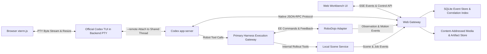

# Astra Embodied Harness: Web Workbench and Codex Integration Plan

> This document preserves the initial design conventions established on 2026-09-30 and outlines long-term extension goals. References to "unimplemented" features reflect the state at that time. For the current supported scope, refer to the code registries, capability declarations, tool contracts, and test suites.

Version: v0.2, September 30, 2026. Status: Implementation specification prior to live Codex session and RoboDojo integration. In accordance with core design requirements, this revision establishes a persistent native Codex execution terminal as the primary right-hand panel. The `/v1/...` HTTP endpoints, event projections, and directory structures described below represent project-defined interfaces rather than pre-existing upstream APIs.

**We adopt a unified web workbench layout: the robot camera view on the left, a persistent native Codex terminal on the right, and a compact timeline of activity nodes with synchronized replay controls along the bottom. Users can watch how Codex works in real time without having to click through individual nodes first.** Specifically, a browser-based terminal component attaches to a backend PTY running the official Codex TUI connected to the active `app-server` and `thread_id`, while structured protocol events are captured in parallel to drive action correlation and historical inspection.

Companion specifications: [Embodied Harness Design Plan](./embodied-harness-design.md), [Local Scene and Short-Horizon Simulation Plan](./local-scene-and-rollout.md), and [Shared Interfaces and Event Protocol v0.1](./shared-protocol.md). All field names, coordinate conventions, state machines, and permission boundaries follow the shared protocol.

## 1 Three Core Questions Answered by the Interface

1. **What is Astra doing right now?** Is it observing the scene, computing 3D measurements, writing or invoking a Python program, submitting an end-effector (EE) motion, verifying an outcome, or waiting on a tool?
2. **How does this operation relate to the physical robot?** Which camera frame was it conditioned on, what EE target path was requested, what trajectory did the backend plan, and where did the arm actually move?
3. **How can we drill down when debugging?** Every high-level node traces cleanly back to raw tool arguments, return payloads, code diffs, stdout/stderr logs, uncropped images, and protocol events.

By default, the interface displays the live native Codex execution stream alongside the live robot camera feed. Verbose JSON payloads, complete tool parameters, and trajectory tracking residuals remain expandable on demand. Activity nodes serve as a navigable index rather than a replacement for the live terminal window, and they never force Astra into a rigid multi-stage pipeline.

## 2 Clean, Hierarchical Layout

### 2.1 Default View: Side-by-Side Robot Feed and Native Codex Terminal

The top bar displays only the task name, run lifecycle status, Live vs. Replay mode indicator, and a single unambiguous run-control menu. Model configuration, environment identifiers, and layout seeds are tucked into a collapsible run-details drawer rather than cluttering the workspace with decorative metric cards.

On desktop viewports, the main workspace defaults to an approximately 50/50 split: the primary robot camera feed on the left and a generously sized native Codex terminal window on the right. A draggable splitter allows resizing or temporarily maximizing either pane so the terminal is never cramped into a narrow log sidebar. Camera view selectors sit cleanly along the top edge of the video pane, with secondary camera feeds expandable on demand. Below the split view sits a compact timeline strip with coarse-grained activity nodes.

Timeline nodes display concise titles, execution status badges, and elapsed durations. Selecting a node highlights both the node and its corresponding 2D/3D target overlay in the camera view using a single muted accent color. The visual theme relies on neutral surface colors, crisp hairlines, and clear typographic hierarchy—avoiding rainbow node palettes, glowing connector lines, heavy gradients, or redundant status badges. The terminal uses a legible monospace font with restrained ANSI colors and renders raw CLI output verbatim without lossy summarization.

On narrow viewports, the robot camera feed and native Codex terminal stack vertically so the live terminal remains directly visible while structured inspectors collapse into drawers. The browser terminal maintains its own scrollback buffer and a "Jump to Bottom" indicator, preserving standard column widths and forwarding PTY resize events (`SIGWINCH`) on layout changes. Terminal viewport dimensions never alter robot execution behavior or mutate the model's prompt context.

### 2.2 Selected View: Three-Tier Action Inspector

Clicking any activity node keeps the user's current workspace context intact while opening a three-tier inspector drawer (with the Summary tier visible by default):

| Inspector Tier | Displayed Content | Primary Purpose |
|---|---|---|
| 1. Summary | Conditioning `observation_id`, requested motion summary, and live execution status or terminal outcome. | Rapid situational awareness. |
| 2. Evidence | Input camera frames, requested EE path, planned trajectory, measured EE feedback trace, and post-action observation. | Verifying physical actions and outcomes. |
| 3. Raw Records | Native Codex `item`, raw tool arguments & responses, stdout/stderr streams, code diffs, artifact refs, and `EventEnvelope` JSON. | Deep debugging and exact reproduction. |

The interface strictly distinguishes between **"Astra's Conditioning Input Frame"** and **"Current Live Environment Feed."** When a user clicks a historical action node, the left-hand camera pane and inspector switch into pinned Replay mode for that action, while the right-hand native Codex terminal continues streaming the live session under a clear `LIVE` header badge—never overwriting the active terminal screen with a static historical summary. Users can inspect historical raw items in the side drawer and click **"Return to Live"** at any time to re-lock the video feed to the live head.

Within the Evidence tier, the four distinct trajectory records—**Requested**, **Planned**, **Dispatched**, and **Measured**—can be toggled individually. If measured feedback is unavailable for a segment, the UI explicitly labels it `Not Recorded` rather than substituting the requested path as fake feedback. Similarly, 2D pixel target overlays are rendered on camera frames only when verified camera calibration is present for that exact `frame_id`; otherwise, the inspector displays numeric 3D coordinates without drawing speculative 2D projections.

### 2.3 Continuous Live Monitoring vs. Deep Inspection

From the start of an episode, the native Codex terminal continuously renders the exact CLI experience: assistant messages, tool and shell invocations, command outputs and errors, busy/waiting indicators, and interactive approval prompts. Any content folded or truncated by the TUI's standard terminal layout remains accessible either by interacting with the terminal scrollback or by opening the structured Raw Records inspector (without claiming to expose hidden internal chain-of-thought tokens that the upstream API itself withholds).

An episode runs within a single persistent Codex `thread_id`, feeding tool execution receipts back into the ongoing conversation loop. A persistent session process does not imply the LLM is generating tokens every millisecond: when the system is waiting for physical arm motion to complete, waiting on user approval, or idle between turns, the UI reflects that exact state. When a multi-turn task requires initiating a subsequent turn, the single run coordinator advances the existing thread according to the task budget—never spawning a fresh, context-free Codex instance per robot motion.

Internal simulation previews (`world_kind="internal"`) live under a dedicated tab in the visual pane, clearly badged with **`Internal Prediction`**, `scene_version`, `snapshot_id`, and `branch_id`. Phase 1 renders simulated rollouts from the exact same virtual camera viewpoints as the evaluated world alongside trajectory comparison plots, embedding an interactive 3D viewport only when spatial structure inspection is needed (avoiding the GPU/browser overhead of rendering two heavy 3D scenes simultaneously by default). When comparing candidate rollout branches, the UI highlights their shared `snapshot_id` origin and independent branch timelines so simulated predictions are never mixed into the evaluated world's replay strip.

## 3 Native Terminal First, Backed by Structured Event Logging

| Integration Route | Engineering Savings | Primary Limitations | Adopted Role in This Plan |
|---|---|---|---|
| Native Codex desktop app or CLI window alongside robot window | Near-zero custom session UI code. | Cannot be embedded into a unified web layout; separate OS windows lack click-to-seek synchronization. | Fastest local developer workflow. |
| Browser Terminal (`xterm.js`) $\rightarrow$ Backend PTY $\rightarrow$ Official Codex TUI $\rightarrow$ Shared `app-server` / `thread_id` | Preserves the authentic real-time CLI experience inside the web workbench. | Requires PTY lifecycle management, reconnection buffering, and strict input ownership; raw ANSI bytes do not replace structured indexing. | **Primary persistent right-hand panel.** |
| Codex `app-server` + Thin Custom Web Inspector | Structured access to native threads, turns, items, tool calls, streaming deltas, and approvals. | Requires custom frontend rendering components; does not replicate the native TUI look and feel. | **Backend source of truth & structured inspector.** |
| DeepSeek Harness (DSH) + Codex Relay Plugin | Reuses an existing web chat/tool UI shell to reduce frontend boilerplate. | Third-party version compatibility and raw correlation fidelity require verification; default prompt wrappers may alter agent behavior. | Optional parallel spike for comparison. |
| OpenAI ChatKit with Custom Backend | Provides prebuilt chat UI widgets. | Still requires translating Codex's `app-server` protocol into ChatKit's schema plus building all robot media and correlation views. | Deprioritized. |

OpenAI's official documentation positions `codex app-server` as the foundation for building rich custom clients, exposing full `thread`, `turn`, and `item` lifecycles alongside server-initiated approval requests. While `app-server` is ideal for deterministic event correlation, it does not ship a prebuilt browser UI out of the box. ([Codex app-server Documentation](https://learn.chatgpt.com/docs/app-server))

**Crucially, official Codex CLI builds now natively support attaching the TUI to a running `app-server`.** Verification against our local installation (`codex-cli 0.159.0`) confirms that both `codex --help` and `codex resume --help` expose the `--remote` flag. Instead of re-implementing a synthetic chat clone from scratch, we run the official Codex TUI inside a managed backend PTY and stream it to `xterm.js` in the browser. Because upstream support for `--remote` is distinct from multi-client orchestration in our Harness, mid-turn attachment behavior is explicitly validated during Phase 1 integration. ([Official Remote TUI Guide](https://learn.chatgpt.com/docs/app-server), [CLI Command Reference](https://learn.chatgpt.com/docs/developer-commands))

The illustrative commands below show how the run supervisor launches and binds a dedicated session (using a per-run Unix domain socket rather than sharing a user's global desktop socket):

```sh
codex app-server --listen unix:///path/to/run/codex.sock
codex resume --remote unix:///path/to/run/codex.sock THREAD_ID
```

The second command runs inside the backend PTY without injecting a new prompt or minting a new thread. Refreshing the browser simply reattaches to the existing PTY byte stream without restarting the model or re-sending task instructions. If a specific pinned CLI build exhibits side effects when attaching mid-turn via `resume --remote`, Phase 1 falls back to launching the primary task directly through the PTY-hosted TUI while the structured event collector subscribes to the same `app-server` instance—never launching a second agent instance that merely pretends to monitor the first.

DeepSeek's open-source DSH (`deepseek-harness`) provides an extensible web shell, and the third-party `relay-dsh-plugin-codex` adapter binds a DSH session to a persistent Codex thread while projecting `thread/turn/item` records into DSH tool cards. However, the plugin's README notes that certain command outputs may appear empty and that historical session imports only backfill terminal user/assistant messages without continuous live sync. Accordingly, we prioritize the native PTY terminal + structured event collector path first, treating DSH as an optional secondary evaluation that never blocks Phase 1 delivery. ([DSH Repository](https://github.com/deepseek-ai/deepseek-harness), [Codex Relay Plugin & Limitations](https://github.com/yangbobo2021/relay-dsh-plugin-codex), [Correlation Adapter Source](https://github.com/yangbobo2021/relay-dsh-plugin-codex/blob/main/codex-adapter.js))

Similarly, while OpenAI ChatKit supports custom backends, adapting `codex app-server` into ChatKit's protocol adds an unnecessary translation layer without solving robot media synchronization. ([Custom ChatKit Documentation](https://developers.openai.com/api/docs/guides/custom-chatkit))

## 4 Backend Architecture: One Event Gateway, Two Independent Sources of Truth



In Phase 1, the Web Gateway can run in the same OS process as the primary Harness while maintaining strict logical separation between run control, read-only queries, and physical robot execution. Browser clients never hold direct execution credentials for either `codex app-server` or the robot motion backend; all physical actions pass exclusively through the primary Harness execution gateway.

Browser clients consume structured domain events over HTTPS/SSE and attach to the terminal byte stream over an authenticated WebSocket connected to the PTY supervisor. Both the PTY-hosted TUI and the gateway's structured event subscriber connect to the same supervisor-managed `codex app-server` over a local Unix domain socket—never spawning two disconnected `stdio` instances or exposing the raw `app-server` socket directly to the browser (noting that upstream TCP WebSocket transport in `app-server` remains experimental with Origin restrictions). ([app-server Transport & Client Documentation](https://learn.chatgpt.com/docs/app-server))

The PTY supervisor manages terminal geometry (`rows`/`cols`), UTF-8/ANSI byte framing, a bounded ring buffer for reconnection scrollback, and stream sequence numbers, insulating the running TUI from browser tab closures (`SIGHUP`). Multiple browser tabs can subscribe to the same PTY output stream in read-only observer mode by default, where the gateway drops all inbound keyboard, paste, and `Ctrl-C` frames. If manual human intervention is requested later, the run coordinator explicitly transfers input ownership before forwarding keystrokes—and even then, sending `Ctrl-C` in the terminal never substitutes for a confirmed robot motion stop from the execution gateway.

The recommended software stack is intentionally lean: a lightweight HTTP/SSE/WebSocket layer integrated into the Python Harness backend, a React + TypeScript frontend, and a local SQLite WAL database paired with a flat artifact directory. Binary images, MP4 videos, and trajectory arrays are served via content-addressed `ArtifactRef` URLs rather than bloated JSON payloads.

## 5 Recording Structured Codex Execution Details

The gateway maintains a two-tier record of Codex activity:
1. **Raw Protocol Archive:** Every JSON-RPC notification, server request, and client response from `codex app-server` is appended verbatim, preserving native `method` names, JSON-RPC request IDs, `thread_id`/`turn_id`/`item_id` values, and any unrecognized upstream fields so zero fidelity is lost.
2. **Projected Inspector Index:** Deterministic projections derive structured user messages, assistant outputs, tool calls, shell outputs, file diffs, approval requests, and timeline activity nodes for fast UI rendering.

The adapter completes protocol initialization and capability negotiation against the pinned `app-server` schema before starting or resuming a thread—relying on generated schema types from the pinned Codex build rather than brittle string matching. Core lifecycle methods include `thread/start`, `thread/resume`, `thread/read`, `turn/start`, `turn/interrupt`, and `item/*` notifications. ([Official Lifecycle & API Reference](https://learn.chatgpt.com/docs/app-server))

The structured inspector supports rendering user prompts and image attachments, visible assistant messages, tool call arguments and structured receipts, shell command streams, file diffs, interactive approval/input requests, error diagnostics, turn completion statuses, and publicly exposed reasoning summaries (clearly labeled as upstream summaries rather than claiming access to unexposed raw chain-of-thought tokens).

To keep the UI responsive, streaming text deltas are never rendered as separate DOM nodes on arrival; instead, the projection layer aggregates deltas per `item_id` and flushes UI updates at a batched cadence of roughly 50–100 ms while preserving the exact raw delta sequence on disk. Long stdout/stderr logs are paginated or collapsed by default, and binary attachments load lazily by reference.

**Establishing deterministic cross-domain correlation requires explicit bridge instrumentation:** the tool execution bridge must bind the active Codex `item_id` and `tool_call_id` to the conditioning `observation_id` and resulting `action_id`. When Astra executes a synthesized Python script rather than invoking an MCP tool directly, the Harness injects a context-aware EE client carrying signed correlation metadata so scripts cannot spoof another action's ID. If a tool invocation lacks an associated robot action or observation, the UI explicitly displays `Uncorrelated` rather than guessing associations by wall-clock proximity.

Within a persistent thread, turn progression and approval responses are owned by a single coordinator (either the automated Harness runner or a designated interactive TUI owner), while secondary clients subscribe strictly as read-only observers. Integration testing must explicitly verify mid-turn TUI attachment, in-flight item backfilling, subsequent event delivery, configuration preservation (model, reasoning effort, working directory, sandbox permissions, and tool definitions), and approval routing against the pinned Codex build—never assuming that the mere presence of `--remote` guarantees side-effect-free attachment.

In particular, the UI must clearly distinguish among **Live Streaming**, **Historical Replay**, and **Disconnected** states. Inspection of upstream Codex TUI source code (`session_lifecycle.rs` and `app_server_session.rs`) shows fallback paths where a failed live resume degrades to rendering historical messages; therefore, merely seeing prior messages on screen does not prove live attachment succeeded. Acceptance tests must verify that newly generated tokens and turn completions stream live after attachment without mutating session parameters. ([TUI Session Lifecycle Source](https://github.com/openai/codex/blob/main/codex-rs/tui/src/app/session_lifecycle.rs), [TUI Session Parameters Source](https://github.com/openai/codex/blob/main/codex-rs/tui/src/app_server_session.rs))

## 6 Deterministic Generation of Coarse-Grained Activity Nodes

Timeline activity nodes are generated via deterministic event projection—never by running a secondary LLM to summarize logs on the fly, nor by forcing the agent into a hardcoded state machine. Core node categories include **Observation**, **Geometry / Computation**, **Robot Motion**, **Internal Simulation**, and **Outcome Verification** (falling back to the literal tool name when a custom tool does not map to a standard category).

| Ingested Domain Event Fact | Projected Activity Node Behavior |
|---|---|
| Tool invocation requests a new observation | Creates an `Acquire Observation` node and links the resulting `observation_id` upon completion. |
| Gateway receives an `EEAction` request | Creates a motion node summarizing the target pose/path in `Requested / Planning` status. |
| Adapter emits `action.started` | Transitions the motion node to `Executing` and binds the starting `sim_step`. |
| Adapter emits `action.completed`, `failed`, or `stopped` | Transitions the node to the confirmed terminal state and records the executed step interval. |
| Adapter emits `action.status_unknown` | Badges the node `Status Unconfirmed` with the last known step interval, awaiting subsequent reconciliation. |
| Scene service emits `job.started` / `job.completed` | Creates an `Internal Rollout / Scene Update` node linked to its `snapshot_id` and `branch_id`. |
| Assistant declares task completion | Creates an `Agent Reported Completion` marker, keeping the authoritative evaluator score in a separate badge. |

The projection strictly separates **"Planned / Requested"** from **"Physically Executed."** Receiving a background `job_id`, a Codex `item/completed` event, or a `turn/completed` event never marks a physical robot motion as `completed`. Conversely, a single failed motion attempt (e.g., an IK rejection) does not mark the overarching Codex turn as failed if the agent is continuing to recover.

In Phase 1, the timeline renders as a clean sequential activity strip with lightweight collapsible sub-items. Local branching graphs are expanded inline only when a single decision forks multiple parallel internal rollout candidates or concurrent tool calls, keeping complex full-run provenance graphs in a dedicated diagnostic drawer. Parent-child relationships derive strictly from recorded `correlation` IDs rather than heuristic string matching.

## 7 Synchronizing with RoboDojo Robot Motion

The workbench enforces an unbroken, auditable traceability chain across every manipulation step:

$$\text{Codex Item} \longrightarrow \text{Tool Call} \longrightarrow \text{Input Observation} \longrightarrow \text{EEAction} \longrightarrow \text{Plan / Execution} \longrightarrow \text{Feedback \& Video} \longrightarrow \text{Post-Action Observation}$$

As defined in the shared protocol, correlation relies on `run_id`, `episode_id`, `env_instance_id`, `env_generation`, `action_id`, `observation_id`, `frame_id`, `branch_id`, and `job_id`. The event store's `server_seq` reflects event ingestion order rather than physical motion order, and unsynchronized host wall clocks are never used to align trajectories.

The RoboDojo adapter emits lifecycle events at action start, progress checkpoints, and termination, recording the exact `sim_step` interval executed. Camera frame sidecars record `camera_id`, `frame_id`, `env_generation`, `sim_step`, capture timestamp, and (whenever delivered to the agent) the associated `observation_id`. Exported MP4 videos include an explicit frame-to-`PTS`-to-`sim_step` lookup table to handle paused stepping, dropped frames, or variable encoding rates cleanly.

Clicking an action node simultaneously selects its conditioning input observation, originating Codex `item_id`, executed step interval, and post-action observation. Scrubbing the timeline cursor selects the active action covering that `sim_step` alongside the matching camera frame (displaying the exact step offset if only a nearby frame exists, or `Frame Missing` if unrecorded). Uncorrelated tool calls remain inspectable in the log without triggering false timeline highlights.

Live monitoring and historical replay share the exact same selection data model: in Live mode, incoming events advance the display cursor automatically; in Replay mode, the user controls the cursor manually. Internal simulation rollouts scrub along their own isolated `branch_id` timeline, aligning comparisons against the shared `snapshot_id` anchor state and normalized action progress rather than wall-clock timestamps.

## 8 Maximizing Reuse for Media Recording and 3D Visualization

### 8.1 Phase 1 Media Pipeline: Reusing and Extending RoboProbe

RoboProbe already provides an offline `trace_viewer.py` supporting multi-camera MP4 playback, tool call lists, frame-accurate seeking, parameter inspection, and tool-to-step interval mapping over HTTP `Range`/`HEAD` requests, paired with `utils/live_frames.py` for writing JPEG previews and appending frame indices as observations are captured without re-rendering per web client. ([Pinned Trace Viewer Source](https://github.com/RoboProbe/RoboProbe/blob/9ffacc54f372beef6479d61711bf4945e31ae4ce/policy/RoboDojo_Agent_L3_Inspect/trace_viewer.py), [Live Frame Recorder Source](https://github.com/RoboProbe/RoboProbe/blob/9ffacc54f372beef6479d61711bf4945e31ae4ce/utils/live_frames.py))

We reuse this recording pattern and HTTP media serving logic while upgrading the metadata schema to incorporate our unified correlation IDs, `env_generation`, conditioning `observation_id` provenance, and exact video `PTS` mapping tables (preserving upstream license notices).

Specifically, our adapter addresses four limitations identified in the pinned RoboProbe reference code:
1. Replacing coarse `policy_step` counters in the live frame index (which repeat across substeps within a single action) with unambiguous `sim_step` and `step_domain` identifiers;
2. Adding an explicit per-frame `PTS` mapping table instead of relying on approximate `frame_number / fps` seeking;
3. Archiving the full sequence of measured per-waypoint robot states as a continuous feedback trajectory artifact; and
4. Explicitly capturing and archiving a terminal `result_observation_id` after the final action of an episode rather than waiting for a subsequent turn.

In addition, lossy display JPEGs are explicitly distinguished from the raw image buffers sent to the model, and disk encoding latency is measured as part of system telemetry. ([Shared Execution & Recording Source](https://github.com/RoboProbe/RoboProbe/blob/9ffacc54f372beef6479d61711bf4945e31ae4ce/policy/RoboDojo_Agent_L3_Inspect/deploy.py))

In Live mode, the camera pane displays the most recently published environment frame. When the physics clock continues running during lengthy LLM reasoning turns, the adapter samples frames at a bounded rate (e.g., targeting 2–10 Hz while logging actual frame age and bandwidth); when the environment steps strictly inside synchronous tool calls, the UI clearly badges the feed as `Environment Paused / Awaiting Action` rather than triggering unauthorized simulation steps from the web server.

### 8.2 3D Spatial Inspection: Evaluating Rerun First

When interactive 3D inspection of point clouds, camera frustums, and coordinate frames is needed, we prioritize integrating the **Rerun Web Viewer** via its official JavaScript/React embedding API (`@rerun-io/web-viewer`). Unlike an isolated iframe, the JS API exposes programmatic timeline control, current time queries, active timeline selection, and entity selection callbacks that can bridge directly to our shared protocol indices. ([Rerun Web Embedding Guide](https://rerun.io/docs/howto/integrations/embed-web), [Rerun WebViewer JS API](https://ref.rerun.io/docs/js/stable/web-viewer/classes/WebViewer.html))

Phase 1 validates loading per-episode exported `.rrd` archives first before enabling live streaming, pinning compatible Rerun SDK and Web Viewer versions and capping point-cloud decimation budgets. Rerun handles 3D spatial rendering while our workbench owns cross-domain correlation across Codex items, `EEAction` records, and observations—avoiding any need to build a custom WebGL 3D timeline engine from scratch.

### 8.3 Native Isaac Sim Viewport Streaming as an Optional Enhancement

RoboDojo currently targets Isaac Sim 5.1.0, whose native WebRTC livestreaming stack imposes strict hardware, driver, and concurrency constraints—including a single-client-per-instance limitation and hardware NVENC requirements that are unsupported on data-center GPUs without NVENC engines (such as NVIDIA A100). Consequently, the web workbench must never depend on native Isaac WebRTC streaming for core operation. ([Isaac Sim 5.1.0 Livestreaming Documentation](https://docs.isaacsim.omniverse.nvidia.com/5.1.0/installation/manual_livestream_clients.html))

Multi-camera recorded/sampled frames already provide complete visibility into task execution; native Isaac viewport streaming is treated strictly as an optional future enhancement for interactive free-camera debugging on compatible workstations (and any free-camera view inspected by a human researcher remains strictly isolated from Astra's observation inputs).

## 9 Runtime Controls, Reconnection Recovery, and Fault Display

Every control button in the workbench maps to an explicit, unambiguous backend state transition:

| UI Control Action | Exact Backend Semantics |
|---|---|
| **Pause Playback** | Freezes the local browser timeline cursor; neither the robot nor the Codex agent is affected. |
| **Interrupt Turn** | Sends `turn/interrupt` to the active Codex turn while continuing to track any in-flight physical robot motion independently. |
| **Stop Run** | Revokes action submission permissions, dispatches both agent turn interruption and backend motion cancellation, and awaits independent confirmation receipts from each. |
| **Pause Simulation** | Suspends environment physics stepping, exposed only when the active adapter supports clock pausing. |

By default, the top bar exposes a single prominent **Stop Run** action while tucking granular turn/clock controls into an overflow menu. Stopping states transition explicitly through `Stop Requested` $\rightarrow$ `Confirmed Stopped` (or `Stop Unconfirmed` if the backend fails to acknowledge within the timeout)—never turning green solely because the HTTP request returned 202. Closing the browser tab or dropping Wi-Fi never stops or alters an autonomous benchmark run; single-writer locks and safety limits are enforced continuously by the backend gateway.

On SSE reconnection, the browser supplies `Last-Event-ID` (`server_seq`) to resume the event stream without gaps and deduplicates records by `event_id`. If the upstream connection between the gateway and `codex app-server` drops, the gateway queries Codex's persisted `thread/read` state to reconcile terminal item statuses and inserts an explicit `stream_gap` marker—never fabricating synthetic token deltas to mask a disconnection. If a client cursor predates the active event retention window, the gateway instructs the client to load the latest run snapshot and highlights the skipped interval.

Interactive tool approvals and user prompts are rendered and answered using their native upstream request IDs. Duplicate submissions are idempotent, and expired prompts are locked against replay. Multi-window write access is governed by server-side coordinator leases so secondary browser windows remain strictly read-only at the API layer rather than relying on hidden CSS buttons. Finally, authentication tokens, API keys, and evaluator-privileged artifacts are scrubbed before egress so observer and actor permission boundaries remain airtight.

## 10 Proposed HTTP/WebSocket Endpoints and Module Boundaries

The table below summarizes the proposed Web Gateway API surface:

| Endpoint | Method & Path | Behavior and Semantics |
|---|---|---|
| Run Metadata | `GET /v1/runs/{id}` | Returns run configuration, capability manifest, live lifecycle status, and latest `server_seq` cursor. |
| Event Stream | `GET /v1/runs/{id}/events?after=...` | Streams live and historical `EventEnvelope` records over SSE with cursor resumption. |
| Activity Nodes | `GET /v1/runs/{id}/nodes` | Returns deterministically projected coarse-grained activity nodes with cursor pagination. |
| Action Detail | `GET /v1/actions/{id}` | Returns requested, planned, dispatched, and measured trajectories plus correlated media refs. |
| Observation Bundle | `GET /v1/observations/{id}` | Returns the immutable `ObservationBundle` filtered by the caller's permission scope. |
| Codex Item Detail | `GET /v1/codex/items/{id}` | Returns the raw upstream `item` record and aggregated text (scoped by `run_id` and `thread_id`). |
| Media & Artifacts | `GET /v1/artifacts/{id}` | Serves content-addressed images, MP4 videos (with HTTP `Range` support), trajectories, and files. |
| Run Control | `POST /v1/runs/{id}/control` | Submits idempotent run control commands (`stop_run`, `interrupt_turn`, `pause_sim`) with a client `request_id`. |
| Interactive Reply | `POST /v1/runs/{id}/interactions/{id}/reply` | Sends a targeted response to a pending native Codex approval or user-input request. |
| Terminal Metadata | `GET /v1/runs/{id}/terminal` | Returns `terminal_session_id`, bound `thread_id`, access mode (`observer` vs. `interactive`), and PTY dimensions without spawning a new task. |
| Terminal Stream | `WS /v1/terminals/{id}/stream` | Streams authenticated PTY output bytes, scrollback replay cursor, and window resize events (dropping input bytes in observer mode). |

Code organization cleanly separates `codex_adapter`, `pty_supervisor`, `terminal_gateway`, `robot_event_adapter`, `event_store`, `node_projector`, `media_index`, `web_gateway`, and `web_app`, backed by shared schema definitions and synthetic fixtures. Crucially, the raw PTY byte stream and structured `EventEnvelope` store remain decoupled—the system never scrapes ANSI terminal escape sequences with regexes to guess `action_id` correlations.

## 11 Phased Independent Development and Acceptance Milestones

1. **Stage 1: Model-Free, GPU-Free Replay Loop.** Using the shared protocol's `synthetic_fixture` bundle—containing multi-camera observations, two `EEAction` records, one motion failure, one internal simulation branch, raw Codex JSON-RPC logs, and sample MP4/JPEG media—verify that clicking any activity node simultaneously highlights the matching camera frame, trajectory plot, and Codex item, and that scrubbing the timeline reproduces identical selections deterministically. Validate responsive layouts across 320 px, 736 px, 1024 px, and 1440 px viewports as well as full keyboard navigation.
2. **Stage 2: Standalone Live Codex Integration (No GPU Required).** Launch the official Codex TUI inside the backend PTY attached via `--remote` to a live `codex app-server` thread wired to mock robot tools. Verify multi-item turns, streaming shell outputs, interactive approval prompts, turn cancellation, and upstream disconnect recovery. Specifically verify that attaching mid-turn, refreshing the browser page, closing and reopening tabs, resizing the terminal, and inspecting historical timeline nodes never restart the agent, re-send the task prompt, or mutate session configuration—confirming that both the live terminal and structured inspector reflect the exact same `thread_id`.
3. **Stage 3: Standalone RoboDojo Motion Integration (No LLM Required).** Drive the RoboDojo adapter with a deterministic test script submitting `EEAction` payloads. Verify visual separation between requested, planned, and measured trajectories, exact frame-to-`sim_step` alignment, rejection of stale actions across environment resets, and bounded media encoding overhead.
4. **Stage 4: End-to-End Astra + RoboDojo Integration.** Click any live model tool call in the workbench and verify that the inspector surfaces the exact conditioning `observation_id`, submitted `EEAction` target, measured feedback step interval, and post-action `result_observation_id` (explicitly flagging any missing field rather than hiding gaps). Verify that when a Codex turn completes while physical arm motion is still underway, the UI accurately displays the action as `Executing` until the robot backend confirms completion.
5. **Stage 5: Internal Simulation Branches and 3D Viewer.** Connect the local scene service's `scene.*`, `job.*`, and `branch_id` event streams to unlock the `Internal Prediction` tab and optional Rerun 3D viewport. Verify that advancing `scene_head` never mutates historical snapshots and that successful internal rollouts never appear as completed physical actions on the primary timeline.

Stages 1 through 4 define the Phase 1 core scope for the primary Harness and proceed without waiting on the local simulation module. Overall acceptance is judged by verifiable, deterministic correlation and replay across Codex items, robot motions, and camera frames—not merely by rendering three independent panels on the same web page.

## 12 Current Evidence Base and Items Pending Empirical Verification

This design specification is grounded in direct inspection of official Codex `app-server`, ChatKit, Rerun, and Isaac Sim 5.1.0 documentation alongside source-level review of RoboProbe and the DSH Codex relay plugin. Because full end-to-end integration tests have not yet been executed on target GPU nodes, concrete UI latency, frame-rate ceilings, stop-confirmation latencies, and crash-recovery timings remain to be measured empirically. Exact upstream commit hashes and binary versions must be locked in the repository dependency manifest at the start of implementation.

Specific engineering items to verify during Stage 2 and Stage 3 bring-up include:
- Exact behavior of `codex resume --remote` when attaching mid-turn under the pinned Codex CLI build;
- Concrete feedback fields populated by the pinned RoboDojo environment across all target tasks;
- Measured synchronization offsets between camera frame capture and physics control steps; and
- Sustainable camera frame encoding rates and internal simulation GPU memory footprints across target hardware configurations.
