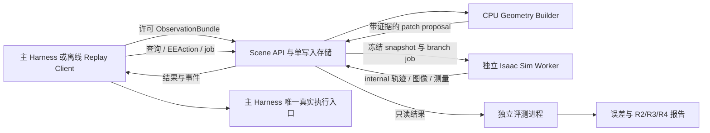

# 局部场景与短时仿真：独立开发方案

> 本文保留方案制订时（2026-09-30）的设计约定，描述扩展目标；其中“待实现”属于当时状态。当前支持范围以代码中的注册表、capabilities、工具契约及测试为准。

版本：设计 v0.1，2026-09-30。状态：可据此拆分开发任务的接口与验收方案，尚未实现或联合部署。本文中的 API、目录和命令均为待实现约定，不代表当前已有服务。

**把这部分做成一个不依赖在线 Astra 的独立服务：输入录制或实时的许可 ObservationBundle，维护任务相关局部场景，提供有来源的几何查询，并在独立 Isaac Sim worker 中对候选 EEAction 做有界短时仿真。它只返回测量与预测；对 RoboDojo 被测环境的执行权限始终属于主 Harness。**

首版以机器人已知模型、RGB、实测关节和明确允许的标定为输入，先实现局部平面、盒形代理、对象状态与未知区域。完整稠密重建、任意物体物理参数辨识、精密插入预测和生成程序的无限制仿真都不作为 MVP 前提。研发阶段按依赖逐步推进，运行时由 Astra 自由选择是否调用，不规定每个任务先扫描、建图、仿真再执行。

本文依赖两份上位约定：[主实施方案](./Astra具身Harness-RoboDojo实施方案与在线仿真探索-2026-09-30.md) 定义任务与评测边界，[共享接口与事件协议 v0.1](./Astra具身Harness-共享接口与事件协议-v0.1.md) 是 ObservationBundle、EEAction、SceneSnapshot、身份与事件的唯一协议来源。本文只补充本模块需要的约束与专属类型；发生字段冲突时修改共享契约并升级版本，不在两个仓库各保留一种解释。

## 1. 独立交付的范围与成功条件

| 交付 | 用户/主 Harness 得到什么 | 本版边界 |
|---|---|---|
| 局部场景服务 | 从许可观测生成场景版本、对象与几何证据；增量更新与回溯 | 有限任务区域和少量刚体，不自动恢复完整房间 |
| 几何查询 | 射线、表面、对象相对关系、距离、路径所覆盖区域和未知项 | 只对已提供的几何/假设有效，不把未知区域判为空 |
| 快照与分支 | 可追溯、不可变的输入快照；互不污染的参数分支 | 克隆自建模型，不克隆原任务 USD、隐藏状态或奖励 |
| Isaac Sim worker | 在相同 EEAction 语义与运动后端下记录短时预测轨迹、接触和测量 | 初始化与接触误差显式报告；不宣称预测等价于真实结果 |
| 离线开发工具 | 重放 ObservationBundle、运行 fixture、对照预测、导出误差报告 | 无需模型账号、在线 Astra 或运行中的 RoboDojo |
| 主 Harness client | 薄 Python client 与可注册工具；异步查询状态、取消和取结果 | 不包含真实动作提交、环境复位或任务完成权限 |

完成“服务能运行”、完成“局部预测准确”和完成“R4 比 R3 有任务收益”是三种验收。第一种可由合成输入和录制数据证明，后两种需要独立评分与对照实验，不能用漂亮的渲染替代。

## 2. 部署与进程划分

首版采用 Python 服务、SQLite 元数据和内容寻址文件存储；不引入分布式队列或大型平台。API 进程使用普通 Python 环境，不导入 Isaac Sim。物理 worker 使用与主实验栈兼容的独立 Isaac Sim 环境，初始对齐 RoboDojo 已核源码要求的 5.1.0/Python 3.11，联合验收后锁定完整镜像、机器人资产和运动后端版本。这个版本是兼容性起点，不是对最新版本的推荐或已测试组合的声明。[RoboDojo 固定版本安装脚本](https://github.com/RoboDojo-Benchmark/RoboDojo/blob/726e9aabfaa642203722eb126f5eaf0f37f3e1ad/scripts/install.sh)



| 进程/模块 | 所有权与职责 | 可访问内容 |
|---|---|---|
| `scene_api` | API、schema 校验、job 状态、scene 单写入者、事件 outbox | 许可观测、场景/任务结果、共享 contract；不持有环境执行凭证 |
| `geometry_builder` | 纯计算 worker；特征追踪、多视几何、拟合、关联、patch proposal | 被分派的输入 blob 与校准/机器人几何；通过 API 提交候选更新 |
| `isaac_worker` | 一个进程一次执行一个物理分支；创建自建 stage、控制、采样、销毁/重置 | 只读 snapshot、分支参数、允许的机器人资产和 controller；独立输出目录 |
| `replay_client` | 按记录顺序送入 observation/action fixture，可模拟中断、重复和延迟 | 已脱敏且符合输入边界的录制包；没有主环境连接 |
| `evaluator` | 比较重建与独立真值、统计预测与任务结果 | 开发/评分权限下的真值及服务导出结果；不向当前 actor episode 回传隐藏答案 |

API 初期用 FastAPI/Pydantic，内部类型从共享 contract 包导入。SQLite 开 WAL；blob 按 SHA-256 存文件。CPU 计算先用受限进程池。GPU worker 从 API 领取 lease，避免两个进程直接并发修改数据库。存储事务负责“结果提交＋job 终态＋事件 outbox”；大文件先写临时文件、校验并原子落入 blob store，再提交 manifest。

本机开发默认监听 loopback；跨机器时使用明确鉴权的服务地址。worker 只有领取内部 job、读取获授权 blob、提交结果的权限。主环境安装目录、任务资产、奖励代码、环境控制 socket 与执行凭证不挂载给 builder/worker。机器人资产从白名单 manifest 单独打包，不以挂载整个 RoboDojo 数据目录代替。

**进程隔离不等于 GPU 资源隔离。** 第一版允许单 GPU 串行调度；与主环境共享 GPU 时记录渲染/动作延迟，必要时降低 rollout 并发或用独立 GPU。不能把 worker 的 GPU 争用从 R4 墙钟成本中扣除。

## 3. 共享身份、时间与来源规则

所有共享消息使用 `schema_version="0.1"`，字段采用 snake_case。身份语义以共享协议为准：

- `run_id, episode_id, env_instance_id, env_generation` 绑定被观察世界。环境复位或重建后 generation 改变，旧 scene 不自动沿用。
- `observation_id` 引用原始许可观测；`action_id` 引用共享 EEAction。一个 action 可用于多个内部试验，但内部结果不表示它在 observed 世界已经执行。
- `scene_version` 在该环境命名空间内单调递增；必须连同环境身份使用，不能拿另一个 episode 的 version 7 混用。
- `snapshot_id, branch_id, job_id` 由服务创建、不可复用。尚未创建的 ID 按共享 schema 省略或为 null，不制造占位“真实 ID”。

`world_kind="observed"` 用于来自被测世界的原始观察/真实执行记录；重建模型、仿真图像、预测轨迹和虚拟接触为 `world_kind="internal"`。内部几何可以有 observed 证据，但不能因此改写媒体的世界来源。

统一事件复用共享 `EventEnvelope`：`event_id`、环境身份、`source/source_instance_id/source_seq/server_seq`、`type`、`occurred_at/received_at`、`sim_step/step_domain/sim_time_s/clock_domain`、`correlation`、`payload_ref/payload`。本服务维护每个 source 实例的递增序列与持久化 outbox，重启生成新的 source_instance_id；主 Harness 事件存储赋予的 run 内 `server_seq` 只表示接收顺序，本服务不另造同名全局序号。状态转移由 job revision、scene base version 和显式引用确定，不由到达先后猜测。

时间域必须分开：

| 时间 | 使用方式 |
|---|---|
| observed `sim_step/sim_time_s` | 属于具体 env_generation；只与同一时钟域的观察/动作比较 |
| internal `sim_step/sim_time_s` | 属于具体 branch 的时钟域；从分支约定初值开始，不混入主环境步数 |
| 图像 capture 时间 | 保存采集设备/host 的 clock domain；通过 `frame_id` 与已确认的控制或物理步关联，并注明 step_domain，不混用计数 |
| API 接收、排队、worker 运行时间 | 用服务端单调计时器计算 duration；UTC 时间只供跨日志定位 |

没有时钟映射时不计算“图像延迟＝墙钟－sim_time”。没有 frame-to-step 关联时也不靠时间看起来接近而宣称 q 与图像同步。延迟指标分别报告接收至 scene commit、排队、计算以及可验证的传感滞后。事件 `occurred_at` 不能代替图像曝光时刻。

## 4. 本模块对 ObservationBundle、EEAction、SceneSnapshot 的要求

下表是模块的必要校验项，不是另一份 schema；完整字段和编码取自共享 contract。

| 共享类型 | 本模块要求 | 缺失时行为 |
|---|---|---|
| ObservationBundle | 环境身份、observation_id、原始 RGB blob/frame_id、相机名称、每帧关联 step 或同步状态、实测 q 的名称/顺序与采样关联、设备与标定引用 | 仍可存储和查看 RGB；米制构建所需信息缺失则返回具体 unsupported/unknown，不补假值 |
| 设备/标定引用 | K、畸变、有效图像尺寸/裁剪变换、固定相机外参或 link-to-camera 安装变换、机器人模型与基座参考、版本/hash | 不允许以默认焦距或身份矩阵冒充有效标定 |
| 机器人状态 | 按共享 source_kind 记录 q 是 measurement、estimate 或 command；可用 qdot、夹爪字段及来源、最后有效控制目标 | FK 起点使用实测或明确估计状态；夹爪控制代理不能充作实测指位或接触证据 |
| EEAction | action_id、环境/观测绑定、TCP/坐标系、路径语义、姿态编码、速度/容差/夹爪语义、后端要求 | 直接用共享 validator；后端不支持的路径/双臂同步模式明确拒绝 |
| SceneSnapshot | 冻结 scene_version、证据观测、机器人初态、校准/机器人/构建器版本、geometry/physics hypotheses、未知项及 blob digests | 创建前校验引用闭合；不允许运行中读取“最新参数”替换冻结输入 |

首版主条件是 **RGB＋q＋已披露标定＋允许的机器人模型**，不接 simulator depth、任务 object pose、完整对象 mesh、摩擦真值或奖励内部状态。若后来加入双目深度输出、RGB-D、标记或已知任务物体 CAD，作为额外输入条件分别记录与评测。

相机米制位姿采用共享坐标约定。对于固定基座上的腕部相机，`T_world_camera = T_world_base × FK(q_measured) × T_link_camera`；多帧点匹配必须对应同一物理点且满足静态/刚体假设。固定单相机不能通过反复拍静态场景获得新的几何基线；只支持已有平面等约束下的条件查询。单目几何与手眼标定依据见 [OpenCV 4.13.0 相机几何](https://docs.opencv.org/4.13.0/d9/d0c/group__calib3d.html)。

为了离线开发，一份录制包至少包含共享 schema manifest、obs JSONL、RGB blobs、设备/校准 manifest、机器人允许资产 manifest、可选候选 EEAction 与期望接口状态。**不需要包括原任务 USD 或原环境进程快照。** 开发评分真值单独放置，replay client 与服务不能读取。

## 5. 局部 scene 的表示、patch 与不可变快照

### 5.1 SceneHead 只保存当前版本指针

scene 命名空间由共享环境身份决定。API 是唯一写入者；builder 只提交 patch proposal。每次有效更新写入新 manifest 与 `scene_version`，旧版本可读取。不存在“把原版本文件覆盖后继续使用原 ID”的更新方式。

局部 scene 的内容包括：

| 条目 | 最少信息 |
|---|---|
| 参考系 | 标定和机器人模型 digest；所有变换统一到固定参考系并保留来源 |
| 几何实体 | 稳定 object/entity ID；plane/box 等几何、位姿、测量支持范围、碰撞代理与可视代理分别引用 |
| 对象状态 | 最后观测、状态时间、`tracked/occluded/lost/retired`、位姿/速度来源、可能的运动区域 |
| 证据 | 源 observation/frame/像素对应、拟合残差、视差、内点、参数假设与生成程序版本 |
| 物理假设 | 质量/摩擦/惯量/关节等已知值或可行范围；来源是 measurement、explicit_prior 或 provisional_default |
| 覆盖与未知 | 观测支持的表面、未观测背面、尚未确定的高度/厚度、移动后需要复测的区域 |

不要生成无校准依据的统一“置信度 0.93”。几何误差可用残差、条件数、区间、样本或有明确假设的协方差表达；未量化就写 `unquantified`。一组参数样本是测试条件集，不默认是真实概率分布。

### 5.2 ScenePatch 是有前置条件的声明式修改

模块专属 `ScenePatch` 至少有：共享环境身份、`base_scene_version`、输入 observation IDs、builder/config digest、操作列表、证据/假设引用、影响区域、计算起止时间。允许操作限定为 `upsert_geometry`、`update_pose`、`set_physics_hypotheses`、`mark_unknown`、`mark_lost`、`retire_entity`；首版不接受任意 JSON 路径写入、任意 Python 或外部 USD URI。

每个 operation 必须声明其字段是观测推断还是显式假设。Astra 可提供对象语义、图像 ROI、像素对应或物理假设；其数值不因来自 Astra 就变成实测。人工标注的离线 fixture 可用于组件开发，但正式自主实验必须记录是否有人提供了额外对应点或物体标签。

提交采用 compare-and-swap：`base_scene_version` 不等于当前 head 时返回 `scene_version_conflict`。首版不做隐式多 patch 合并；builder 可以在预算内基于新 head 重新计算一次，否则由调用方决定。迟到观测不能覆盖更新的对象状态，只能作为历史证据或触发显式重建。

标定、机器人模型或坐标系版本变化属于模型更新；必须重建受影响几何或将其标为失效，不能简单换一个 transform 标签。相同 observation ID 搭配不同内容 digest 是冲突，不能悄悄覆盖。

### 5.3 Snapshot 与 branch 的区别

`SceneSnapshot` 冻结一个 scene manifest，并绑定用于 rollout 的 anchor observation/机器人初态。某个对象可能只在更早的帧中可见，因此各实体保留自己的最后观测时间；snapshot 不能声称所有实体都在 anchor step 同步实测。

snapshot ID 指向不可变 manifest，引用的所有 blob 都有 digest。创建后即便 scene head 更新，旧 snapshot 内容不变。标定/构建器/引擎升级也不改变旧快照；用旧版本离线重放可以保留，但其对当前世界的适用性另行判断。

模块专属 `BranchManifest` 包含 `snapshot_id`、从快照声明的假设集选出的参数/初态、seed manifest、engine/controller/planner 配置 digest 和初始化策略。引擎、controller、标定等配置继承快照；若改变快照已冻结的配置或假设范围，创建新 snapshot。只在原假设集内换采样条件时创建新 branch，不能在已有分支中间偷偷换摩擦或物体位置。首版每次 job 从 branch manifest 冷建/受控重置；同一 branch 的两次 job 是两次独立重放，不是默认接着上次终点跑。

分支之间只共享只读资产，运行时 stage、控制器、队列、RNG、状态和输出目录分离。候选试验结果只能生成待审阅的模型修订 proposal，不能自动回写 observed scene 的对象位姿或物理属性。

## 6. RGB 场景构建的可实现 MVP

### 6.1 输入处理与稀疏几何

builder 首版实现以下可单独调用的计算，不把它们变成每个动作必经的任务流程：

1. 校验观测身份与 frame/q 关联；按各图像原始尺寸应用 K 与畸变。保留原图，overlay 另存。
2. 由共享 FK 与标定计算相机位姿；自机器人投影可作为排除区域，并记录遮罩和误差余量，不能误把邻近物体像素也当可靠背景。
3. 在指定 ROI 中用 OpenCV 特征匹配/LK 追踪产生对应点；检查前后向一致性、极线残差、遮挡和模糊。第一版不承诺发现和理解任意对象。
4. 在已知米制相机基线下三角化；检查正深度、平移视差、重投影误差和退化条件。纯旋转、低视差、错误同步、对象移动导致的不一致都返回原因。
5. 由这些点拟合有限平面或对象代理。平面要报告支持点与支持区域；不把无限数学平面自动扩张成整张桌子。

第一组 primitive 只做有限平面与 box。box 的高度/朝向/背面若不能由观测约束，就保留范围或候选，不凭一个2D矩形给出完整精确盒子。圆柱、凸包、局部 mesh 以后按任务需要增加。

纯 RGB 稀疏点只支持局部表面，不自动给出完备 occupancy 或 ESDF。距离查询应说“到这些已知代理的最小距离”，不能把没有点的区域都当自由空间。碰撞代理可采用保守包络，但其过度覆盖和原始观测表面分别保存，避免把保守余量当实测尺寸。

### 6.2 对象关联与动态更新

首版对象 ID 由显式 ROI/种子或前次对象观测初始化。跨帧用外观匹配、投影门限与几何一致性维持关联；相似物体交叉、长时遮挡和不可能运动时标记 ambiguous/lost，不自动交换身份。

可交互对象与静态背景分开。确认移动的对象只更新状态，不继续把旧位置留在静态模型。失去跟踪后保留最后证据并扩大可能位置范围；如果范围无法量化，相关查询返回 unknown。动作可能触及的对象和区域标为 dirty，等待新观察后再决定恢复哪些用途。

夹爪闭合命令不证明物体已抓住；TCP 与对象的刚性附着需要视觉或其它允许证据支持。MVP 中“已持物但接触状态未知”的分支不作为可靠接触 rollout 起点；可以进行显式附着假设下的几何查询，但结果必须标为 conditional。发生释放、滑动证据或身份丢失时，旧附着假设失效。

对象速度由同一时间域的多次观测估计并保存误差；缺少数据时是 unknown。做静止假设必须成为 branch 的初始化条件，不能把缺失速度默认为已测到零。

### 6.3 接触参数先做假设范围

首版不从 RGB 外观自动推断准确质量、摩擦和惯量。对少量对象使用明确声明的可行范围，运行参数扰动，测候选排序是否稳健。若要从交互中缩小范围，必须保存实际发送的动作、实测机器人/物体响应和拟合目标，并在留出动作上验证；相关参数不可辨识时保留多种解释。

抽屉、铰链、柔性物和精密插入暂不进入核心接触 MVP。新增 articulated object 需要单独实现关节类型、轴/框架、范围、阻尼与可观测性验收；不能把一张门板 mesh 当作完整门模型。

## 7. 几何查询与适用性返回值

模块专属 `QueryResult` 包含共享环境/scene/observation 引用、查询类型、结果坐标与单位、证据范围、未知项、假设、算法版本、实际耗时。推荐状态为 `supported`、`conditional`、`unknown`、`invalid_input`；不存在一个把任意查询归成“安全”的统一布尔值。

首版查询支持：

| 查询 | 可返回结果 | 必须一同返回 |
|---|---|---|
| `pixel_ray` | 相机中心和世界系射线 | 标定/图像尺寸/帧引用；无深度时不填 xyz |
| `ray_surface` | 与指定平面/代理的交点 | 指定几何假设、支持区域、近平行或越界状态 |
| `entity_pose` | 位姿或位姿候选/区间 | 最后观测、跟踪状态、对称性/遮挡未决项 |
| `distance` | 指定实体或路径采样对已知模型的距离 | 模型覆盖、碰撞余量、离散分辨率或连续方法 |
| `project_geometry` | 投影 overlay 与误差 | 同一个 frame_id 的原图；2D吻合不证明深度正确 |
| `preview_ee` | IK/路径预检结果与计划引用 | 共享动作语义、实际检查的几何、未知相交区域、失败原因 |

query 必须解析到具体 scene_version。client 允许“查询当前 head”的便利入口，但服务在同一读取事务中冻结所用版本并返回它，不能先读对象 A 的旧版本再读对象 B 的新版本。

是否仍适用于当前真实执行由主 Harness 检查。服务可返回 `applicability` 及原因，例如 `different_generation`、`robot_state_changed`、`entity_dirty`、`calibration_changed`、`newer_scene_available`、`no_fresh_observation`。scene 更新不必令每个旧几何结果都数学失效，但旧结果不能默认为当前有效；主 Harness 通过最新 observation 与受影响对象判定是否重新测量/预演。

## 8. REST API 与异步 job

API 前缀 `/v1`，JSON 使用共享 schema 及下表模块专属类型。带副作用的 POST 要求 `Idempotency-Key`；作用域为调用方与环境命名空间。同 key 同内容返回原资源；同 key 不同 digest 返回 409。URI 中的 ID 与 body 身份必须一致。

| API | 输入 | 返回与语义 |
|---|---|---|
| `GET /v1/health` | 无 | API 可用、schema/version；不以此宣称 Isaac worker 可用 |
| `GET /v1/capabilities` | 可选环境/机器人引用 | 当前支持的 primitive/query、共享 EEAction/后端版本、worker ready 状态、资源上限 |
| `POST /v1/blobs` | 类型、内容、预期 digest；受限大小 | 内容寻址 ref；不接受任意远程 URL 或宿主任意路径 |
| `POST /v1/observations` | ObservationBundle＋已上传 blob refs | 201 新记录/200 完全相同记录；immutable；不自动触发物理仿真 |
| `POST /v1/scene/update-jobs` | observation IDs、base scene_version、ROI/实体选择、builder config、预算 | 202 JobRecord；完成后提交新 scene_version 或返回 no_change/具体失败 |
| `POST /v1/scene/patches` | ScenePatch proposal | CAS 验证后 201 新版本；409 冲突；被拒内容保留诊断 |
| `GET /v1/scene/head` | 环境身份 | 最新版本与摘要；不返回原任务真值 |
| `GET /v1/scene/versions/{scene_version}` | 环境身份 | 指定不可变 manifest |
| `POST /v1/scene/query` | 明确 scene_version、查询、引用观察、预算 | 有界 QueryResult；昂贵 preview 转 202 job，不长时间阻塞 HTTP |
| `POST /v1/alignment-jobs` | scene_version、留出 observation IDs、测量选项 | 202；结果为逐视角残差/覆盖，不输出主任务成功判定 |
| `POST /v1/snapshots` | scene_version、anchor observation、允许的初始化策略 | 201 SceneSnapshot ref；校验闭合引用与输入条件 |
| `POST /v1/branches` | snapshot_id、HypothesisSet、seed/config/初始化策略 | 201 BranchManifest；逻辑创建，不保证 GPU 已加载 |
| `POST /v1/rollout-jobs` | branch_id、共享 EEAction 或其内容 ref、测量、预算 | 202 JobRecord；服务将 branch 解析为冻结 snapshot/参数/seed，存档完整共享 RolloutRequest；只执行 internal 世界 |
| `POST /v1/compare-jobs` | 同一 snapshot、候选 action refs、同一参数/seed集合、总预算 | 202 父 job，展开受限子 job；按候选返回原始测量与敏感性，不自动选真实动作 |
| `GET /v1/jobs/{job_id}` | 可选 revision/等待上限 | 当前 JobRecord、进度、终态、结果 ref；支持短轮询 |
| `POST /v1/jobs/{job_id}/cancel` | 原 job 身份、原因 | 返回 cancel_requested 或原终态；请求成功不等于计算已停止 |
| `GET /v1/artifacts/{sha256}` | 获授权 ref | 图像/轨迹/JSON；校验归属和 MIME，仿真媒体标 internal |
| `GET /v1/events` | 本服务 outbox 游标 | 供主事件网关或离线 client 读取；以 event_id 去重。网页仍使用共享协议的 run/events 接口与 server_seq |

大 blob 上传完成后才允许引用；不把二进制图像嵌入高频事件。场景模型与 artifact ref 只指向本服务内容存储或允许的机器人资产 manifest。OpenUSD 导出时禁止未授权外部 references/payloads，避免自建场景绕回原任务资产。

### 8.1 JobRecord 与终态

JobRecord 的模块字段包括 `kind`、`status`、`revision`、冻结输入 refs/digests、预算、实际资源、当前 phase、创建/启动/结束时间、lease attempt、结果 refs、error。共享 ID 与事件 correlation 继续按协议使用。

状态机：`queued → running → succeeded | failed | cancelled | expired`。`cancel_requested` 是非终态标记；worker 确认停止或被专属 supervisor 终止后才进入 cancelled。`phase` 可取 `validating/building/loading/initializing/planning/stepping/encoding`，不是虚假的完成百分比。

事件投影明确映射：running 发 `job.started`，succeeded 发 `job.completed`，failed 发 `job.failed`，cancelled 发 `job.cancelled`；expired 在共享协议注册为新增 `job.expired`，携带 deadline 原因。事件 payload 保留 JobRecord 的 status/revision，不能仅凭事件名字猜任务结果。

`succeeded` 仅表示这项计算产出了完整合格结果。候选路径不可达是可解释的 rollout outcome；设备崩溃或缺少 controller 则是 job failure。区别保存在结果/错误码中，避免用 job 成功率冒充候选成功率。

排队超过请求 deadline 为 expired；运行超预算为 failed，error=`budget_exceeded`，保留部分轨迹并标 partial。取消、超时、失联产生的部分结果不能参加“完成候选”的默认排名。只在所有需要的结果终态后父 compare job 汇总；被取消的父 job 取消未启动子项，并等待正在运行子项结束/停止确认。

worker lease 有心跳和 attempt token；只接受当前 token 的终态提交，迟到 worker 不能覆盖新状态。CPU 纯计算可在无版本冲突且预算允许时重试；GPU 崩溃首版不自动重跑昂贵试验。重新请求需新的 idempotency key，保留原失败与成本。

### 8.2 典型错误

| code | 处理 |
|---|---|
| `schema_mismatch / identity_conflict` | 拒绝，不尝试猜测字段或跨 episode 适配 |
| `missing_calibration / unsynchronized_observation` | 保留 RGB/2D用途，相关米制构建停止 |
| `insufficient_parallax / inconsistent_correspondence` | 返回退化证据；可由主 agent 决定是否补视角 |
| `scene_version_conflict / stale_generation` | 不提交；调用方读取 head 或新环境身份 |
| `unsupported_capability / backend_mismatch` | 不改变路径语义，不静默改用其它 planner |
| `initial_state_unsupported / initialization_drift` | 不输出可信物理 rollout；可保留几何 preview |
| `worker_unavailable / resource_exhausted` | 查询仍可用；主 Harness 可继续 R2/R3 路径 |
| `numerical_failure / worker_crashed` | 隔离该 worker/branch，返回部分结果与原因 |
| `cancelled / deadline_exceeded` | 不自动真实执行、不无限重试 |

HTTP 400/422 表示输入错误，409 表示身份/版本/幂等冲突，429 表示 admission 拒绝，503 表示后端不可用；已经返回 202 的 job 错误由 JobRecord 表达，不靠后续 HTTP 500 隐藏终态。

## 9. Isaac Sim worker 与 EEAction 执行链

### 9.1 只构建自建场景

worker 从空 stage 开始，只加载白名单机器人资产和 SceneSnapshot 中有来源的 plane/box 等对象。相机按允许标定构建；对象质量/摩擦等从 BranchManifest 取值；collision、visual、rigid body、material 属性明确创建。每次加载记录实际资产与配置 digest。

不能加载原任务 stage 再删掉几个对象，也不能复制原环境物体状态作为初始化。用于测试编译器的合成 cube fixture 可以有已知参数，但该条件与从 RGB 重建的模型分别标注。导出的自建 USD 是构建结果，不是唯一可信输入；权威源仍是可审阅的 scene manifest 与证据。

Isaac Sim 提供 standalone 应用、显式 physics/render stepping、程序化 asset 和 reset 接口，可用于独立 worker；这些接口的存在不证明任意接触状态均可无损恢复。[Isaac Sim 5.1.0 standalone 示例](https://docs.isaacsim.omniverse.nvidia.com/5.1.0/core_api_tutorials/tutorial_core_hello_world.html)

### 9.2 与主执行器共享运动适配

完整路径为：

```text
Shared EEAction
  → shared validator / frame / TCP conversion
  → the pinned IK + planner + timing adapter
  → joint command schedule + gripper schedule
  → matching articulation controller / actuator model
  → physics stepping
  → measured internal q / qdot / FK(EE) / object trajectories
```

复用主系统固定的 CuRobo fork/后端适配器与配置；不要因为最新 cuRobo 有其它能力而在仿真 worker 中单独升级。共享动作 schema、TCP 到法兰变换、关节名称顺序、限位、速度、夹爪时序和双臂行为都必须一致。[已核 EE 参考执行源码](https://github.com/RoboProbe/RoboProbe/blob/9ffacc54f372beef6479d61711bf4945e31ae4ce/policy/RoboDojo_Agent_L3_Inspect_EEF/policy.py)

适配器向主环境与内部 worker 注入不同的 state/collision/control backend，不能为了复用而让内部规划器读取原环境碰撞对象。计划时采用当前分支机器人状态与自建几何；记录实际 planner/collision scope。两臂独立规划再时间对齐的参考能力不能宣称已支持联合避碰。

**正式 rollout 不允许每步直接设置 TCP/world transform，也不允许把关节位置逐步硬写成理想轨迹从而绕过驱动动态。** 直接状态赋值只用于明确记录的初始化/重置。运行阶段给 articulation 下发与主路径一致的目标/速度/力矩控制，physics 实际前进一步后读取反馈。纯运动学回放可单列 `kinematic_preview`，不能混入接触预测结果。

Isaac 的 articulation action 按关节索引/名称下发控制；控制方式和顺序需要匹配，一个关节不能同时由冲突控制方式驱动。[Isaac Sim 5.1.0 Articulation Controller](https://docs.isaacsim.omniverse.nvidia.com/5.1.0/robot_simulation/articulation_controller.html)

### 9.3 控制器一致性是显式能力

`ControllerProfile` 保存机器人/驱动模型 digest、控制模式、PD/其它增益、力矩/速度限制、physics dt、控制周期、规划采样周期、插值与保持策略、夹爪映射、状态恢复能力。共同使用 EE schema 但这些配置不同，仍会产生不同轨迹。

首版只启用已经过单臂/双臂小动作对照的模式。若主 adapter 的 cancel、同步夹爪或某类曲线尚未实现，worker 同样返回 unsupported；不在仿真中另写更强执行器后把收益归于“试错”。

worker 记录三条独立轨迹：计划 joint/EE、实际发送的命令、内部 physics 实测 q/EE。观察到的 EE 偏差、指位和接触由反馈产生，不能从目标命令复制。主参考中的夹爪某些字段来自旧控制量，不能当作测量恢复初态；来源边界见 [固定版观察实现](https://github.com/RoboDojo-Benchmark/RoboDojo/blob/726e9aabfaa642203722eb126f5eaf0f37f3e1ad/env/observation_manager/obs_manager.py)。

## 10. 初态、seed、控制器与接触 warm-start

SceneSnapshot 是观察推断的模型状态，通常不包含原环境求解器内部状态。即使位置完全相同，速度、驱动器积分状态、旧控制目标、接触历史/摩擦和数值 warm-start 不同，也可能改变短时结果。因此必须把初始化策略写入 branch，并按能力分级。

| 模式 | 首版状态 | 能证明什么 |
|---|---|---|
| `geometry_only` | 必做 | 固定几何下的查询/运动学可达性；没有动力学预测 |
| `cold_quasistatic` | 物理 MVP | 在明示静止/近静止与参数假设下，从干净 stage 初始化并稳定化的短时预测 |
| `state_restore_cold_contacts` | 后续按需 | 恢复已保存的公开刚体/关节与控制状态，但接触缓存重建；不能叫精确 checkpoint |
| `full_internal_checkpoint` | 待后端证明，默认不提供 | 只有证明所有相关引擎/控制器/RNG/接触状态都可恢复后才可宣称；仅针对本 worker 自有世界 |

`cold_quasistatic` 的具体流程：

1. 从 branch manifest 新建或清洁重建 stage，初始化 physics/articulation handles。
2. 写入机器人 q、已知/假设 qdot、对象 pose/velocity；每个非实测字段保留 assumption 标记。设置当前保持目标与夹爪目标，清空旧执行队列。
3. 重置控制器中可访问的状态；记录不可恢复项。不能用“reset 返回成功”推断所有隐藏状态已清零。
4. 按固定、记录的策略运行有限 settling steps，让接触形成。保持机器人目标不变；记录物体沉降、穿透、漂移、机器人移动和最大接触异常。
5. 若 settling 造成的状态偏移超出本任务/模型允许范围，则 `initialization_drift`，不强行把物体每帧放回去。实际稳定后的状态另存 `rollout_start_state`，不篡改输入 snapshot。
6. 从这个实际初态规划并执行 EEAction，清楚记录与 anchor observation 的偏差。动态场景、已经高速移动的对象、未知持物接触不适用此模式时明确拒绝。

settling 与实际 rollout 分别记录内部步数和耗时；候选比较必须使用同一初始化策略/条件。将物体移动到“舒服的无碰撞位置”或把初始穿透消掉属于模型修订，需要新 branch，不能成为未记录的修复。

seed manifest 包括 master seed、参数采样 seed、planner seed、CPU/学习组件 seed 以及引擎能够设置的随机源。相同参数条件下的不同候选尽量共享同一组初态/随机数，减少比较噪声。未支持的 seed 控制标为 unsupported；GPU 并行求解和数值分支可能仍不完全确定，**相同 seed 不承诺 bitwise replay**。

“可重置”验收用重复运行的机器人/对象轨迹误差、接触事件变化和测量变化来证明，同时记录硬件/driver/engine/config。首版的 reset oracle 是自己的冻结 manifest 与初始化策略，不是原环境物理快照。

## 11. RolloutResult、候选比较与版本失效

结果至少包含：共享输入身份与 digests、初始化策略/实际初态、controller/planner/engine 信息、内部时间域、EEAction 原文 ref、计划与实测轨迹、对象轨迹、接触记录、请求的测量、未知/失败项、参数场景、媒体 refs、实际资源和终止原因。

接触记录说明采样频率、接触阈值和引擎定义，不把 impulse、力、穿透深度混为同一个量。没有实现接触传感时返回 unavailable，不能以视觉重叠伪造接触力。渲染帧使用 internal frame_id、branch_id 和对应 sim_step；媒体标识醒目区分被测世界与虚拟预测。

默认测量是通用量：目标 EE 到位误差、已执行时长、对象位移/姿态、几何间距、接触对象/时刻、数值异常。允许调用方给出由许可信息定义的目标区域或局部 predicate；其成立只叫 `predicate_satisfied_in_model`。不导入 RoboDojo 私有 reward/success 函数，也不把它填成正式任务成功。

compare 的每个候选共享同一 snapshot 和同一组参数/初始化条件，保存完整 candidate × condition 矩阵。返回哪些条件完成/失败、测量范围、排序是否随条件改变。若只预算够测部分条件，明确矩阵缺失；不能把较少被测候选的最佳一次与另一候选完整均值相比。

假设集的 8/10 通过表示 10 个测试条件中有 8 个通过，不是已校准的现实 80% 成功率。主 Astra 可以据此选择、要求补观察或放弃仿真，服务不替它输出唯一执行决策。

scene 更新、主环境动作或环境复位时：

- 正在运行的 job 继续使用冻结 snapshot；绝不读取新 head 偷改中间条件。
- 新 generation 使旧 job 对当前环境不适用。按请求策略取消以节省资源，或完成历史分析；结果保留旧绑定。
- 新物体状态/标定/几何版本让相应结果标记需重新验证。离线复现仍可使用旧 snapshot。
- 主 Harness 提交真实动作前再次检查 generation、引用观察、机器人起点与所需对象状态。内部预测不给出绕过这项检查的“执行许可票”。

## 12. 预算、取消与失败降级

预算分 admission、队列、构建、规划、physics、渲染/编码及存储；任务总预算由主 Harness 分配，服务不能另开无限内部试验。预留额度用于排队，按实际用量结算，失败与取消消耗仍计入。

以下仅为首轮开发的可调上限，不是已测性能承诺：

| 项目 | 初始策略 |
|---|---|
| 物理并发 | 每 worker 1 个 branch；首版 1 worker，队列最多 4 项 |
| CPU 构建 | 最多 2 个计算任务；同一 scene 只允许一个 commit writer |
| 局部模型 | 最多 64 个代理 collider、16 个动态刚体；超限返回需要裁剪区域 |
| 单 rollout | 请求 horizon 默认 2 秒内部仿真时间；额外限制 physics steps、规划 wall time 与总 wall time |
| compare | 默认不超过 4 个候选 × 4 个条件；展开前检查总预算 |
| 物理 job wall budget | 初始 30 秒 warm-worker 计算预算；冷启动单独限制并计费/计时，实测后调整 |
| 输出 | 默认状态轨迹＋少量关键帧；视频按需生成，限分辨率/帧数/字节 |
| 存储 | run 级 quota；仍被 job/snapshot 引用的 blob 不回收，超额拒绝新产物 |

physics dt 和控制周期继承已验收 ControllerProfile；不能为了赶时间静默加大 dt 或降低求解质量。`max_physics_steps` 由请求 horizon 与 dt 推导并另设硬上限；超限拒绝，不缩短动作后声称完整执行。

长 job 在加载、规划、每个有界 physics step 区间和编码检查取消标志。能协作停止就清理该分支；底层调用卡住时 supervisor 在宽限期后终止**自己创建的 worker 进程**，将分支标记 tainted 并重新启动空 worker。不可用宽泛进程名终止主环境或其它实验。

客户端掉线后通过 job_id 查询原请求；不能靠重发 action 获得“可能新开的同一 job”。主 Harness 超时也不意味着 observed 世界停止，它必须独立处理其真实控制状态。

降级顺序是能力降级：worker 不可用时仍提供 scene 查询；场景不可信时仍提供当前观测上的 R2 几何或原始 RGB。服务返回缺失能力和原因，主 Astra 决定下一动作。禁止在服务中隐藏“失败就自动重建五次/自动小推一下”等真实任务策略。

## 13. 无在线 Astra 的开发与测试方式

### 13.1 录制包与 replay

`replay_client` 从共享 ObservationBundle JSONL 与 blob manifest 读取数据，用同一公开 API 上传/构建/查询。CLI 允许按原记录、单步、加速或注入网络延迟重放；改变交付速度不改变 observation 的 sim_step/capture 来源。不会通过记录的文件名或 seed 查找原任务答案。

候选 EEAction 可以来自固定测试脚本或既有录制，使用共享 validator；不需要在线模型生成。合成 fixture 使用共享 `data_origin=synthetic_fixture` 标记。fixture 可以明确提供 ROI/对应点来隔离几何模块，但端到端自主构建结果必须单独测，不能把人工对应的精度当作自动追踪精度。

API/geometry 单元开发可在无 GPU 的机器运行。Isaac worker 未启动时 capabilities 明确 unavailable；mock worker 仅用于 job/取消/故障协议测试，结果标 `backend=fixture_stub`，不得作为物理预测样本。

待实现 CLI 示例：

```text
scene-sim api --config configs/dev.yaml
scene-sim replay fixtures/recorded_multiview/manifest.json --until-step 120
scene-sim build --observation-set fixtures/cases/table_box.json
scene-sim query --request fixtures/requests/distance.json
scene-sim rollout --request fixtures/requests/short_push.json
scene-sim validate-run runs/<run_id> --profile geometry
```

Isaac worker 单独用锁定镜像/launcher 启动；上述普通 CLI 不隐式安装或导入 Isaac。首个里程碑交付实际可运行的命令、fixture 和测试结果后，才将本节命令从设计约定改为使用说明。

### 13.2 合成几何单元测试

用独立生成的3D点/相机轨迹和解析真值验证几何，不只检查输出 shape：

- 不同坐标系、TCP/link 外参、米制基线、图像缩放/裁剪、畸变后的投影与三角化；有效无噪声 fixture 使用预先声明的数值容差。
- 纯旋转、小基线、负深度、近平行射线、不共面点、错误匹配、非同步 q；要求正确返回退化/unknown，而非勉强输出数值。
- 标定偏差与像素噪声逐级注入，报告深度误差随距离/基线变化；残差小不自动判尺度准确。
- 盒子只见正面或只有桌面点时，背面/高度保持未知；遮挡区域不被当作自由空间。

单元 fixture 参数与期望误差存入测试配置，避免在断言里重写同一实现公式就当独立验证。

### 13.3 服务与跨模块集成 fixture

必测同 observation/action 重试、同 ID 内容冲突、跨 generation 拒绝、迟到 frame、scene CAS 冲突、snapshot digest 稳定、branch 参数修改隔离、cancel race、worker crash、lease 超时与迟到提交、预算耗尽、缺 blob、服务重启后 job/event 恢复。

至少提供四个端到端 fixture：

| fixture | 验收内容 |
|---|---|
| 静态多视平面＋盒子 | 从录制 RGB/q 构建局部代理；独立视角重投影与有限区域查询正确 |
| 对象移动与遮挡 | 背景保留、对象旧位置失效、重新识别无无声身份交换 |
| 短自由空间 EE 运动 | 相同 action 经共享 adapter；计划/下发/反馈分开，跟踪误差可测 |
| 单刚体短推动＋参数扰动 | 冷初始化可审计、重复 reset 误差可测、结果矩阵完整；不宣称任意抓取/接触都适用 |

主执行 adapter 与 worker 的契约测试必须覆盖 frame/TCP 转换、关节顺序、方向/单位、夹爪映射、保持未指定手臂、轨迹时间基准和 unsupported 行为。若主 adapter 尚未实现，先由它的固定代码建立离线 golden fixture，明确兼容性待联合验证。

输入隔离另做可执行检查：worker 无主环境控制凭证/任务目录挂载；请求未经授权的 asset/ref 失败；服务仅接受允许 schema；原始 observation manifest 不含隐藏物体状态；独立 evaluator 的诊断文件不在 actor 可读根目录中。

## 14. 主环境误差与 R2/R3/R4 评测

### 14.1 先验证预测链，再验证 agent 收益

独立 evaluator 在允许的开发/评分条件下读取 RoboDojo 真值，计算重建位置、尺寸、姿态、支持面、局部间距、对象关联和预测偏差。它读取服务结果，但不在当前正式 episode 中把真值修正回服务或 Astra。开发集调参后冻结算法/阈值，再跑留出布局。

预测对照使用同一个已验证 EEAction：在内部模型得到预测，在主世界由主 Harness 单独授权提交并记录真实反馈，再按 step/动作进度对齐比较。不是根据两段视频相似就算一致。分别量化：

| 层次 | 指标 |
|---|---|
| 机器人运动 | FK(实测 q) 的 EE 位置/旋转偏差、时序、路径偏离、停止/夹爪响应 |
| 几何 | 对象/支持面位置尺寸误差、缺失区域、保守代理过度覆盖、错误自由空间判定 |
| 动态对象 | 轨迹偏差、方向/位移误差、接触时刻、预测失败类型 |
| 初始化 | settling 漂移、初态假设、不同 reset 的轨迹差异 |
| 决策信息 | 错判不可行/漏判碰撞、候选排序翻转、参数敏感性、unknown 覆盖率 |
| 系统 | scene commit 延迟、job 排队/规划/physics/编码时间、GPU/内存峰值与完整成本 |

对不同用途设置任务相关阈值。几何误差大于插入间隙时不能批准该精细接触用途；同一模型可能仍足以支持远距离接近。没有预先确认误差阈值的任务标为探索性，不拼一个通用“孪生质量分”。

### 14.2 与主方案保持同一消融定义

| 条件 | 启用能力 | 本模块的研究问题 |
|---|---|---|
| R2 | 相同标定与当前观测几何；无累计局部场景/rollout | 即时测量基线 |
| R3 | R2＋局部场景和历史空间查询；禁用物理 worker 工具 | 累计场景是否超过当前几何查询的价值 |
| R4 | R3＋短时 rollout/候选比较 | 额外仿真是否在总预算内进一步改善任务 |

R2/R3/R4 使用同一 Astra/runtime、EE 执行器、输入权限、布局与评分方式。可获得的相机信息相同；agent 选择不同观察动作属于方法行为，额外观察与时间都计成本。组件误差对照则用完全相同的录制观察流，避免输入差异掩盖算法误差。

固定并披露主世界时钟策略：Astra/构建/rollout 工作时被测世界继续运行还是暂停，各条件一致。内部模拟时间、主环境步数、墙钟、GPU、LLM 调用和费用分别统计。暂停主世界得到的结果不能称为已证明实时可部署。

采用同布局配对结果，报告成功数/总数、完整预算内成功率、失败类型、耗时与成本、不确定区间。比较 R4−R3 和 R3−R2；不只展示几段成功视频。另设真值几何/物理诊断条件时明确 oracle 标签与额外信息，不能混入非特权主结果或自动当作理论上界。

正式样本量由预算与开发方差决定，延续主方案记录每任务布局/重复数。本子项目最先交付可重复 fixture 和误差报告，不以尚未运行的 180 episodes/条件作完成证明。

## 15. 仓库目录、依赖与团队接口

建议先建独立仓库/包 `local-scene-sim`，通过版本化依赖接主 Harness 的共享 contract、FK/EE 适配包。不能把两个包的源文件手工各复制一份后分别修改。

```text
local-scene-sim/
  pyproject.toml                 普通 Python API/geometry/client
  src/local_scene_sim/
    api/                        REST / admission / identity validation
    contracts/                  仅模块专属 ScenePatch/Branch/Job/Result
    scene/                      版本存储 / evidence / uncertainty / invalidation
    geometry/                   calibration / correspondence / fit / query
    jobs/                       state machine / leases / event outbox
    adapters/                   shared EE backend binding，不重定义动作
    client/                     TwinClient / replay / tool wrappers
    storage/                    SQLite / immutable blob store
  worker_isaac/
    launcher.py                 独立 Isaac runtime 入口
    stage_builder.py            仅自建 scene → stage
    controllers.py              共享适配器与 ControllerProfile
    initialization.py           cold state / settling / reset checks
    runner.py                   step / cancel / measurements
    export.py                   traces / frames / result manifest
  configs/                      dev / controller / budget / engine locks
  fixtures/
    synthetic_geometry/         解析3D真值与许可输入
    recorded_multiview/          录制 ObservationBundle 与 RGB
    requests/                   共享 EEAction / API golden requests
    expected/                   可公开的协议与合成期望
  tests/                        unit / integration / contract / GPU marked
  evaluation/                   独立评分入口，真值目录由外部注入
  docs/                         OpenAPI / runbook / profiles / limitations
  runs/                         本模块实验索引与结果，不存原任务资产
```

依赖从最少开始：共享 contract、NumPy、OpenCV、FastAPI/Pydantic；局部点云/mesh 确有需求时加入 Open3D。Isaac 与固定运动后端只属于 worker 环境。首版不依赖 nvblox、FoundationPose、SLAM 或 action model；标准 nvblox/ FoundationPose 接口需要的深度等输入不能凭纯 RGB 自动补齐。

主 Harness 只需提供：共享协议包与样例、许可 ObservationBundle 导出、固定机器人/标定 manifest、可复用运动 backend adapter、真实执行事件和分配的预算。子项目返回：TwinClient、工具注册描述、OpenAPI、capabilities、fixture、镜像/依赖锁、验收报告。真实 action submit/cancel 仍由主系统接口处理，不能经 TwinClient 转发。

## 16. 里程碑、进入条件与验收

| 阶段 | 可单独交付的工作 | 必须通过的验收 | 本阶段不声称 |
|---|---|---|---|
| M0 协议与离线骨架 | API、shared contract 校验、immutable blobs、jobs/events、replay、mock worker | 幂等、身份/generation、CAS、取消、崩溃恢复；无 Astra 可跑 fixture | 有可用3D或物理能力 |
| M1 局部几何 | 同步校验、FK/标定、稀疏多视、有限平面/box、QueryResult | 有效/退化合成案例；录制多视角留出误差；未知区域诚实返回 | 通用全场景重建 |
| M2 更新与 R3 接入 | 对象状态/失效、scene patch/snapshot、TwinClient、alignment | 移动/遮挡 fixture、版本不污染、主 Harness 只读查询跑通 | 接触预测或任务增益已成立 |
| M3 独立 Isaac 运动 | 自建 stage、共享 EE backend、ControllerProfile、冷重置 | 原任务 GT 隔离；自由空间动作兼容；反馈非 teleport；重复 reset 可量化 | 原世界接触状态已恢复 |
| M4 有限短时物理 | 单刚体推/放等限定接触、参数条件集、compare、预算/cancel | 初始化漂移可控、误差报告与完整矩阵、无分支污染 | 任意抓取/精密插入可靠 |
| M5 R2/R3/R4 实验 | 冻结版本与任务子集、同预算配对实验、结果分析 | 报告所有失败/费用；R3/R4增量价值及不确定性可审查 | 仿真内结果已经真机迁移 |

阶段进入以证据为准，不预设固定工期。M0/M1 可完全离线推进；M2 只需主 Harness client 联调；M3 起才要求 Isaac GPU 环境与经过验证的运动适配。M4 无增益时仍可交付 M2/R3 的有效空间查询，不以“已经投入开发”强行开启物理工具。

第一份可评审开发 PR 建议只覆盖 M0 与一个解析几何 fixture，确保共享契约和状态边界正确。第二份覆盖 M1 的有限平面/box；第三份再接独立 worker。每份交付保留运行命令、版本/digest、失败例和实际结果，避免先做所有模块的空壳。

## 17. 开发前需冻结的决策与明确待验证项

| 项目 | 当前决定 / 待验证 |
|---|---|
| 共享字段和事件 | 冻结共享协议 v0.1；本模块不私增另一个 ObservationBundle/EEAction 解释 |
| 第一个机器人/相机 | 以主方案固定 ARX X5 与实际可录多视角为起点；相机视野重叠、标定导出和 frame-step 关联需实测 |
| 最小输入 | RGB、q、许可标定与机器人模型；没有深度。qdot/夹爪实测是否可得按源核查 |
| 初始几何 | 有限平面＋box；对象 ROI/种子来源需记录；自动关联质量待 fixture 验证 |
| 物理引擎 | 独立 Isaac Sim，与主栈版本一致；具体镜像、GPU/driver、solver 参数联合验收后锁定 |
| 运动适配 | 复用固定 EE backend；导出为可注入 collision/state/control 的库接口仍需开发 |
| 复位等级 | MVP 只承诺可审计的 cold_quasistatic；完整 controller/contact checkpoint 支持未知 |
| 稠密/学习组件 | 未选型；只有输入条件与精度/收益证明需要时再加入 |
| 模型更新 | scene 单写入＋不可变 snapshot/branch；首版冲突拒绝或重算，不做自动语义合并 |
| 当前结果适用性 | 主 Harness 最终核对最新观察与起点；本服务不能独自证明 observed 世界没变 |
| 真实设备迁移 | 本次范围外；需要另测相机噪声、标定、执行器与物理差异 |

## 18. 固定来源与事实边界

本文的模块划分、API、状态机、预算和里程碑属于本项目设计；目前没有实现或性能结果。已有软件只支持可复用的部件，不构成完整在线物理重建已经解决的证据。

关键固定来源：

- [RoboProbe EE adapter，commit 9ffacc54](https://github.com/RoboProbe/RoboProbe/blob/9ffacc54f372beef6479d61711bf4945e31ae4ce/policy/RoboDojo_Agent_L3_Inspect_EEF/policy.py)：现有动作转换、规划与执行链的对齐基准。
- [RoboProbe 评测协议，同一 commit](https://github.com/RoboProbe/RoboProbe/blob/9ffacc54f372beef6479d61711bf4945e31ae4ce/docs/llm_benchmark_protocol.md)：许可输入与标定增强条件需披露，辅助工具也属于 evaluated system。
- [RoboDojo install，commit 726e9aab](https://github.com/RoboDojo-Benchmark/RoboDojo/blob/726e9aabfaa642203722eb126f5eaf0f37f3e1ad/scripts/install.sh)：当前计划对齐的 Isaac/Python 版本来源；不代表联合运行已验收。
- [OpenCV 4.13.0 相机几何](https://docs.opencv.org/4.13.0/d9/d0c/group__calib3d.html)：投影、相对位姿尺度与多视几何接口。
- [Isaac Sim 5.1.0 物理基础](https://docs.isaacsim.omniverse.nvidia.com/5.1.0/physics/simulation_fundamentals.html)：视觉几何、碰撞近似、刚体/材料/关节需要分别定义；导入 mesh 不等于物理模型合格。
- [Isaac Sim 5.1.0 Articulation Controller](https://docs.isaacsim.omniverse.nvidia.com/5.1.0/robot_simulation/articulation_controller.html)：关节控制入口与顺序/控制模式边界。
- [Isaac Sim 5.1.0 standalone/reset 示例](https://docs.isaacsim.omniverse.nvidia.com/5.1.0/core_api_tutorials/tutorial_core_hello_world.html)：独立进程和明确 step 的实现基础；没有据此推断完整物理 checkpoint。

本独立方案遵循主文档选用 Isaac worker；MuJoCo、nvblox、FoundationPose、cuRoboV2 等只是未来有明确理由时的候选，不进入首版必需栈。
