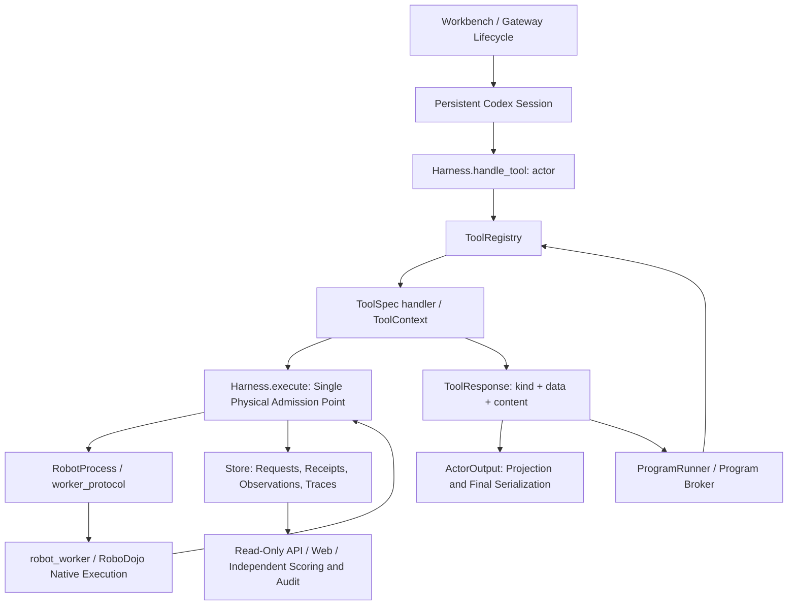

# Architecture and State Ownership

This document describes the current implementation layout to help contributors locate where changes belong. For conceptual background, see the [README](../../README.md) and the [Shared Protocol](../design/shared-protocol.md); before adding new functionality, read the [Development Conventions](../../AGENTS.md) and the [Extension Guide](extensions.md). Legacy actions, templates, skills, and `scene_*` tools that were restricted to the `trusted_legacy` role were removed in the 2026-10 refactoring.

## End-to-End Call Flow



`Workbench` assembles services and owns the startup/shutdown lifecycle, `Harness` manages intra-run action identity, state, and admission, and the worker executes physical motion. Neither cross-process timeouts nor process exits alone prove that an action did not execute. Tools return typed facts, and only the presentation layer serializes external `{success, contentItems}` payloads. The program broker consumes raw typed data, while generated programs call `AurigaClient.call` to read a `kind/data` copy that has passed through the same information boundary projection. Neither path infers execution quantities by parsing model-readable text, though `contentItems` is preserved for client compatibility.

## Module Map

`auriga/` is organized into six top-level packages layered in the order below: module-level imports only point to the same layer or lower layers. A few deferred imports inside functions still reference upper layers and are loaded only at call time; new code must not introduce additional upward dependencies.

```text
auriga/
  core/        Shared kernel: protocol contracts, config, information boundary, storage, model presentation
  robot/       Robot models and calibrated geometry, action contracts and motion algorithms, RoboDojo backend
  perception/  Visual comparison, overlays, optional external perception, RGB-D, scene storage
  cortex/      Native Codex session and sandbox, actor startup context, turn supervision
  runtime/     Harness, robot_action orchestration, tool registry and plugins, programs, policy bridge
  apps/        Executable applications: workbench gateway, experiment library, evaluation queue, HD replay, reference baseline
```

Paths in the table below are relative to `auriga/`, while `configs/`, `web/`, `third_party/`, `tests/`, `scripts/`, and `.github/` are relative to the repository root.

| Location | Responsibilities and Modification Scope |
| --- | --- |
| `core/contracts.py`, `core/action_validation.py` | Run/action identity, core contracts for requests/observations/receipts, and pure data validation. |
| `core/config.py`, `configs/auriga.json` | Structured configuration, defaults, and runtime overrides; see [Configuration](configuration.md) for machine paths and model authentication. |
| `core/observation_policy.py`, `core/presentation/` | Observation profiles and actor information boundary; named projection of typed results, ID aliasing, and metadata filtering. Owners such as `observation_output.py` and `history_output.py` define their respective summaries. |
| `core/tool_output.py`, `core/tool_errors.py` | `ToolResponse`/`ToolOutput` and actionable input diagnostics shared across tool owners. |
| `core/storage/` | SQLite events/state/references and artifact bytes, RGB encoding, and read-only paginated projections; sealed archive reading and compressed image reconstruction have explicit interfaces. |
| `robot/model/` | Arm descriptions and asset bindings, ARX X5 command limits, contact references, pose and calibration geometry (`geometry.py`), and packaged robot specifications. |
| `robot/motion/` | Pure batch/queue/proxy contracts, ARX motion compilation, batch preview and execution, velocity/tolerance/gripper guards, and failure diagnostics; also runs inside the simulation worker (see [Robot Backend Boundaries](robot-backend-boundaries.md)). |
| `robot/backends/` | Environment construction (`factory.py`); `robodojo/` contains the host-side process owner (`robodojo.py`, `robot_process.py`), JSONL protocol, Isaac thread worker (`robot_worker.py`), environment initialization, native state restoration, and observer recording (see [Robot and Environment Integration](robot-environment-integration.md)). |
| `perception/` | Image comparison and view selection; `overlays/` draws contact and trajectory references; `external/` provides optional external perception (object table, `scene3d`, VGGT height, in-hand perception, and pose planning); `depth/` provides numeric tools under explicit RGB-D profiles. |
| `perception/scene/` | Builds bounded scenes, versioned geometry, and snapshots from permitted observations; never reads hidden ground truth and does not promise full physical rollouts. |
| `cortex/session/` | Codex SDK session, configurable OS namespaces, model relay, account and terminal management, token accounting, auxiliary visual review, and the read-only source snapshot published to `/harness`. |
| `cortex/context/`, `cortex/supervision/` | Startup instructions, official task rules and overrides, task plans, operational experience, and guidance; post-turn stall detection, recovery, and completion reminders. |
| `runtime/harness.py`, `runtime/supervision.py` | Intra-run action identity, idempotency, state/budget admission, and the single physical entry point `Harness.execute`; startup, turn, and stop waiting. |
| `runtime/actions/` | `robot_action` schema (`robot_action_schema.py`), batch compilation/preview/cached execution and continuation (`unified_actions.py`), inspection and contact overlays, and post-action feedback; replaying historical receipts never mutates the active plan cursor. |
| `runtime/tools/` | Public tool declarations, handlers, and built-in assembly; `registry.py` governs inputs/outputs, roles, effects, and availability, `context.py` provides a narrow plugin port, and `plugins/` houses optional self-contained `ToolSpec` plugins. |
| `runtime/programs/` | Program lifecycle, configurable OS isolation, FD broker, review, cancellation, and action evidence; `auriga_client.py` is copied into the program workspace by filename. Consumes bound callbacks via frozen `ProgramServices` without holding the robot or registry directly. |
| `runtime/policy/` | Optional OpenPI policy bridge; `policy_workers/` run in their dedicated Python interpreter while physical execution remains owned by `Harness`. |
| `apps/gateway/` | `cli.py` argument and startup validation, `server.py` single-run registration/waiting/scoring/finalization, `routes.py` HTTP/SSE/WebSocket routes, and `workbench.py` assembly, launch, control, and shutdown. Put new domain logic in its respective owner module rather than in the gateway. |
| `apps/evaluation/`, `apps/library/` | Queue/retry/completion hooks, source binding, reporting/auditing; experiment catalog, comparisons, independent scoring policy, and the persistent experiment library service. Reading historical archives must never mutate original evidence. |
| `apps/replay/`, `apps/reference/` | Resimulates/records from archived actions or exports data-only trajectory ZIP bundles (true replay must maintain `model_calls=0`); RoboProbe reference baseline. |
| `web/` | Web workbench and experiment library source, build pipeline, and browser fixtures. Built assets are packaged into the wheel. |
| `third_party/` | Provenance records and reference assets; preserve license and version metadata and never silently swap in host directories. |
| `tests/`, `.github/workflows/ci.yml`, `scripts/build_package.py`, `scripts/check_package.py` | CPU contract and fault regressions, CI workflow, full package build, and out-of-checkout verification. |

Different Python interpreters load different subsets of the codebase:
- The gateway, evaluation queue, and experiment library run in the `Auriga` environment.
- `robot/backends/robodojo/robot_worker.py` and `apps/replay/hd_replay.py --worker` run inside the RoboDojo/Isaac Python interpreter. The worker's module-level dependencies are restricted to `core/` and `robot/` (functions lazily load motion, perception, and other modules on demand), so any new worker dependency must be importable in that interpreter.
- `runtime/policy/policy_workers/` are launched by file path inside the OpenPI environment.
- Program workspaces only receive `auriga_client.py` and, when enabled, `scene3d_helpers.py`.

Command entry points include `python -m auriga.apps.gateway` (console script `auriga`), `python -m auriga.apps.library`, `python -m auriga.apps.evaluation.queue` (`auriga-queue`), and `python -m auriga.apps.replay.hd_replay`. The evaluation queue also recognizes frozen checkouts from before the package rename (0.1.x, `daedalus/apps/gateway/cli.py`) and before the package restructuring (0.0.x, `daedalus/gateway.py`), launching them via their original entry points and `DAEDALUS_` environment variable prefixes; legacy names used in older archives, manifests, and logs are centralized in `core/legacy_names.py`.

## State and Fault Rules

| State / Data | Authoritative Owner | Usage Rules |
| --- | --- | --- |
| Current run identity, observation, action budget | `Harness` | Tools receive snapshots; any action that may advance physical state invalidates prior observations if its terminal frame is missing. A fresh `observe` only replenishes observations and cannot clear `unknown`/`stop` gates. |
| Plan revision / cursor | Batch plan owner | Advances at execution checkpoints; historical replay returns historical facts without advancing or rewinding the cursor. |
| Execution status, control / native steps | Worker receipt, persisted by `Harness` | Preserves the distinction between `completed`, `partial`, `stopped`, and `unknown`; presentation failures never overwrite execution facts. |
| Program status and review | `ProgramRunner` | `succeeded` means the program process exited with 0 and was neither cancelled nor marked `unknown`; task success, action completion, and output delivery are evaluated independently. |
| Geometry validity | Evidence actually referenced by the scene entity | The same entity validates time, clock/step domain, and freshness against the exact subset of evidence it references; newer timestamps from unrelated observations cannot revalidate stale geometry. |
| Task success / score | Independent native evaluator + scoring policy | Never reads self-reported success from the actor; corrupted archives or missing evidence remain `null`, reporting against a fixed case denominator alongside valid counts. |
| Blob integrity | Store reference + byte verification + audit profile | A database row existing does not mean the file exists; reconstructed images never impersonate original image bytes, and passing integrity checks does not imply task success. |

If optional presentation rendering fails after an action has already executed, the system returns the original `ToolResponse(kind="action", data=...)` with post-handler delivery diagnostics and an explicit notice prohibiting automatic replay. If terminal state sampling fails, known step counts and existing trajectory points are preserved while explicitly marking the missing terminal boundary sample—commanded trajectories must never be substituted for measured trajectories.

## Read Access and Information Boundary

The actor reads permitted RGB images, proprioceptive state, and public calibration; RGB-D requires an explicit observation profile. Final actor presentation recursively strips provenance fields such as hashes, source URLs, file paths, repositories, and commit IDs while preserving action diagnostics and domain measurements. Program presentation and historical cache replay apply the same filtering and reversible short references, whereas raw typed data and observer artifacts retain full facts. Full-result queries let domain owners decide content without maintaining a separate receipt allowlist at the final projection stage. Codex session prompts, auxiliary model evidence, program logs, and text artifacts all pass through the shared presentation layer, and the Responses request egress filters readable text again for resumed history and compacted turns. Local and remote $\pi_{0.5}$ inference also scrubs hashes from task prompts. Media bytes, encrypted reasoning items, and native protocol IDs are transport payloads and must not be rewritten as plain text. For detailed rules and regression tests, see [Tool Plugins](tool-plugins.md).

When `features.sandbox_enabled=true`, the primary Codex app-server, native tools, and subagents run inside a bubblewrap namespace mounting only the private workspace, session directory, explicitly published read-only Harness source, and runtime dependencies. Web search and host extensions are disabled, and network access is restricted to the fixed model/account relays and the PyPI package proxy. Native local tool search over registered tools does not access external networks, and dispatch is still validated by the same `ToolRegistry`. Real authentication credentials remain in the host relay, while standalone programs and the evidence agent each maintain their own isolation boundaries. Setting `features.sandbox_enabled=false` (the default) disables both the primary/auxiliary Codex namespaces and `program_run` Landlock/seccomp isolation while retaining private session directories, relays, the broker, action review, and resource budgets; code can access host files and networks permitted to the launching user, and the information boundary is enforced at the application layer only. The sandbox mode is frozen for the lifetime of a run, and resuming across modes is rejected. See [Code Execution Sandbox](configuration.md#code-execution-sandbox) for details.

Sealed archives must always be opened via `open_read_store(root)`, which reads from a private copy when a WAL file is present; reading an active run uses the existing `live=True` protocol. Never open an active WAL database in immutable mode. Standalone replay initialization writes locks, Store records, and scene state, so it must point to a copy; use the read-only experiment library interfaces when inspecting original archives in place.

## Extensions and Package Boundaries

New tools are injected into `Workbench`/`Harness` via an explicit `ToolSpec` list; there is no automatic plugin scanning or dynamic installation service. Built-in capabilities use the same registry, and program permissions, availability, and final tool catalogs are derived from that single declaration. When modifying a contract, verify input validation, typed results, actor presentation, program consumption, manifests, and backward compatibility with historical archives.

Running from source and running from a built wheel use the same Python package; the build script additionally bundles default configurations, built Web assets, and reference resources, and package checks execute outside the repository checkout. When adding modules or assets, verify the wheel manifest rather than relying on files that happen to exist in the working tree during local tests. Large modules can be split along existing ownership boundaries without introducing a new generic plugin framework.
