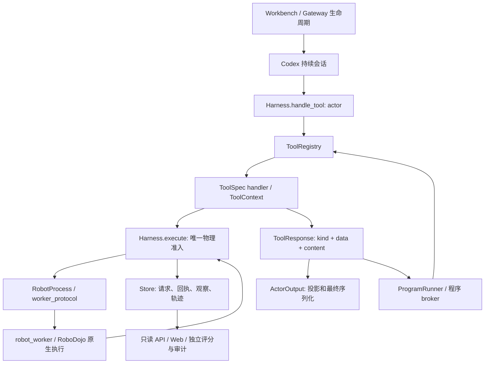

# 当前实现架构与状态所有权

本文描述当前的实现布局，供开发者定位修改。概念设计见[README](../../README.md)和[共享协议](../design/Astra具身Harness-共享接口与事件协议-v0.1.md)；新增内容先读[开发约定](../../AGENTS.md)与[扩展指南](extensions.md)。只有 `trusted_legacy` 角色可调用的旧动作、模板、skill 和 `scene_*` 工具已在 2026-10 重构中删除。

## 一次调用如何完成



Workbench 组装服务并拥有启动/关闭生命周期，Harness 负责运行内动作身份、状态和准入，worker 执行实际运动。跨进程超时和进程退出都不能单独证明动作未执行。工具返回 typed 事实，展示层才生成外部 `{success, contentItems}`；程序 broker 消费原始 typed 数据，生成程序通过 `AurigaClient.call` 读取经过相同信息投影的 `kind/data` 副本；两者均不从模型可读文本反推执行量，客户端兼容保留展示 `contentItems`。

## 模块地图

`auriga/` 由六个顶层包组成，按下列顺序分层：模块级 import 只指向同层或更低层的包。少数函数内的延迟 import 仍然反向引用上层，它们只在调用时加载，新增代码不要再增加这类反向依赖。

```text
auriga/
  core/        共享内核：协议契约、配置、信息边界、存储、模型侧展示
  robot/       机器人模型与标定几何、动作契约与运动算法、RoboDojo 后端
  perception/  视觉测量、叠加图、可选外部感知、RGB-D、场景存储
  cortex/      Codex 原生会话与沙箱、actor 启动上下文、回合监督
  runtime/     Harness、robot_action 编排、工具注册与插件、程序、策略桥接
  apps/        可执行应用：工作台网关、实验库、评测队列、高清重放、参考基线
```

下表路径相对 `auriga/`；`configs/`、`web/`、`third_party/`、`tests/`、`scripts/` 与 `.github/` 相对仓库根目录。

| 位置 | 职责与修改落点 |
| --- | --- |
| `core/contracts.py`、`core/action_validation.py` | 运行/动作身份、请求/观察/回执的基本契约与纯数据校验。 |
| `core/config.py`、`configs/auriga.json` | 结构化配置、默认值和运行覆盖；机器路径/模型认证详见[配置说明](configuration.md)。 |
| `core/observation_policy.py`、`core/presentation/` | 观察条件与 actor 信息边界；typed 结果的具名投影、ID alias 与元信息过滤，`observation_output.py`、`history_output.py` 等 owner 决定各自摘要。 |
| `core/tool_output.py`、`core/tool_errors.py` | `ToolResponse`/`ToolOutput` 与可操作的输入诊断，被各层工具 owner 共用。 |
| `core/storage/` | SQLite 事件/状态/引用和 artifact 字节、RGB 编码、只读分页投影；封存读取与压缩图重建有明确接口。 |
| `robot/model/` | 机械臂描述与资产绑定、ARX X5 命令限值、接触参考、位姿与标定几何（`geometry.py`）及打包的机器人资料。 |
| `robot/motion/` | 纯批次/队列/代理契约、ARX 动作编译、批次预览与执行、速度/容差/夹爪门禁与失败诊断；同时在仿真 worker 内运行，见[机器人边界](robot-backend-boundaries.md)。 |
| `robot/backends/` | 环境构造（`factory.py`）；`robodojo/` 下为宿主侧进程 owner（`robodojo.py`、`robot_process.py`）、JSONL 协议、Isaac 线程 worker（`robot_worker.py`）、环境初始化、原生状态恢复与 observer 记录；见[机械臂与环境接入](robot-environment-integration.md)。 |
| `perception/` | 图像比较与视角选择；`overlays/` 绘制接触与轨迹参考；`external/` 为对象表、scene3d、VGGT 高度、持物与姿态规划等可选外部感知；`depth/` 为显式 RGB-D 条件下的数值工具。 |
| `perception/scene/` | 从许可观察构建有限场景、版本化几何与快照；不读取隐藏真值，不承诺完整物理 rollout。 |
| `cortex/session/` | Codex SDK 会话、按配置启用的 OS namespace、模型 relay、账户与终端、用量记账、辅助视觉复核，以及发布到 `/harness` 的只读源码快照。 |
| `cortex/context/`、`cortex/supervision/` | 启动说明、官方任务规则与覆盖、任务计划、经验与操作说明；完成回合的停滞、恢复与完成提醒。 |
| `runtime/harness.py`、`runtime/supervision.py` | 运行内动作身份、幂等、状态/预算准入和唯一物理入口 `Harness.execute`；启动、回合与停止等待。 |
| `runtime/actions/` | `robot_action` 的 schema（`robot_action_schema.py`）、批次编译/预览/缓存执行与续跑（`unified_actions.py`）、inspect 与接触叠加图、动作后反馈；重放旧回执不能修改活跃计划 cursor。 |
| `runtime/tools/` | 公共工具声明、handler 和内建组装；`registry.py` 管输入输出/role/effect/availability，`context.py` 提供窄插件 port，`plugins/` 为自带 `ToolSpec` 的可选工具。 |
| `runtime/programs/` | 程序生命周期、按配置启用的 OS 隔离、FD broker、审核、取消与动作证据；`auriga_client.py` 按文件名拷入程序工作区。通过冻结 `ProgramServices` 使用绑定回调，不持有 robot/registry。 |
| `runtime/policy/` | 可选 OpenPI 策略桥接；`policy_workers/` 在各自解释器中运行，执行仍归 Harness。 |
| `apps/gateway/` | `cli.py` 参数与启动校验、`server.py` 单次运行的注册/等待/评分/收尾、`routes.py` HTTP/SSE/WebSocket 路由、`workbench.py` 装配、启动、控制与关闭。新增领域逻辑放回对应 owner。 |
| `apps/evaluation/`、`apps/library/` | 队列/重试/完成钩子、来源绑定、报告/审计；实验目录、对照、独立评分政策与常驻实验库服务。不能因读历史档改写原证据。 |
| `apps/replay/`、`apps/reference/` | 从归档动作重新仿真/录制，或导出数据型 ZIP，真实回放必须保持 `model_calls=0`；RoboProbe 参考基线。 |
| `web/` | Web 工作台与实验库源码、构建和浏览器夹具。随 wheel 打包的是构建产物。 |
| `third_party/` | 来源记录和参考资源；保留许可证和版本信息，不能静默换成宿主目录。 |
| `tests/`、`.github/workflows/ci.yml`、`scripts/build_package.py`、`scripts/check_package.py` | CPU 契约与故障回归、CI、完整包构建及 checkout 外验证。 |

不同解释器加载的范围不同：网关、队列和实验库运行在 `Auriga` 环境；`robot/backends/robodojo/robot_worker.py` 与 `apps/replay/hd_replay.py --worker` 在 RoboDojo/Isaac 的 Python 中运行，worker 的模块级依赖只在 `core/` 与 `robot/` 内（函数内还会按需加载运动、感知等模块），新增 worker 依赖必须能在该解释器中导入；`runtime/policy/policy_workers/` 在 OpenPI 环境中按文件路径启动；程序工作区只拿到 `auriga_client.py` 与按需拷入的 `scene3d_helpers.py`。

命令入口：`python -m auriga.apps.gateway`（console script `auriga`）、`python -m auriga.apps.library`、`python -m auriga.apps.evaluation.queue`（`auriga-queue`）、`python -m auriga.apps.replay.hd_replay`。队列同时识别更名前（0.1.x，`daedalus/apps/gateway/cli.py`）和包结构重构前（0.0.x，`daedalus/gateway.py`）的冻结 checkout，用其自身的入口和 `DAEDALUS_` 环境变量前缀启动；旧归档、旧 manifest 与旧日志中的名称集中定义在 `core/legacy_names.py`。

## 状态与故障的规则

| 状态/数据 | 权威来源 | 使用规则 |
| --- | --- | --- |
| 当前运行身份、观察、动作预算 | Harness | 工具拿快照；可能推进物理状态的动作缺末帧会使旧观察失效。fresh observe 只补观察，不能解除 unknown/stop 门禁。 |
| 计划 revision/cursor | 批次计划 owner | 执行检查点推进；历史 replay 只返回历史事实，不重新推进或倒退。 |
| 执行状态、控制/原生步数 | worker 回执，经 Harness 持久化 | 保留 completed/partial/stopped/unknown 的差异；展示失败不覆写执行事实。 |
| 程序状态与审核 | ProgramRunner | `succeeded` 表示程序进程以 0 退出且未被取消/判 unknown；任务成功、动作完成和输出交付各自判断。 |
| 几何有效性 | scene 实体实际引用的证据 | 同一实体使用同一证据子集检查时间、clock/step domain 和 freshness；旁证的新时间不能让旧几何恢复有效。 |
| task success / score | 独立 native evaluator + scoring policy | 不读 actor 自报成功；坏档/缺证据保留 null，报告固定 case 分母与有效数。 |
| blob 完整性 | Store 引用 + 字节校验 + audit profile | 行存在不等于文件存在；重建图不冒充原图字节，integrity 通过不等于任务成功。 |

已执行动作的可选展示失败时，返回原 `ToolResponse(kind="action", data=...)`，追加 after-handler 交付诊断及禁止自动重放说明。终态状态采样失败时保留已知步数和既有轨迹，明确最后边界样本缺失，不能把命令轨迹当成实际轨迹补齐。

## 读取与信息边界

actor 读取正式 RGB/本体状态/公开标定，RGB-D 需显式配置。actor 最终展示会递归省略 hash、来源 URL/文件/仓库/提交等 provenance 字段，保留动作诊断和业务数值；program 展示和历史缓存重放采用同一过滤与可逆短引用，原始 typed data 和 observer artifact 保留事实。完整结果查询由业务 owner 决定内容，最终投影不再另建 receipt 白名单。Codex 会话提示、辅助模型证据、程序日志与文本 artifact 都经过共享展示层；Responses 请求出口再次处理恢复历史和 compaction 的可读文本。π0.5 的本地/远程推理也清理任务提示中的哈希。媒体字节、加密 reasoning 和原生协议 ID 是传输载荷，不能当作普通文本改写。详细规则及回归见[工具开发](tool-plugins.md)。

默认 `features.sandbox_enabled=true` 时，主 Codex app-server、原生工具及子代理整体运行在 bubblewrap namespace 内；只挂载私有工作区、会话目录、明确发布的只读 Harness 源码和运行依赖。联网搜索与宿主扩展关闭，网络仅经固定模型/account relay 和 PyPI 包代理。当前已注册工具的原生本地搜索不访问外网，派发仍由同一 ToolRegistry 校验。真实认证保留在宿主 relay；独立程序与 evidence agent 也各有隔离边界。设置 `false` 会一并关闭主/辅助 Codex 的 namespace 与程序 Landlock/seccomp，保留私有会话目录、relay、broker、审核及资源预算；代码可访问启动用户有权访问的宿主文件与网络，信息边界仅由应用层执行。模式随运行冻结，恢复不允许跨模式切换。详见[代码执行沙箱](configuration.md#代码执行沙箱)。

封存归档统一用 `open_read_store(root)`，含 WAL 时在私有副本读取；需要读取活动运行时使用既有 `live=True` 协议。不要将活动 WAL 按 immutable 模式打开。standalone replay 初始化仍会写 lock/Store/scene，需指向副本；保持原档不变的查看使用实验库只读接口。

## 扩展与包边界

新工具通过显式 `ToolSpec` 列表注入 Workbench/Harness，没有自动插件扫描或安装服务。内建能力仍使用相同 registry；程序权限、可用性和最终目录来自同一声明。修改契约时同时检查输入、typed 结果、actor 展示、program 消费、manifest 和旧档兼容。

源码运行与 wheel 使用相同 Python 包；构建脚本另外带入配置、Web 和 reference 资源，包检查在 checkout 外运行。新增模块/资源要检查 wheel 清单，不能靠当前工作目录下碰巧存在的文件通过测试。大型模块可沿现有 owner 拆分；本轮没有要求再建一层通用插件框架。
