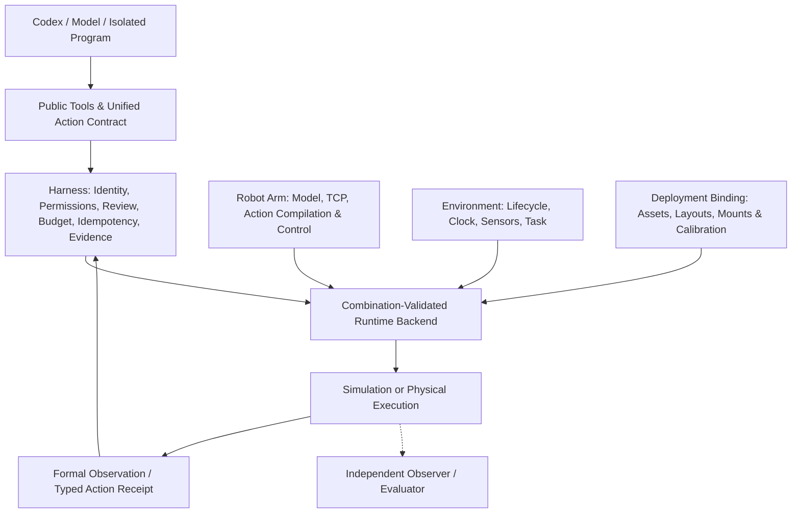

# Robot Arm and Environment Integration Guide

Integrating a new robot arm requires adapting **documentation, control, observation, and deployment bindings** together. URDFs and physical specifications tell the model what the robot is; the control adapter executes commands accurately; the environment adapter manages the world, task, and clock; and the deployment binding verifies that a specific robot model is actually supported in that environment.

Decoupling responsibilities in code does not mean arbitrary robot arms and environments can be mixed and matched at will. The validated production configuration remains **RoboDojo + dual-arm ARX X5**. Robot assets, native action layouts, task layouts, and motion planners in RoboDojo are tightly coupled and must be integrated as a verified combination. This guide details the current code entry points, required data files, adapter responsibilities, and validation checklist; real hardware and alternative simulation platforms do not yet have validated implementations.

## 1. Layering and Invariant External Behavior



Existing entry points—including `robot_information`, `robot_observe`, `robot_action`, `robot_wait`, and program review—remain unchanged. Swapping internal adapter implementations must not alter current X5 tool names, schemas, coordinate and gripper conventions, default documentation, batch preview/execution ordering, receipt statuses, or information boundary permissions (internal source hashes naturally change when source files change and are not expected to stay constant).

Future platforms follow the same model interaction paradigm while truthfully reporting their own capabilities and robot specifications. Public actions currently address arms as `left` / `right` with absolute poses and normalized gripper goals (`0` closed, `1` open); a single-arm robot can map to one slot and reject the other rather than fabricating a second arm. Capabilities beyond the current schema—such as more than two arms, mobile bases, or force control—require explicit contract evolution rather than hidden backend reinterpretations.

| Owner | Responsible For | Must Not Assume or Own |
| --- | --- | --- |
| Robot description & control adapter | Model ID, joint order and limits, TCP, gripper mapping, action compilation, measured proprioception, actuator control, and stop feedback | Task scores, object ground truth, scene resets, or universal mounting poses across arbitrary environments |
| Environment adapter | World creation/shutdown, simulation stepping or real-time clock, task initialization, sensor capture, episode termination, and independent evaluator hooks | Hardcoding a specific robot's TCP, fixed joint count, or gripper offset as a global Harness rule |
| Deployment binding (environment × robot) | Supported combinations, in-environment assets, planner configs, task layouts, instance/actuator mappings, and mount/calibration sources | Claiming a combination is runnable merely because static files exist on disk |
| Harness | Identity and observation validation, single-writer physical admission, program review, idempotency, budgets, cancellation coordination, and evidence persistence | Calling vendor SDKs directly, dispatching native commands by robot name, or inferring task success |

Environment and control adapters can share a single native worker process (where the Isaac main thread still exclusively owns simulation calls); logical separation does not require spawning extra daemons or maintaining duplicate robot state.

## 2. Current Implementation Entry Points and Supported Combinations

| Location | Current Responsibility |
| --- | --- |
| [`backends/factory.py`](../../auriga/robot/backends/factory.py) | `ENVIRONMENT_BACKENDS` explicitly maps environment names to constructors; `create_backend` rejects unknown environments without scanning for plugins. |
| [`embodiments.py`](../../auriga/robot/model/embodiments.py) | `RobotDescription` holds control identifiers; `RoboDojoRobotBinding` holds asset paths for a validated pair; `get_robodojo_robot` rejects unregistered models. |
| [`robodojo.py`](../../auriga/robot/backends/robodojo/robodojo.py) | Combination-validated parent-process backend providing compilation/validation hooks, worker lifecycle and RPC dispatch, and pre-reset layout file verification. |
| [`robodojo/environment.py`](../../auriga/robot/backends/robodojo/environment.py) | Isaac app launch, native task configuration, depth configuration, layout identity and reset, and episode termination/validity queries. |
| [`robot_worker.py`](../../auriga/robot/backends/robodojo/robot_worker.py) | Live RoboDojo/X5 native control, observation capture, and receipt generation; asset loading uses explicit bindings while joint control remains X5-specific. |
| [`action_compilation.py`](../../auriga/robot/motion/action_compilation.py) | Pure compilation hook routing public actions to the backend; rejects unknown robots lacking a compiler/validator rather than falling back to X5. |
| [`batch_contract.py`](../../auriga/robot/motion/batch_contract.py) | Batch structure, dependency graph, and stage constraints; retains strict native checks for X5 while allowing other backends to validate against their declared frame/TCP/limits and native validator. |

Configuration uses the existing `backend` section:

```json
{
  "version": 1,
  "backend": {
    "environment": "robodojo",
    "robot_model_id": "arx-x5",
    "root": "~/code/robodojo",
    "python": "~/miniforge3/envs/RoboDojo/bin/python"
  }
}
```

Omitting the first two fields preserves the default `robodojo` + `arx-x5` pair so existing config files need no migration. Calling `robot_information(robot_id=...)` queries static documentation only and never switches the active runtime robot. Currently, only the pair above is registered; specifying any other string fails fast without dynamically loading external drivers. Python hosts can still inject a custom backend via `Workbench(..., robot=backend)` for integration and testing (the caller is responsible for validating the combination, and public actions still route through `Harness`).

Binding validation happens at two levels: backend construction rejects unsupported environment/model pairs immediately, the worker re-validates the robot binding before launching Isaac, and post-creation checks verify the selected seed/layout path on disk. Joint dimensions, TCP offsets, active planner joints, and execution time limits remain enforced by the native adapter. Adding a registry entry is only one step of integration and never substitutes for control adaptation and live runtime validation.

### Native RoboDojo Configuration

[`native_eval_config()`](../../auriga/robot/backends/robodojo/environment.py) loads simulation, scene, robot, and camera settings from the deployment binding's RoboDojo configuration and invokes `process_randomization()` and `process_config()` in the exact order used by the official evaluation entry point. Device placement, Fabric settings, physics timestep, PhysX parameters, rendering settings, object parameters, and task overrides all follow the native configuration and defaults. Harness selects only the episode's task, seed/layout, single-environment count, local policy lifecycle hooks, and declared RGB/RGB-D observation boundary (camera collection frequency matches the official entry point via `observation.collect_freq`). GPU assignment, headless camera startup, and confirmed worker shutdown remain managed by the application lifecycle, while explicit high-definition replay resolution overrides apply separately.

RoboDojo currently defaults to the `device="cpu"`, `use_fabric=False` scene management path while its underlying `setup_physics()` still forces GPU PhysX. Never override the scene path to CUDA merely because a GPU is present: upstream RoboDojo skips `fluid` objects on the CUDA scene path. Our adapter neither duplicates physics defaults nor hardcodes CPU; it defers to the installed official configuration. See [`test_environment_adapter.py`](../../tests/test_environment_adapter.py) for configuration preservation checks and [`test_native_config.py`](../../tests/test_native_config.py) for native configuration parity across all 42 tasks (54 task/variant entry points). Live native validation must still verify object creation, state updates, and task scoring, as matching configuration alone does not guarantee task success.

## 3. Static Information Files Required for a New Robot Arm

Follow the existing data package layout under `auriga/robot/model/robot_information_data/<robot_directory>/` (where `<robot_directory>` is an explicitly registered directory name, not an auto-discovered path):

```text
auriga/robot/model/robot_information_data/<robot_directory>/
├── briefing.txt          # Required: model-readable physical and control briefing
├── physical.json         # Required: full static parameters and default supplementary fields
├── resources.json        # Required for default geometry: registered resource IDs and formats
├── geometry_model.zip    # Required for default profile: original URDF + all referenced meshes
├── hardware.json         # Optional: hardware specs, vendor comparisons, and unconfirmed items
├── geometry.png          # Optional: static diagram, read only on demand
└── cad/*.STEP            # Optional: per-part CAD files, each explicitly registered
```

### 3.1 `briefing.txt`: Model-Readable Physical and Control Briefing

Write a clear engineering briefing covering the following facts rather than copying marketing copy or raw SDK docs:

- Exact arm and end-effector version, degrees of freedom, mounting structure, and workspace constraints.
- Reference coordinate frames, whether end-effector poses represent the flange or TCP, tool axis direction, and orientation conventions.
- Gripper command direction, range, and the distinction between geometric jaw aperture and measured joint values.
- Contact reference points, protruding camera mounts or brackets, and which links are covered (or omitted) by the planner's collision spheres.
- Control frequency, tracking/stopping semantics, and unobservable physical quantities (explicitly marking unknown payload mass, friction, or grasp force as unknown).

Live camera and base poses are read from formal episode observations; never hardcode example coordinates from a single installation as universal defaults. Do not include task solutions, hidden object locations, evaluator state, or build metadata that does not aid motion decisions.

### 3.2 `physical.json`: Complete Record and Default Supplementary Parameters

Structure the full record into `identity`, `kinematics`, `geometry`, `dynamics`, and `control` sections following the [ARX X5 `physical.json`](../../auriga/robot/model/robot_information_data/arx_x5/physical.json):

| Section | Information to Collect and Verify |
| --- | --- |
| `identity` | Exact model/variant, number of arms, and joint/gripper command dimensions (do not conflate a dual-arm deployment with single-arm intrinsic properties). |
| `kinematics` | Base and end-effector links, joint names/types/order/positive directions, units, orientation representations, TCP, and contact-reference transforms. |
| `geometry` | Installed fingers, tools, cameras, and mounts; URDF assembly entry point, resource IDs, mesh formats, and units/axes/scales. |
| `dynamics` | Verified mass, center of mass, inertia, and actuator configurations; distinguish manufacturer datasheets, simulation configs, and empirical measurements, and never treat URDF nominal limits as real-hardware safety limits. |
| `control` | Control modes/frequencies, command increment/velocity caps, gripper command mapping, dwell/arrival/stop semantics, and whether preview and execution share the exact same mapping. |

**Note that the current default projection is not yet a generic schema for arbitrary robots.** [`robot_information.py::_compact_reference`](../../auriga/robot/model/robot_information.py) reads specific paths: `identity.physical_model/native_action_dimensions`, `pose_units/tool_axis_link6/grasp_contact_offsets_m` under `kinematics.pose_interface`, `dynamics.configured_actuators_and_physics`, and designated fields under `control.default_harness/gripper/preview_gripper_mapping`. If a new robot has different kinematics or end-effector semantics, generalize `_compact_reference` while keeping X5 output backward-compatible—never populate fake `link6` names, contact offsets, or parallel-jaw parameters just to satisfy the reader.

The default JSON projection retains only interface and control facts not already expressed in the URDF; kinematic chains, link inertias, and mesh placements already present in the URDF are not duplicated in the default JSON, while full static details remain queryable by section.

### 3.3 Original URDF, Meshes, and `resources.json`

`geometry_model.zip` packages the verbatim URDF text alongside all referenced meshes, preserving relative paths, origins, scales, joint transforms, and GLB node transforms. The default reader extracts `assembly_member` directly from the ZIP; robots defined only in USD or MJCF must either supply a verified equivalent URDF or explicitly extend the documentation contract—never rename a non-URDF file to `.urdf`.

Resource registration snippet inside `physical.json`:

```json
{
  "geometry": {
    "native_model": {
      "resource_id": "geometry_model",
      "archive_format": "ZIP",
      "assembly_member": "robot.urdf",
      "mesh_formats": ["STL"],
      "coordinates": "Specify units, axis conventions, and assembly frame per the actual model"
    }
  }
}
```

Corresponding `resources.json`:

```json
[
  {
    "resource_id": "geometry_model",
    "name": "Robot geometry and assembly",
    "format": "ZIP",
    "description": "URDF and all referenced meshes for the installed robot version, preserving relative directory structure."
  }
]
```

The current resource resolver maps `ZIP` to `<resource_id>.zip` and `STEP...` to `cad/<resource_id>.STEP`, rejecting arbitrary `path` fields. Supporting additional file formats requires updating resolution, permission checks, packaging, and tests. Large native scene assets and neural network weights belong in external deployment directories; the Git repository stores only lightweight public specifications and provenance indices.

Register `robot_model_id -> data_directory` explicitly in `ROBOT_INFORMATION_REGISTRY`, and check `package-data` in [`pyproject.toml`](../../pyproject.toml) (which currently includes top-level JSON/TXT/PNG/ZIP files and `cad/*.STEP`). Installed wheels must be able to read all robot information and resources outside a Git checkout.

## 4. Configuration and Runtime Data Required for a New Deployment

A static documentation package does not replace runtime deployment configurations. Supply the items below in the native configuration format of the target environment—**do not invent a redundant set of generic JSON files for them**:

| Requirement | Current RoboDojo Location | What a New Environment or Real Robot Must Provide |
| --- | --- | --- |
| Environment & sensor config | `env_cfg/arx_x5.yml` and referenced files | Scene/device setup, cameras, control/capture frequencies, and permitted observation profiles. |
| Robot assets & driver config | `Assets/Robots/x5/X5A.urdf`, `robot_config.yml` | Native simulation assets or hardware drivers, joint/actuator mappings, installed end-effector, effective limits, and controller gains. |
| Motion planner config | `curobo.yml` in the same directory | Matching kinematic chain, active joints, collision spheres/meshes, and solver parameters (or explicitly disable planner-dependent previews if unavailable). |
| Tasks & layouts | `task/RoboDojo/config/<task>.yml`, `Assets/Eval_Layout/RoboDojo/arx_x5/<seed>/<task>_<layout>.json` | Supported tasks, initialization routines, and environment validity checks (real hardware resets cannot reuse simulation teleport resets). |
| Mounting & calibration | Native camera/base configs published via the worker | Camera intrinsics and distortion, hand-eye transforms, base transforms, and TCP/tool calibration with documented provenance and validity scope. |
| Driver connection | Local worker subprocess | Device node or network connection settings, session lifecycle, and disconnect semantics (credentials must never enter Git or model context). |

Episode calibration is published by the observation producer as `camera_calibration` and `camera_pose_sample` artifacts linked through `ObservationBundle`: per-camera intrinsics `K`, image dimensions, distortion/optical axes, `T_link_camera` (where applicable), and current-frame `T_world_camera`, `T_world_link`, and `T_world_base`. By convention, `T_A_B` transforms coordinates from frame `B` into frame `A` with translations in meters; RGB frames, poses, and proprioception must carry verifiable frame IDs, step counters, and clock domains.

[`robot_calibration_information.py`](../../auriga/robot/model/robot_calibration_information.py) reads only the latest published permitted observation without triggering new sensor captures or backfilling static default poses. If data is missing, inconsistent, or disallowed by the observation profile, calibration is reported as unavailable. Asynchronous real-world cameras must declare timestamp offsets and uncertainty rather than masquerading frames from different instants as a synchronized snapshot, and real-hardware adapters must never rely on the simulation assumption that the world stands still while paused between steps.

## 5. Adapting Control and Environment Backends

### 5.1 Robot Arm Control Adaptation

The backend's pure compilation entry point is `compile_action(kind, args, identity, capabilities)` (plus `compile_dual_action(args, identity, capabilities)` if legacy dual-arm grasp compatibility is needed). Compilation constructs action requests without advancing the world. A new backend implements `validate_action(action)` to enforce its own joint dimensions, limits, frame/TCP conventions, gripper semantics, and combination constraints rather than merely loosening shared validation.

Runtime backends follow the `start/observe/execute/reset/close` lifecycle contract and expose `preview_batch`, stop, and recording hooks according to their actual capabilities; see [Robot Backend Boundaries](robot-backend-boundaries.md). Unsupported action kinds or resets must be rejected explicitly, and synchronous vs. asynchronous execution and reliable step counters must be reported truthfully.

At minimum, a control adapter must map:

1. **Joint and command layout**: Public joint names and ordering to driver commands, units (radians/meters), sign conventions, zero offsets, and limits. The `6+1+6+1` (14-DOF) layout is specific to native dual-arm ARX X5 control and must not be assumed for other robots.
2. **Poses and end-effector**: Public target poses to native reference frames, applying flange/TCP/grasp-contact offsets exactly once. On X5, `angles_deg` follows a specific top-down grasp convention rather than general world Euler angles; a new implementation must either implement that exact convention or reject `angles_deg` in favor of explicit quaternions.
3. **Gripper**: Mapping normalized commands (`0` = closed, `1` = open) to actuator commands, rate limits, synchronized during-motion ramps, and measured aperture reporting. Suction cups or dexterous multi-finger hands must not masquerade as the existing parallel-jaw model.
4. **Trajectories and preview**: Previews never execute physical motion; execution dispatches the reviewed cached trajectory and rejects stale or modified plans without silent replanning. Batch dependencies, dual-arm concurrency, and observation checkpoints must be backed by real scheduler capabilities.
5. **Execution feedback**: Record requested, planned, dispatched, and measured values separately, preserving `completed`, `partial`, `stopped`, and `unknown` outcomes. Image delivery failures must never trigger physical replay, and missing confirmation must never be reported as zero executed steps.
6. **Stopping and recovery**: Confirm actual actuator hold, stop, or e-stop state; RPC timeouts, closed sockets, or process exits do not prove the physical arm has stopped. When stop state is `unknown`, block subsequent physical actions—a fresh observation alone must not clear a stop gate.

All physical writes continue to pass through `Harness.execute` (and `ToolContext.execute` for plugins) without introducing side channels to the robot worker.

### 5.2 Environment Adaptation and Combination Constraints

Register new environment constructors in `ENVIRONMENT_BACKENDS` to assemble the complete runtime backend, and explicitly register supported robot/driver/asset combinations inside that environment module. Just as RoboDojo bindings live in `RoboDojoRobotBinding`, a new platform should define its own binding structure rather than shoehorning paths into RoboDojo's layout.

The environment adapter owns scene loading, reset, shutdown, time advancement, sensor capture, and task lifecycle. For simulators, verify the exact mapping between physics steps, control steps, and rendered frames; for real hardware, use real sampling clocks, continuously evolving world state, observation staleness policies, and bounded waits—never equating `time.sleep` with executed simulation steps. Where shared schemas currently use simulation terminology (such as `sim_step`), any extensions needed for real-hardware clocks or waits must be designed and tested explicitly rather than fabricating `sim_step` counters.

Task evaluation and scoring are independent responsibilities: if a new environment has no native evaluator, task scores remain `unknown`/`null` rather than borrowing X5/RoboDojo heuristics. Evaluator state, hidden scene ground truth, and developer diagnostics belong strictly in observer archives, while formal observations and auxiliary models obey the [Actor Information Boundary](actor-information-boundary.md).

Launch admission checks must verify at minimum: a registered environment/robot pair, matching robot model/kinematic chain/end-effector, compatible assets and motion planner, valid task layout, and permitted frame/TCP and control mode. During execution, continue enforcing current observation bindings, identity generations, joint limits, and stop confirmation. Decoupling modules allows code reuse, never skipping validation.

### 5.3 Optional Features Must Be Adapted Individually

- **Geometry, collision, and contact overlays**: Verify link names, mesh formats, tool contact points, and collision sphere coverage. `robot_model.urdf_manifest` is only a public geometry export, and `collision_mesh_bounds` currently defaults to X5 finger links rather than claiming support for arbitrary URDFs.
- **Joint-space replanning**: The worker's current 6-DOF, `link6`, and frame-bias guards are specific to X5; adapt and test new robot kinematics explicitly rather than disabling safety guards to force replanning on.
- **$\pi_{0.5}$ and learned policies**: Current policy inputs, camera views, joint ordering, normalization, checkpoints, and $50 \times 14$ action chunks are bound to ARX X5. A new robot requires a policy adapter matching its training distribution; basic integration does not require enabling learned policies.
- **Task Notes and operational memory**: Filter operational notes by robot, end-effector, and environment applicability; never apply X5 offsets, legacy layout coordinates, or X5 grasp heuristics as ground truth on a new platform.
- **Replay and evaluation**: Record the active combination and effective configuration in run manifests. Archived actions can only be replayed in a compatible environment, never by sending X5 trajectories to a different robot model. Model-free replay must still verify `model_calls=0`.

## 6. Recommended Integration Order and Validation Checklist

1. **Define the supported combination**: Specify the robot/end-effector variant, simulation or hardware environment, driver, control mode, and required capabilities. Assign a new stable `robot_model_id` (do not invent a new model ID when merely updating mounting or calibration for an existing robot).
2. **Prepare documentation and deployment assets**: Register static documentation and geometry resources, and verify that native assets, configs, planner files, and task layouts match the documentation. Passing documentation parsing tests only completes this layer.
3. **Wire up read-only observation**: Validate model IDs, joint states, measured poses, camera frames, and calibration, checking permissions, clock synchronization, and missing-data handling. Block physical actions whenever observation invariants fail.
4. **Wire up control adaptation**: Implement action compilation/validation, bounded motion/gripper/wait execution, preview caching, receipts, cancellation, and disconnect handling, adding dual-arm or advanced capabilities as supported.
5. **Verify model interface compatibility**: Compare tool catalogs/schemas, compiled requests, robot information, observations, and typed receipts against X5 baselines across both actor and program entry points, ensuring legacy configs, session resume/replay, and short artifact references do not regress.
6. **Verify live execution**: Run the bounded interface validation matrix in the target environment before running independent task evaluations, recording conditions, tracking errors, stop confirmations, and raw evidence.

| Validation Layer | Recommended Test Entry Points | What Passing Establishes |
| --- | --- | --- |
| Environment / model binding | `test_backend_selection`, `test_embodiments`, `test_environment_adapter` | Default backward compatibility, pre-launch rejection of unknown pairs, layout validation, and environment helper behavior. |
| Documentation & calibration | `test_robot_information`, `test_robot_information_integration`, `test_robot_calibration_information` | Verbatim URDF/resource readability, prompt injection, no fallback on unknown model IDs, and synchronized frame calibration/permissions. |
| Compilation & action pipeline | `test_action_compilation`, `test_robot_boundaries`, `test_unified_actions`, `test_batch_motion` | Backend selection reaches live Harness paths, non-X5 synthetic backends can preview and execute, invalid inputs and missing validators are rejected, and X5 behavior is regression-tested. |
| Fault handling & isolation | `test_native_wait`, `test_runtime_lifecycle`, `test_program_review`, `test_observation_policy` | Idempotency, program review, unknown/stop gating, observation invalidation, and information boundary enforcement. |
| Full software & packaging | CPU, Web, and wheel build/check suites in [Validation Guide](validation.md) | Cross-boundary compatibility and out-of-checkout resource/module availability (does not prove physical motion). |
| Native interface & tasks | [Backend validation matrix](robot-backend-boundaries.md) and platform-specific native tests | Actual trajectories, clock semantics, stopping behavior, and tracking errors (task success requires separate evaluator runs). |

The existing `scripts/robot_validation.py --matrix current` script targets RoboDojo/X5 and cannot be claimed as-is to cover a new robot arm or real hardware. Passing synthetic-backend unit tests proves only that extension seams are wired properly, not that a second physical robot is production-ready.

When delivering an integration, record the source revision, environment/model/asset/calibration/config identities, exact commands run, pass/fail/skip counts, and measured vs. unverified capabilities. Provenance hashes and full verification logs stay in the archive, while the model receives only the physical facts, evidence, and reversible short references needed for reasoning and tool invocation.
