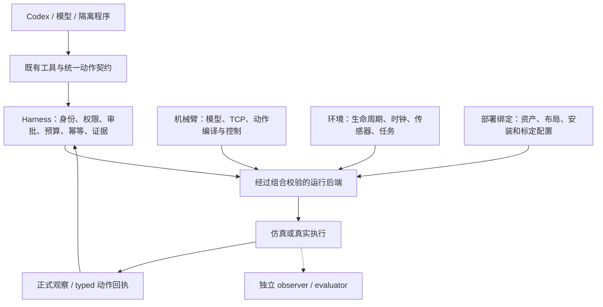

# 机械臂与环境接入指南

新增机械臂需要同时完成**资料、控制、观察和部署组合**的适配。URDF 和物理说明让模型知道机器人是什么；控制适配器让它能正确执行；环境适配器负责世界、任务和时钟；部署绑定则确认这台机器人确实能在这个环境中运行。

代码职责分离，不代表环境与机械臂可以任意组合。当前正式实现仍是 **RoboDojo + 双臂 ARX X5**。RoboDojo 的机器人资产、原生动作布局、任务布局和规划器相互关联，必须作为经过验证的组合接入。本文分别说明当前入口、需要提交的文件、适配职责及验收要求；真机和其他仿真平台尚无已验证的实现。

## 1. 分层与不可变的外部行为



保持 `robot_information`、`robot_observe`、`robot_action`、`robot_wait` 和程序审批等现有入口。更换内部实现不改变当前 X5 的工具名称、schema、坐标与夹爪语义、默认资料、批次预览与执行顺序、回执状态或信息权限。内部来源哈希随源码改变，不能要求它保持旧值。

后续新平台沿用相同的模型交互方式，但要如实报告自己的能力和机器人资料。当前公开动作仍以 `left` / `right`、绝对位姿和归一化夹爪为接口；单臂可映射到一个已有槽位并拒绝另一槽位，不伪造第二只机械臂。超过两臂、移动底盘、力控等超出现有 schema 的功能需要单独演进契约，不能只在后端增加隐藏解释。

| 所有者 | 应当负责 | 不应承担 |
| --- | --- | --- |
| 机械臂描述和控制适配 | 型号、关节顺序和限位、TCP、夹爪映射、动作编译、实测本体状态、驱动控制与停止反馈 | 任务得分、物体真值、场景 reset、任意环境中的通用安装位姿 |
| 环境适配 | 世界创建/关闭、仿真步进或真实时钟、任务初始化、传感器采集、环境终态、独立评分接口 | 将某型号 TCP、固定关节维数或夹爪偏移写成通用 Harness 规则 |
| 环境与机械臂的部署绑定 | 支持的组合、环境内资产、规划配置、布局、实例和驱动映射、安装/标定来源 | 声称文件存在就等于该组合可运行 |
| Harness | 通用身份/观察校验、唯一物理准入、审批、幂等、预算、取消协调、证据保存 | 直接调用厂商 SDK、按机器人名称分发原生命令、推断任务成功 |

环境和控制实现可以共用一个原生 worker：Isaac 主线程仍独占仿真调用。不需要为了逻辑分层多启动服务或多维护一份机器人状态。

## 2. 当前实现入口与支持组合

| 位置 | 当前职责 |
| --- | --- |
| [`backends/factory.py`](../../auriga/robot/backends/factory.py) | `ENVIRONMENT_BACKENDS` 显式选择环境构造器；`create_backend` 拒绝未知环境，不扫描插件。 |
| [`embodiments.py`](../../auriga/robot/model/embodiments.py) | `RobotDescription` 保存控制标识；`RoboDojoRobotBinding` 保存该组合的资产路径；`get_robodojo_robot` 拒绝未登记型号。 |
| [`robodojo.py`](../../auriga/robot/backends/robodojo/robodojo.py) | 经过组合校验的父进程后端，提供编译/校验入口、worker 启停与请求，reset 前核对该组合的布局文件。 |
| [`robodojo/environment.py`](../../auriga/robot/backends/robodojo/environment.py) | Isaac 应用启动、原生任务配置、深度配置、布局身份与 reset、环境终态/有效性读取。 |
| [`robot_worker.py`](../../auriga/robot/backends/robodojo/robot_worker.py) | 当前 RoboDojo/X5 原生控制、观察和回执；资产读取使用显式绑定，关节控制仍是 X5 专用。 |
| [`action_compilation.py`](../../auriga/robot/motion/action_compilation.py) | 公共动作转交后端的纯编译 hook；未知机器人缺少编译/校验器时拒绝，不套用 X5。 |
| [`batch_contract.py`](../../auriga/robot/motion/batch_contract.py) | 批次结构、依赖和各阶段约束；X5 保留原生严格校验，其他后端使用声明的 frame/TCP/limits 及通用叶动作校验，再接受后端原生校验。 |

配置使用现有 `backend` 段：

```json
{
  "version": 1,
  "backend": {
    "environment": "robodojo",
    "robot_model_id": "arx-x5",
    "root": "~/code/robodojo",
    "python": "~/miniforge3/envs/RoboDojo/bin/python"
  }
}
```

前两个字段省略时保持原默认组合；旧配置不必迁移。`robot_information(robot_id=...)` 只查询资料，不切换运行机器人。当前注册的环境和组合只有上述一项；写入其他字符串会失败，不会自动加载新驱动。Python 宿主仍可用 `Workbench(..., robot=backend)` 显式注入完整后端，用于集成和测试；注入方负责组合校验，公共动作仍通过 Harness。

绑定采用两级检查：构造阶段拒绝不支持的环境/型号，worker 在启动 Isaac 前再次选择合法机器人绑定；原生环境创建后还要校验实际选中的 seed/layout 路径。关节维数、TCP、规划器活动关节和执行时限仍由原生适配器检查。增加一条注册记录只是接入步骤之一，不能替代控制适配和运行验证。

### RoboDojo 原生配置

[`native_eval_config()`](../../auriga/robot/backends/robodojo/environment.py) 从部署绑定的 RoboDojo 配置加载仿真、场景、机器人和相机，并按官方评测入口的顺序调用 `process_randomization()`、`process_config()`。设备、Fabric、物理步长、PhysX、渲染、物体参数和任务覆盖均沿用原生配置与默认值。Harness 只选择本局任务、seed/layout、单环境数量，接入本地策略生命周期，并实施已声明的 RGB/RGB-D 观察边界；相机采集频率同官方入口取 `observation.collect_freq`。GPU 分配、无头相机启动及 worker 关闭确认仍由应用生命周期管理，HD 回放的显式分辨率选项单独生效。

当前 RoboDojo 默认采用 `device="cpu"`、`use_fabric=False` 的场景管理路径，底层 `setup_physics()` 仍强制使用 GPU PhysX。不能因为机器有 GPU 就覆盖成 CUDA 场景路径：上游会在该路径跳过 `fluid` 对象。适配层不复制一套物理默认值，也不硬编码 CPU；以实际安装的官方配置为准。回归见 [`test_environment_adapter.py`](../../tests/test_environment_adapter.py) 的配置保留检查，以及 [`test_native_config.py`](../../tests/test_native_config.py) 对 42 个任务、54 个含变体入口的原生配置比对。原生运行验证还须核对对象创建、状态更新和评分；配置相同不等于任务成功。

## 3. 新机械臂需要补齐的信息文件

推荐沿用现有资料包结构，`<robot_directory>` 是注册目录名，不是自动发现规则：

```text
auriga/robot/model/robot_information_data/<robot_directory>/
├── briefing.txt          # 必需：模型可读的物理与控制简报
├── physical.json         # 必需：完整静态参数及默认补充参数
├── resources.json        # 默认几何资料必需：注册资源 ID 和格式
├── geometry_model.zip    # 默认资料必需：原始 URDF + 完整引用 mesh
├── hardware.json         # 可选：硬件规格、比较、未确认项
├── geometry.png          # 可选：静态示意图，仅按需读取
└── cad/*.STEP            # 可选：单部件 CAD，须逐项注册
```

### 3.1 `briefing.txt`：模型理解机械臂所需的简报

写清以下内容，而不是复制产品宣传或 SDK 文档：

- 机械臂/末端执行器的实际版本、自由度、安装结构和工作空间限制。
- 使用哪个参考坐标系，末端位姿代表法兰还是 TCP，工具轴和姿态约定是什么。
- 夹爪命令的方向、范围、几何开口与实测关节位置的区别。
- 接触参考点、相机或支架的突出部分、规划模型覆盖与未覆盖的碰撞范围。
- 控制频率、跟随/停止语义、不可推断的物理量；未知载荷、摩擦、夹持力等直接标为未知。

本局相机和基座位姿从正式观察读取，不把一次安装的示例坐标当作所有部署的默认真值。不要加入任务解法、隐藏物体位置、评分状态或无助于动作判断的构建信息。

### 3.2 `physical.json`：完整记录与默认补充参数

完整记录沿用 `identity`、`kinematics`、`geometry`、`dynamics`、`control` 等分区，参考 [X5 文件](../../auriga/robot/model/robot_information_data/arx_x5/physical.json)。至少核对：

| 分区 | 要收集和核对的信息 |
| --- | --- |
| 身份 | 实际型号/变体、机械臂数量、关节和夹爪命令维数；不能把双臂部署当作单臂本体属性复用。 |
| 运动学 | 基座/末端 link、关节名称/类型/顺序/正方向、单位、姿态表示、TCP 及接触点变换。 |
| 几何 | 真实安装的手指、工具、相机和支架；URDF 装配入口、资源 ID、mesh 格式、单位/轴向/缩放。 |
| 动力学 | 有依据的质量、质心、惯量、驱动配置；区分制造商数据、仿真设置和实测，不用 URDF 声明限位代替真机安全限位。 |
| 控制 | 控制模式/频率、命令增量/速度限制、夹爪命令映射、驻留/到位/停止语义，以及预览与实际执行的映射是否一致。 |

**当前默认投影还不是任意机器人 JSON schema。** [`robot_information.py::_compact_reference`](../../auriga/robot/model/robot_information.py) 直接读取 `identity.physical_model/native_action_dimensions`、`kinematics.pose_interface` 中的 `pose_units/tool_axis_link6/grasp_contact_offsets_m`，以及 `dynamics.configured_actuators_and_physics`、`control.default_harness/gripper/preview_gripper_mapping` 中指定字段。新机器人不具备这些语义时，应调整该投影并保持 X5 输出兼容，不能填入虚假的 `link6`、接触偏移或平行夹爪参数来通过读取。

默认内容只保留 URDF 未表达的接口/控制信息；关节链、惯量和 mesh 装配已有 URDF 时不在默认 JSON 再展开一遍。完整静态明细可按 section 读取。

### 3.3 原始 URDF、mesh 与 `resources.json`

`geometry_model.zip` 内保存原始 URDF 文本和所有引用 mesh，保留相对目录、origin、scale、关节变换和 GLB 节点变换。当前默认读取器从 ZIP 的 `assembly_member` 原样读取 URDF；只有 USD/MJCF 的机器人需要提供与原生模型核对过的 URDF 表达，或明确扩展资料接口，不能把其他格式改名成 URDF。

以下只是资源注册片段，不是完整 `physical.json`：

```json
{
  "geometry": {
    "native_model": {
      "resource_id": "geometry_model",
      "archive_format": "ZIP",
      "assembly_member": "robot.urdf",
      "mesh_formats": ["STL"],
      "coordinates": "按实际模型填写单位、轴向和装配约定"
    }
  }
}
```

对应 `resources.json`：

```json
[
  {
    "resource_id": "geometry_model",
    "name": "Robot geometry and assembly",
    "format": "ZIP",
    "description": "当前安装版本的 URDF 与全部引用网格，保持相对目录。"
  }
]
```

当前资源解析器将 `ZIP` 映射为 `<resource_id>.zip`，将 `STEP...` 映射为 `cad/<resource_id>.STEP`；不接受任意 `path` 字段。新增其他文件格式要更新解析、权限、打包与测试。大型原生场景/权重保存在外部部署目录，仓库仅保留必要的轻量公开资料与来源索引。

在 `ROBOT_INFORMATION_REGISTRY` 显式登记 `robot_model_id → 资料目录`。核对 [`pyproject.toml`](../../pyproject.toml) 的 package-data；现有一层 JSON/TXT/PNG/ZIP 和 `cad/*.STEP` 已覆盖上述结构，额外目录或格式需补充。安装后的 wheel 必须能在 checkout 外读取资料和资源。

## 4. 新部署需要哪些配置和运行时资料

静态资料包不代替部署配置。下面的内容按所属环境的现有配置格式提供，**不是要求给每项再造一个通用 JSON 文件**。

| 内容 | 当前 RoboDojo 对应位置 | 新环境/真机要提供什么 |
| --- | --- | --- |
| 环境与传感器配置 | `env_cfg/arx_x5.yml` 及其引用配置 | 场景/设备、相机、控制/采集频率和许可观察条件。 |
| 机器人资产与驱动配置 | `Assets/Robots/x5/X5A.urdf`、`robot_config.yml` | 原生资产或设备驱动、关节/执行器映射、真实安装的末端、有效限位和控制参数。 |
| 规划器配置 | 同目录 `curobo.yml` | 匹配的运动学链、活动关节、碰撞模型、规划器参数；无此能力时明确禁用相关预览/规划。 |
| 任务与布局 | `task/RoboDojo/config/<task>.yml`、`Assets/Eval_Layout/RoboDojo/arx_x5/<seed>/<task>_<layout>.json` | 该组合支持的任务、初始化及环境有效性要求；真机复位不能套用仿真 reset。 |
| 安装与标定 | 原生相机/基座配置，经 worker 发布 | 相机内参和畸变、手眼、基座变换、TCP/工具标定；记录标定来源和有效范围。 |
| 驱动连接 | 当前为本机 worker 进程 | 本地设备名/网络连接配置、会话和断连语义；凭据不入仓、不进模型上下文。 |

本局标定由观察生产者发布为 `camera_calibration` 与 `camera_pose_sample` artifact，并通过 `ObservationBundle` 关联：每相机的 `K`、图像尺寸、畸变/光学轴、适用时的 `T_link_camera`，以及本帧 `T_world_camera`、`T_world_link`、`T_world_base`。约定 `T_A_B` 将 B 系坐标变换到 A 系，平移用米；RGB、位姿和本体状态须有可核对的帧、步数和时钟域。

[`robot_calibration_information.py`](../../auriga/robot/model/robot_calibration_information.py) 只读取最新已发布的许可观察，不自行采集、不用静态默认位姿补齐。缺失、不一致或 profile 不允许时明确不可用。真机异步相机须声明时间差/不确定性，不把不同时间的帧装成同步观察；真机不能使用“暂停仿真期间观察不变”的假设。

## 5. 控制与环境需要做什么适配

### 5.1 机械臂控制适配

后端纯编译入口为 `compile_action(kind, args, identity, capabilities)`；需要旧双臂抓取兼容时提供 `compile_dual_action(args, identity, capabilities)`。编译只生成请求，不推进世界。新后端提供 `validate_action(action)` 检查自己的维数、限位、坐标/TCP、夹爪语义及组合约束；不能只放宽通用校验。

运行后端沿用 `start/observe/execute/reset/close` 的现有调用约定，按真实支持提供 `preview_batch`、停止、记录等方法，参见 [后端边界](robot-backend-boundaries.md)。不支持的动作/复位明确拒绝；同步还是异步、哪些计数可靠由后端如实描述。

适配时至少完成以下映射：

1. **关节和命令布局**：公开关节名称/顺序到驱动命令；弧度/米、方向、零位与限位。当前 X5 的 `6+1+6+1` 共 14 维只属于原生 X5 控制，不能用于其他型号。
2. **位姿与末端**：公开位姿到原生参考系，法兰/TCP/抓取点只转换一次。X5 的 `angles_deg` 是特定 top-down 姿态约定，不是任意世界欧拉角；新实现要么正确支持同一语义，要么明确拒绝并使用四元数入口。
3. **夹爪**：命令 `0=闭合、1=张开` 到驱动的映射、限幅、同步运动及实测开度。吸盘/灵巧手不能假装成现有平行夹爪模型。
4. **轨迹与预览**：预览不执行动作；执行所审查的缓存轨迹，过期/改变时拒绝，不偷偷重规划。批次依赖、双臂并发与检查点由实际能力支持。
5. **执行反馈**：分别记录请求、规划、下发和实测；保留 `completed/partial/stopped/unknown`。图像交付失败不能触发物理重放，缺少确认不能当成零执行。
6. **停止与恢复**：实现驱动停止/保持/急停状态的实际确认；RPC 超时、连接关闭、进程退出均不等于机械臂已停。停止未知时阻断后续动作，fresh observe 不能解除门禁。

所有物理写入仍经 `Harness.execute`。插件使用 `ToolContext.execute`；不能增加绕过 Harness 的机械臂写通道。

### 5.2 环境适配与组合约束

新增环境构造器登记到 `ENVIRONMENT_BACKENDS`，构造完整运行后端；在该环境内部显式登记支持的机械臂/驱动/资产组合。RoboDojo 的绑定集中在 `RoboDojoRobotBinding`，新平台应提供自己的绑定，不复用 RoboDojo 的路径结构。

环境负责加载、reset、关闭、时间推进、传感器和任务生命周期。适配仿真时核对物理步、控制步、渲染帧的对应关系；适配真机时使用真实采样时钟、持续变化的世界状态、观察过期策略和有界等待，不能将睡眠当作已执行若干物理步。通用字段当前仍有仿真用语，必要的真机时钟/等待语义变更必须明确扩展并测试，不伪造 `sim_step`。

任务和评分是独立职责：新环境没有 native evaluator 时分数保持 unknown/null，不能借用 X5/RoboDojo 的判据。evaluator、隐藏场景状态和开发诊断只进 observer 归档，正式观察及辅助模型继续遵守[信息边界](actor-information-boundary.md)。

启动准入检查至少包含：注册组合、实际机器人型号/关节链/工具、资产和规划器匹配、任务布局适用、合法 frame/TCP 与控制模式。运行中继续检查当前观察、身份代次、实际限位和停止状态。共享代码可以复用，校验不能因解耦而取消。

### 5.3 可选功能必须单独匹配

- **几何/碰撞/接触叠加**：核对新的 link、mesh 类型、工具接触点和碰撞范围。`robot_model.urdf_manifest` 只是公开几何导出；`collision_mesh_bounds` 当前默认 X5 手指 link，不能宣称支持全部 URDF 格式。
- **关节重规划**：当前 worker 的 X5 六关节、link6、frame bias 等保护条件保留；新型号另做适配和回归，不删除 guard 来强行启用。
- **π0.5 等策略**：当前策略输入、相机、关节顺序、归一化、checkpoint 与 50×14 动作绑定 ARX X5。新机械臂需要匹配训练条件的策略适配；基础接入不要求开启它。
- **Task Notes/经验**：检查机器人/工具/环境适用条件，不能将 X5 的偏移、旧布局坐标或成功经验当作新平台事实。
- **回放和评测**：记录实际组合及有效配置；归档动作只能在兼容环境中重放，不能将 X5 轨迹发给新型号。无模型重放仍应证明 `model_calls=0`。

## 6. 推荐接入顺序与验收清单

1. **先明确支持组合**：确定机械臂/工具变体、仿真或真机环境、驱动、控制模式及必要能力。选择新的稳定 `robot_model_id`，只修改现有安装/标定时不要伪造新型号。
2. **准备资料包和部署资产**：登记静态资料和资源；核对实际资产、配置、规划器、任务布局与资料一致。资料解析成功只完成这一层。
3. **接通只读观察**：校验型号、关节、实测位姿、相机和标定，检查权限、时钟与缺失项。不合格时不得放行动作。
4. **接通控制适配**：完成编译/校验、有限运动/夹爪/等待、预览缓存、回执、取消与断连处理；按需支持双臂和其他能力。
5. **验证模型接口兼容**：对旧 X5 请求比较工具目录/schema、编译请求、资料、观察和 typed 回执；验证 actor 与程序两个入口，旧配置、resume/回放和资源短引用不回退。
6. **验证真实执行**：在相应授权环境先做受限接口矩阵，再做独立任务评测；记录条件、误差、停止确认和原始证据。

| 验证层 | 建议复用的入口 | 通过意味着什么 |
| --- | --- | --- |
| 环境/型号绑定 | `test_backend_selection`、`test_embodiments`、`test_environment_adapter` | 默认兼容、未知组合在启动前拒绝、布局校验和环境 helper 行为正确。 |
| 资料与标定 | `test_robot_information`、`test_robot_information_integration`、`test_robot_calibration_information` | 原文/资源可读、正确注入、未知型号不回退、同帧标定和权限正确。 |
| 编译与动作链 | `test_action_compilation`、`test_robot_boundaries`、`test_unified_actions`、`test_batch_motion` | 后端选择进入真实 Harness 路径、非 X5 合成后端可预览/执行、非法输入和缺失校验器拒绝、旧 X5 行为受回归保护。 |
| 故障与隔离 | `test_native_wait`、`test_runtime_lifecycle`、`test_program_review`、`test_observation_policy` | 幂等、审批、未知/停止、观察失效与信息边界正确。 |
| 完整软件与发行 | [验证指南](validation.md) 的 CPU、Web、wheel build/check | 跨边界兼容与 checkout 外资源/模块可用；不能证明真实运动。 |
| 原生接口与任务 | [后端验证矩阵](robot-backend-boundaries.md)及新组合自己的测试 | 实际轨迹、时钟、停止和控制误差；任务效果须另有独立评分。 |

现有 `scripts/robot_validation.py --matrix current` 本身面向 RoboDojo/X5，不能原样宣称覆盖新机械臂或真机。合成 backend 的测试只证明扩展接口贯通，不代表已有第二种可运行机器人。

交付时记录源码 revision、环境/型号/资产/标定与配置身份、运行命令、通过/失败/skip、实测与未验证能力。来源和完整校验记录留在归档；模型只接收判断与调用所需的物理信息、证据和可逆短引用。
